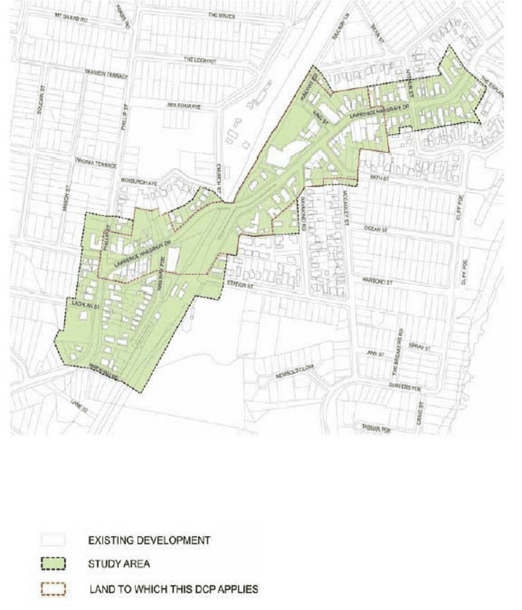

## 1 INTRODUCTION

### 1.1 Land to which the precinct plan applies

1\. The Thirroul Village Centre Precinct Plan applies to certain lands contained within the Thirroul Town Centre as shown in Figure 1.

> [Picture on page 3: a picture, saved as a picture (images/chapter-d12-thirroul-village-centre-page-3-5.gif, 150 dpi).]

#### Figure 1: Land to which this DCP applies
