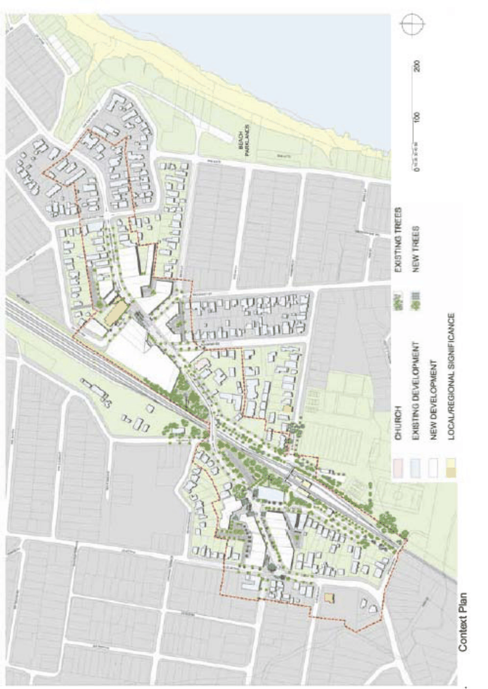
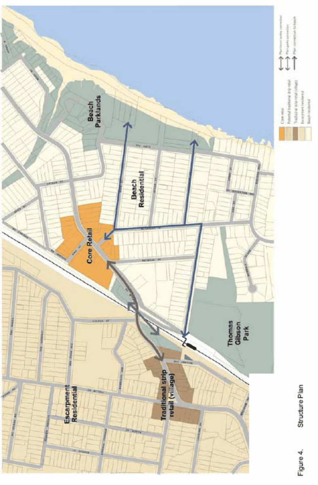

## 4 EXISTING CHARACTER AND FUTURE DESIRED CHARACTER

### OF THIRROUL VILLAGE CENTRE

### 4.1 Existing character of Thirroul Village Centre

1\. The existing character of the Thirroul Village Centre is defined by two contrasting natural scenic elements - the escarpment to the west and the ocean to the east. The unique history of Thirroul contributes to its cultural identity and its establishment as the focus of commercial, cultural and community activities within the northern suburbs of Wollongong.

2\. Thirroul is the gateway to the northern suburbs of the Illawarra. It is a focal point for residents of the northern suburbs and provides an important connection for commercial, cultural and community activities.  It is situated between the Bulli Pass Scenic Reserve to the west and the Pacific Ocean to the east.  To the south lies the old historical township of Bulli and to the north the suburb of Austinmer. Thirroul is an appealing and attractive suburb that offers a relaxed beachside lifestyle and a friendly environment.  Thirroul has a distinctive cultural identity that is supported by the retail amenity and the convenient clustering of community and educational facilities in or near the Village Centre.

3\. Thirroul’s Village Centre is separated into two distinct areas by the South Coast Railway line. The northern side of the village is the core focal point for retail and community services within the suburb.  The southern side comprises of a small mix of retail and community services with a more village, compact character, highlighted by its close proximity to the Thirroul Railway Station.

4\. The two sides of the Village Centre are unique and offer a variety of services and facilities that promote and improve the quality of life of all residents.

5\. The north and south sides of the Village Centre are linked via a railway bridge on Lawrence Hargrave Drive and a footbridge at the Thirroul Railway Station providing vehicular and pedestrian access.

6\. The Village Centre is connected to surrounding areas by Lawrence Hargrave Drive, which runs directly through Thirroul’s Village Centre.  This provides a key arterial connection to Wollongong, suburbs to the south and the coastal villages to the north. Bulli Pass, which separates Thirroul and Bulli to the south, connects Thirroul with the F6 allowing quick and direct access to Sydney.

7\. Two local bus companies operate services both to the north and the south. All passenger trains service Thirroul Railway Station, with the station acting as a changeover point for travellers from southern suburbs waiting for express services to Sydney.

8\. Thirroul Railway Station has recently been upgraded to provide for disabled access lifts to all platforms.  This is complemented by the general improvement of other elements of the station including awnings, lighting and plantings.

9\. Parking facilities for commuters are provided on the eastern and western sides of the Railway Station. On the eastern side commuters use the parking facilities available for Thomas Gibson Park. On the western side, situated between Lawrence Hargrave Drive and the South Coast Railway Line, commuters can utilise either a small bitumen car park or an unsealed car park.

10\. On street parking is available along Lawrence Hargrave Drive on both sides of the Village Centre. On the northern side of the Village Centre parking is predominantly provided in the Thirroul Village Plaza car park and the Franklins supermarket car park. On the southern side, a car park adjacent to Lawrence Hargrave Drive is accessible from Philip Street. Additionally, there is a small car park at the eastern end of the retail strip adjacent to Railway Parade.

#### 4.1.1 Retail

1\. Thirroul Village Centre has a successful retail mix that includes Thirroul Village Plaza and a range of commercial operations. Lawrence Hargrave Drive is the focus of commercial and retail activities within the Village Centre.  The Village Plaza is an open-air plaza that predominantly consists of a Bi-Lo supermarket and a number of specialty shops.  The Plaza’s central location provides easy access to other services available on the northern side of the Village Centre including a Franklins and associated car parking, numerous cafes, restaurants and specialty shops.  The northern side of the Village Centre offers the greatest variety and volume of services for residents.

2\. The southern side of the Village Centre has a more prominent village theme due to the provision of services that meet the day-to-day needs of residents through services such as a newsagent, video shop, deli, fruit shop, take away shops and numerous cafés and restaurants.

#### 4.1.2 Community Facilities

1\. The Village Centre has a well-developed community focus with the location of its community and youth support services and facilities. Facilities such as the Thirroul Neighbourhood Centre provide a range of programs, support services and community information functions as well as providing community meeting spaces.  Thirroul Library provides library services and also has a strong information and community support focus. The location of these services allows easy access for residents and forms a part of the day-to-day functions of the Village Centre.

2\. A new Thirroul Library and community centre is to be constructed on the southern side of the Village Centre.  This will provide services and facilities that support the demand that currently exists within Thirroul and surrounding suburbs.

#### 4.1.3 Education

1\. There are two primary schools located within close proximity to the Village Centre. Thirroul Public School is located to the west of the Village Centre along Roxburgh Avenue.  St Michael’s Catholic Primary School is located on the northern side of the Village Centre.

2\. There are no high school facilities located within Thirroul with the nearest State High School, Bulli High located at Bulli, one suburb to the south.  The nearest Catholic High School, Holy Spirit College is located at Bellambi, 8 kilometres south of Thirroul.

#### 4.1.4 Religious and Cultural Organisations

1\. Religious institutions are found throughout the Village Centre. St Michael’s Parish is located diagonally across from Thirroul Village Plaza and forms a prominent part of the streetscape.  The Oasis Christian Church is also located on Lawrence Hargrave Drive, 200 metres north of Thirroul Village Plaza.  The Thirroul Anglican Church is located adjacent to Thirroul Public School on Roxburgh Avenue, with the Christian City Church situated adjacent to Thirroul Railway Station.

2\. The Thirroul Surf Lifesaving Club forms a prominent part of Thirroul Beach and associated beach reserve areas.  It however lacks eating facilities and is only used for day-to-day beach patrols in summer.

3\. ‘The Beaches Thirroul’ is a focal point of Thirroul’s main street as it is located directly adjacent to the Thirroul Village Plaza, and provides an outdoor plaza style area for customers.  It is Thirroul’s most successful hotel, with it also supporting many local community activities through its sponsorship of sporting clubs.

4\. The Thirroul Sea Side and Arts Festival is an annual festival held over a weekend in April. Currently in its fourteenth year, this festival is a celebration of visual and performing arts from

community organisations, educational institutions, sporting groups, and the general public.  It is a unique event for the Wollongong region and highlights the area’s sense of community.

#### 4.1.5 Open Space and Landscape Character

1\. Thirroul’s Village Centre has a number of recreational and open space facilities.  Thomas Gibson Park is located adjacent to Thirroul Railway Station, and is a major recreational and sporting facility for residents.  This open space area consists of a full sized football oval with night lighting, a number of soccer fields and tennis courts and an outdoors grandstand.  The park is utilised by many local sporting organisations as well as both local primary and secondary schools for sporting activities and carnivals.

2\. Located between the Thirroul Library and Senior Citizens Centre is a small parcel of grassed land with a small number of bench seats.  This area is used to hold large community meetings.  This area and W.F. Jackson Park, located directly to the south, forms the major areas of open space in the Northern Village.

3\. The War Memorial and associated landscaped areas, located on the southern side of the Village Centre form the prominent public open space areas for the Southern Village.

4\. Thirroul Beach Reserve offers extensive open space for residents and visitors through its open grassed areas, playground equipment, undercover beach huts, barbeque facilities, and its beach and pool access.

5\. No cycleway exists through Thirroul. A cycle network begins at McCauley’s Beach at the south-eastern boundary of Thirroul and follows the Illawarra coastline all the way to Wollongong.  A pedestrian network links both the northern and southern sides of the Village Centre to Thirroul Beach and surrounding residential areas, however limited pedestrian access is provided to Bulli and Austinmer via a single footpath along Lawrence Hargrave Drive.  Opportunities exist in creating a pathway and walkway system along existing streets linking residential areas to:

(a) The Village Centre;

(b) The existing community facilities;

(c) Thirroul Beach Reserve;

(d) Thomas Gibson Park;

(e) Austinmer to the north and Bulli to the south; and

(f) The cycleway.

### 4.2 Desired future character of Thirroul Village Centre

1\. The significance of the Thirroul Village Centre as a commercial and retail precinct with cultural linkages to the community of Thirroul as well as Thirroul’s history can be strengthened through the expansion of existing commercial/retail operations, the encouragement of mixed-use development designed to foster a lively main street Village Centre, and improvements to community facility provisions.

2\. The linkages between the Village Centre, the history of Thirroul and the community will be accommodated through the adoption of appropriate built forms and land uses that respond to the social and cultural aspirations of the community.  The Village Centre will retain its identity as a low-rise township and a social / cultural hub.

3\. Thirroul’s historic ‘gateway’ role to the Northern Suburbs will be maintained through the provision of retail and parking areas servicing Lawrence Hargrave Drive.

4\. Promoting economic growth within the Village Centre particularly in retail and small businesses will provide local employment and support the needs of the community.  A strong local economy will enable people to shop, work and relax near their home and enjoy the benefits of high accessibility to services in regional centres.

5\. Development of the Village Centre should appropriately respond to the natural environment in Thirroul, which includes but is not limited to the conservation and protection of natural resources, the coastal climate, the Illawarra Escarpment and the Pacific Ocean.

Refer to Figures 2 and 3.

> [Picture on page 9: a picture, saved as a picture (images/chapter-d12-thirroul-village-centre-page-9-1.gif, 150 dpi).]

#### Figure 2: Context Plan

> [Picture on page 10: a picture, saved as a picture (images/chapter-d12-thirroul-village-centre-page-10-1.gif, 150 dpi).]

#### Figure 3: Structure Plan

6\. The South and North Villages will retain the character provided by the two contrasting natural scenic elements of the Illawarra Escarpment to the west and the ocean to the east. Future built forms must maintain these views and sightlines to preserve connections to the escarpment and water.  To ensure this, building separation, building height limits and roofline controls will ensure a built form that does not obstruct views from the Village Centre.  The Villages will also retain their distinctive cultural identity, but be better supported by retail amenity and the convenient clustering of community and educational facilities in or near the Village Centre.

7\. The existing street and built form character of the Village Centre should be retained.  New buildings should be designed and articulated through vertical components and roof forms and contribute to the character of the Village Centre by adding visual interest to the skyline when viewed from street level or surrounding key vantage points.  Street frontages should continue to have an active character with continuous retail uses on the ground level. Continuous awnings will also be retained along footpaths.

8\. The distinctive characteristics of the South and North Villages give them individual identities, functions and forms. These are described below.

#### 4.2.1 South Village

1\. The southern sector of the Village Centre will retain the characteristic traditional strip retail village, but will also have new developments which still retain the two storey height limit of the existing built form.  The height and scale of the existing patterns of development along both sides of Lawrence Hargrave Drive will be retained.  The southern sector will become a more vibrant area by enhancing its mix of retail and community services.

2\. The existing built form pattern, characterised by separations between buildings, will create framed views of the Illawarra Escarpment and will maintain the relationship of the built form to the escarpment.

3\. The public space character will be maintained with consistent built edges within the Village Centre and a zero front setback.

#### 4.2.2 North Village

1\. The northern sector of the Village Centre will retain core retail village components, including supermarkets, the Beaches Hotel and the Thirroul Plaza.  Additional residential activity will be provided; residences will retain the architectural character of the proximity and views to the ocean will be maintained.

2\. The ocean views and view to Kennedy Hill from Lawrence Hargrave Drive at the crossing of the railway bridge will be maintained.  The northern sector will be the focal point for retail.  It will be characterised by a two storey street wall that maintains the village scale.  Three storey buildings are located in the vicinity of the Thirroul Plaza and the Beaches Hotel. The street character will be enhanced and improved by providing increased setbacks to the public domain.

3\. Access, appearance and views throughout the Northern Village will be maintained.
