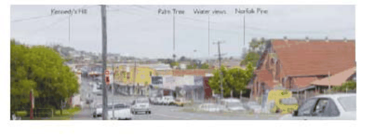

## 5 VIEWS

### 5.1 General

1\. Existing views from the Village Centre to the escarpment and water are important visual components which should be maintained as a backdrop to the Village Centre.

2\. Future built forms need to maintain views to the escarpment and sightlines that preserve connections to the escarpment and water.  In this regard, building separation, building height limits and roofline controls need to maintain a built form rhythm that does not obstruct views from the Village Centre.

### 5.2 Strategies

#### 5.2.1 South Village

a) Retain the two storey height limit in order to maintain the relationship of the built form to the escarpment;

b) Maintain the built form, characterised by one and two storey buildings with separations between buildings, which create framed views of the escarpment.

#### 5.2.2 North Village

a) Retain Ocean views and view to Kennedy Hill from Lawrence Hardgrave Drive at the crossing of the railway bridge

b) Setback the third storey of any development to minimise the impact on ocean views; and

c) Setback the third storey of any development to maintain the existing street scale.

### 5.3 Development Controls

#### 5.3.1 South Village

a) Maintain parapet lines for existing two storey buildings.

b) Provide a 4 metre side setback between buildings at a minimum of every 40 metres.

c) Development must not be more than 2 storeys in height, as indicated in Figure 9.

d) Any development above 1 storey requires lodgement of a photomontage to Council, demonstrating that the bulk and scale of any proposed development does not detract from the views of the escarpment.

#### 5.3.2 North Village

a) Limit development to three storeys, as indicated in Figure 10.

b) The third storey of a development must be setback a minimum distance of 6 metres from the front boundary;

c) Any new development may be required to lodge a photomontage to Council, demonstrating the proposed development does not detract from views of the escarpment;

d) Any development above 1 storey, within the boundaries of Lawrence Hargrave Drive, McCauley Street, Station St. and Raymond Road, must demonstrate that views to the ocean northbound on Lawrence Hargrave Drive are not obstructed. Refer to Figure 4.

> [Picture on page 13: a picture, saved as a picture (images/chapter-d12-thirroul-village-centre-page-13-1.gif, 150 dpi).]

#### Figure 4: Ocean Views northbound on Lawrence Hargrave Drive
