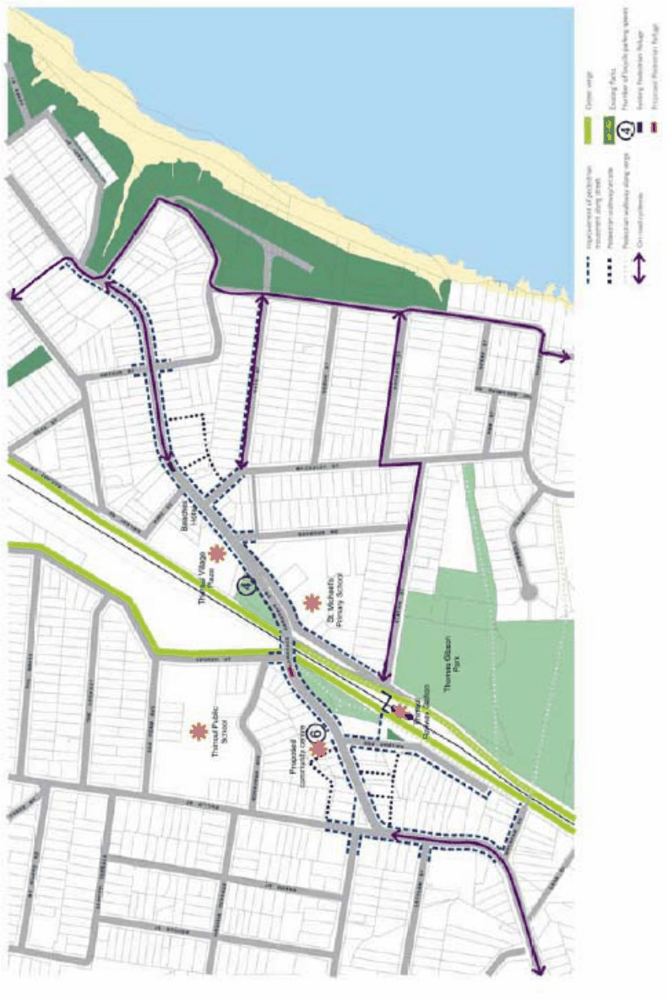
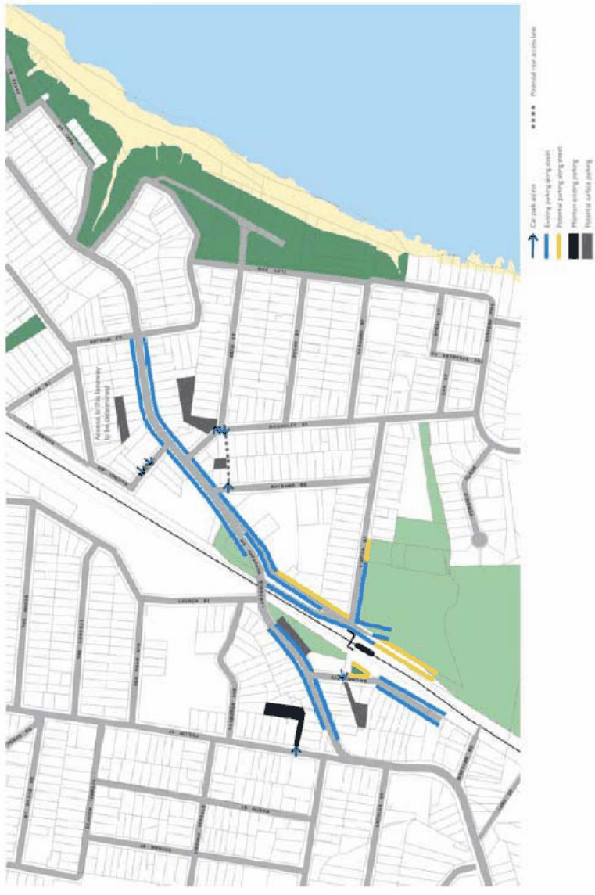
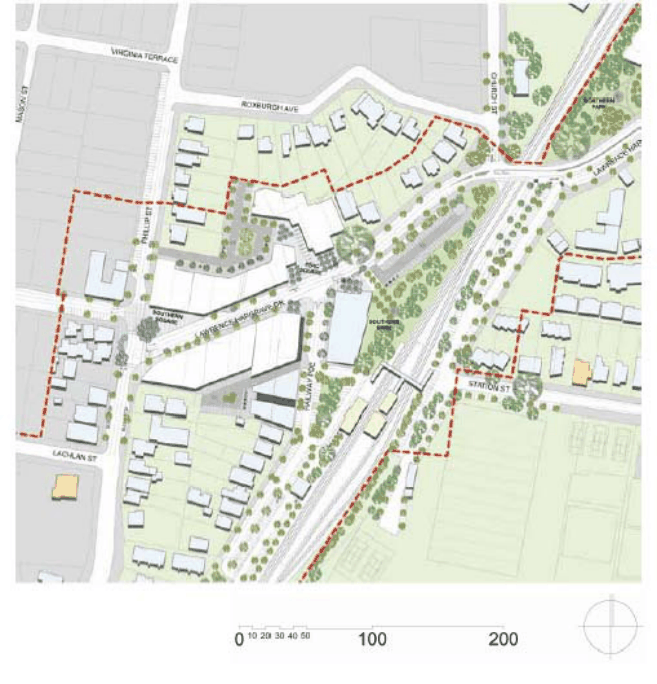
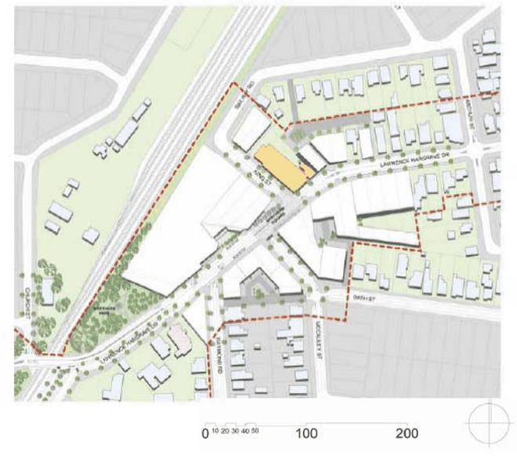
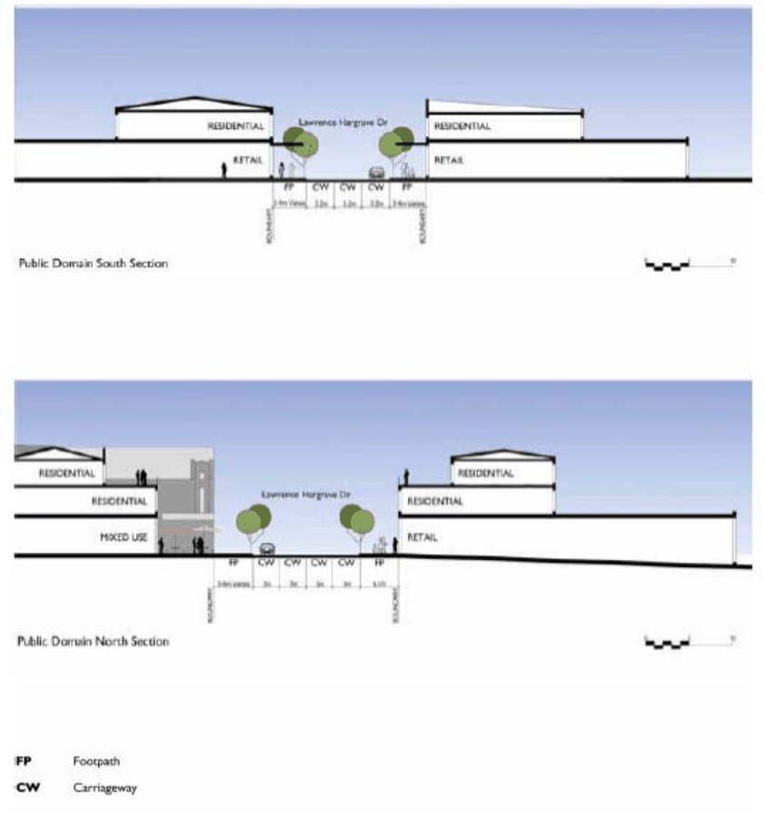

## 11 PARKING FOR VEHICLES AND BICYCLES

### 11.1 General

1\. The location, quantity and form of parking areas are a critical component of achieving an accessible and sustainable Village Centre. Parking will be provided in the form of designated car park areas and on-street parking.  Car park areas allow for the clustering of a large number of spaces while on-street parking provides high levels of access to activities and creates a buffer between passing vehicles and pedestrians on the footpath.

Refer to Figure 6.

### 11.2 Development Controls

a) Maintain parallel parking along Lawrence Hargrave Drive.

b) Provide on-street parking as indicated in Figure 6.

c) Pedestrian safety must be provided for in the design of parking areas.

d) Incorporate pedestrian access into vehicular laneways where car parking areas for retail and commercial activities would otherwise be inaccessible to pedestrians.

e) Provide rear vehicle access lanes as indicated in this part of the DCP, if site amalgamation occurs.

f) Redevelopment of properties within the building envelope controls between Lawrence Hargrave Drive, McCauley Street and Raymond Road should provide rear service access. This need not entail the proposed street (or part thereof) to be dedicated unless the scale of redevelopment justifies this.

g) Parking entry and exit ramps must be at grade for an entire car length before crossing the pedestrian pavement, so that drivers have a level space from which to stop their vehicles and look for pedestrians.

h) Well-lit parking areas must be provided for night time use.

i) Parking areas must contain shade trees to interrupt the mass of the car park and so that they shade 70% of the surface area within 10 years of planting.

j) Driveways must have minimal impact on developments to the street and/or laneway through appropriate design measures.

k) Provide surface parking for retail / commercial uses in accordance with the Car Parking requirements contained in Part E of the DCP.

l) Residential parking standards must be in accordance with the Car Parking requirements in Part E of the DCP.

m) Council will consider parking concessions where sufficient market evidence indicates that this is acceptable.

n) Parking for residential uses can be underground.

o) No additional access to Lawrence Hargrave Drive will be provided unless exceptional circumstances apply.

p) Where rear service lanes exist or can be created in redevelopment, parking or servicing must not access Lawrence Hargrave Drive.

q) Maintain servicing areas to the rear of properties to minimise disruption to the streetscape.

r) Provide waste servicing not from the Main Street by way of bulk waste containers.

s) Air conditioning facilities must not be visible from the street.

t) Promote underground car parking within the major retail portions of the Village Centre.  Underground car parking is recommended for all new two or three storey developments.

u) Vehicles must enter and exit sites in a forward direction.

v) Provide the following minimum rates of bicycle parking for retail use;

i) 1 space per 300 square metres of GFA for employees;

ii) 1 space per 200 square metres of GFA for shoppers.

w) A further 10 bicycle parking spaces will be provided in the Village Centre for the location of these refer to Figure 5.

> [Picture on page 18: a picture, saved as a picture (images/chapter-d12-thirroul-village-centre-page-18-1.gif, 150 dpi).]

#### Figure 5: Pedestrian and Cycle Movement

> [Picture on page 19: a picture, saved as a picture (images/chapter-d12-thirroul-village-centre-page-19-1.gif, 150 dpi).]

#### Figure 6: Parking facilities

> [Picture on page 20: a picture, saved as a picture (images/chapter-d12-thirroul-village-centre-page-20-1.gif, 150 dpi).]

#### Figure 7: Public Domain - South

> [Picture on page 20: a picture, saved as a picture (images/chapter-d12-thirroul-village-centre-page-20-3.gif, 150 dpi).]

#### Figure 8: Public Domain - North

> [Picture on page 21: a picture, saved as a picture (images/chapter-d12-thirroul-village-centre-page-21-1.gif, 150 dpi).]

#### Figure 9: Public Domain - Sections
