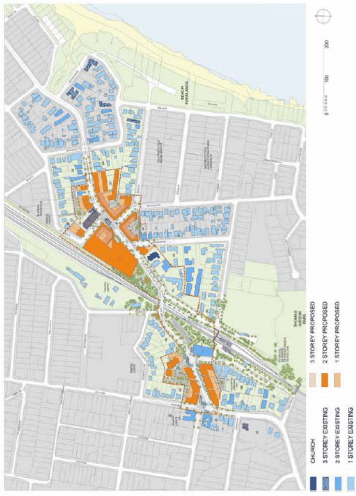

## 17 CONTRIBUTORY BUILDINGS

### 17.1 General

1\. Contributory buildings are those that have cultural value or provide value to the streetscape. Contributory buildings are not necessarily heritage items.

2\. Contributory buildings are indicated in the block diagrams in clause 18 of this plan.

### 17.2 Development Controls

a) New developments are to refurbish and/or integrate contributory buildings.

> [Picture on page 25: a picture, saved as a picture (images/chapter-d12-thirroul-village-centre-page-25-1.gif, 150 dpi).]

#### Figure 10: Building Heights
