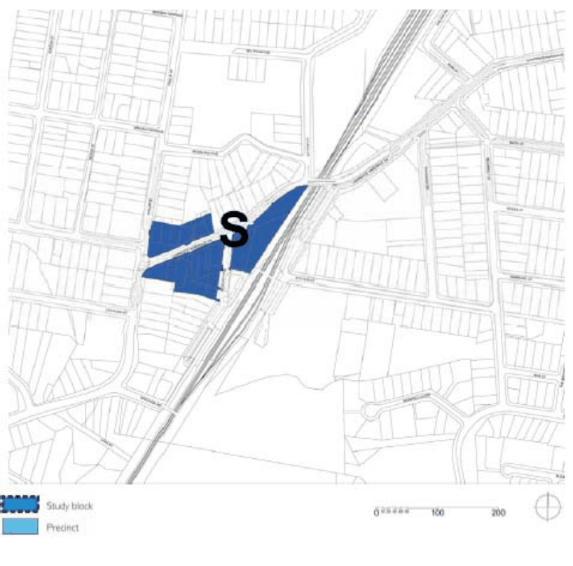
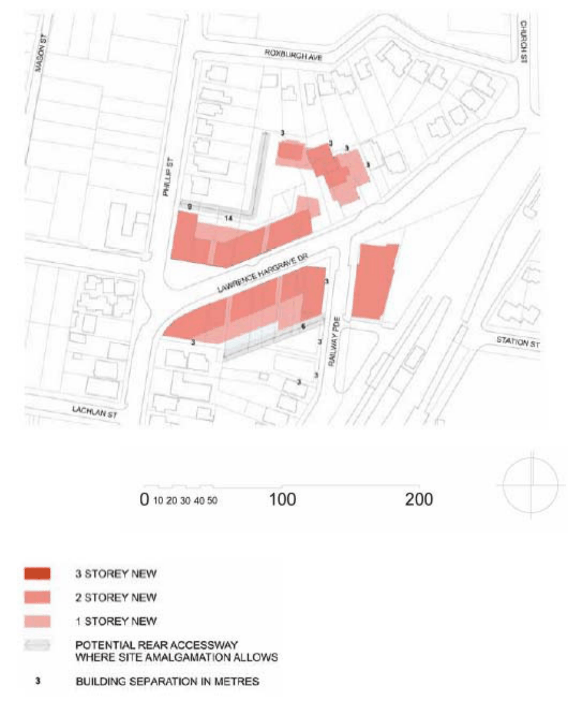
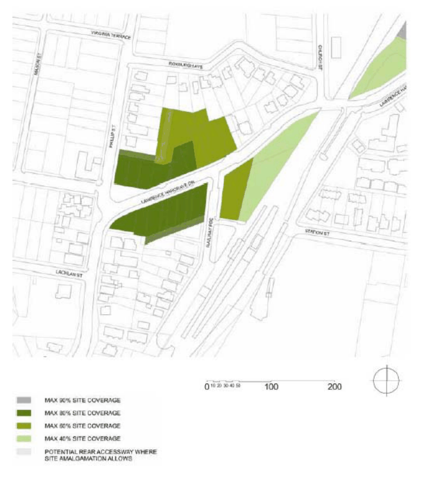
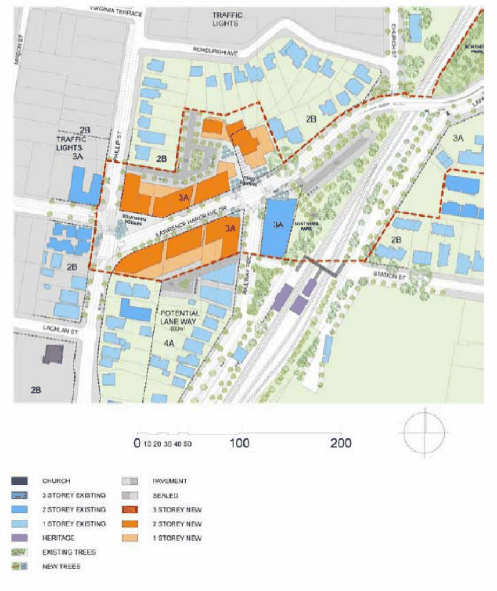
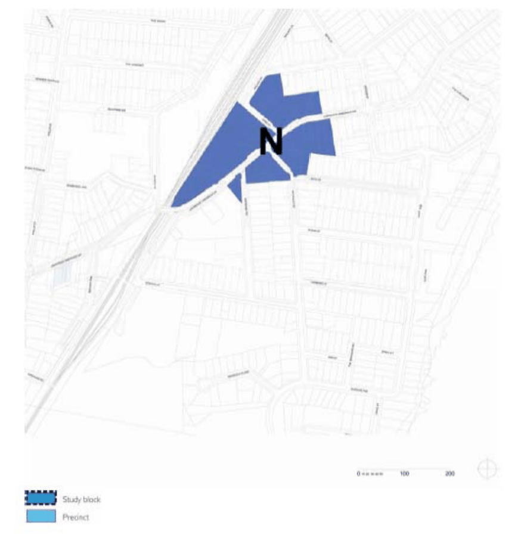
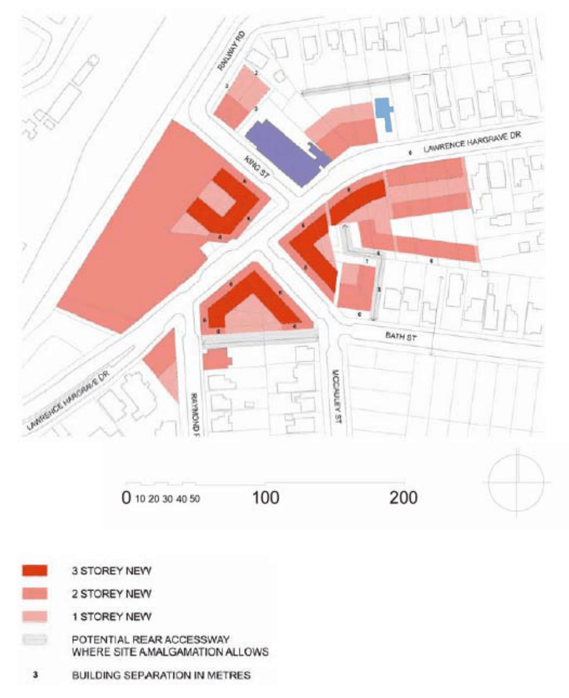
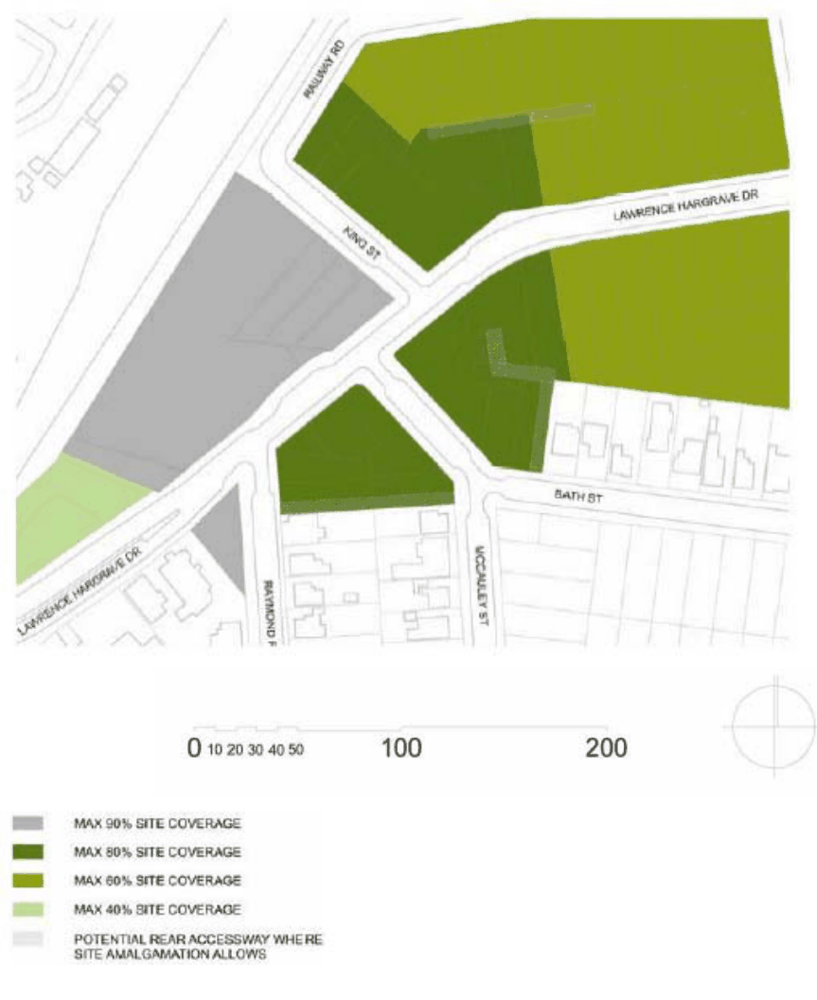
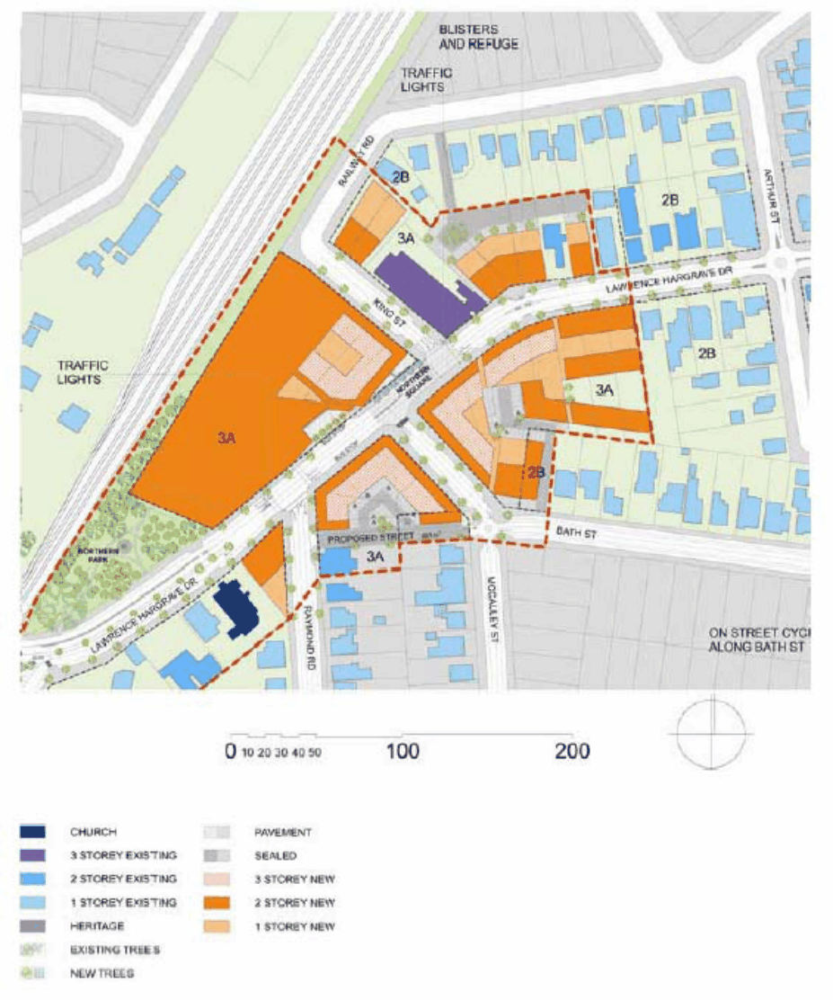
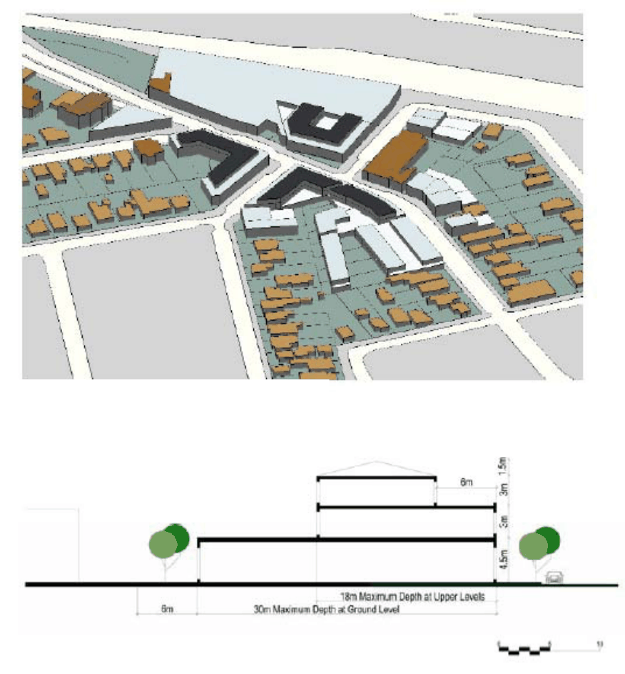

## 18 BLOCK DIAGRAMS

### 18.1 General

1\. This part of the Precinct Plan sets out building envelope controls for the Northern and Southern sectors of the Thirroul Village Centre. The controls address heights, setbacks, build-to-lines, building depth and site coverage.

2\. The aim of the design controls are to ensure that all development proposals are of an appropriate bulk and scale and maintain the desirable aspects of the local character, as well as taking into account environmental considerations.

3\. This part of the Precinct Plan sets out the design controls for each block in the Thirroul Village Centre (refer to Figures 11 and 15). The building envelopes provided describe and give expression to required building forms and location, and may be found at the conclusion of each locality.

4\. The building envelopes for the Northern Village and the Southern Village are defined by the following design controls as specified in Clauses 12 – 16 of this Precinct Plan, namely:

a) Building heights;

b) Building depths;

c) Build to lines;

d) Building setback;

e) Building separation; and

f) Site coverage.

5\. The specified building envelopes are critical in achieving the desired future character of Thirroul. Any deviation from these diagrams or controls must be sufficiently justified and must be consistent with the vision and strategies contained in this plan.

### 18.2 Block diagrams - Southern sector

> [Picture on page 27: a picture, saved as a picture (images/chapter-d12-thirroul-village-centre-page-27-2.gif, 150 dpi).]

#### Figure 11: South Sector block diagram

> [Picture on page 28: a picture, saved as a picture (images/chapter-d12-thirroul-village-centre-page-28-1.gif, 150 dpi).]

#### Figure 12: Building Form Control - South

> [Picture on page 29: a picture, saved as a picture (images/chapter-d12-thirroul-village-centre-page-29-1.gif, 150 dpi).]

#### Figure 13: Site coverage - South

> [Picture on page 30: a picture, saved as a picture (images/chapter-d12-thirroul-village-centre-page-30-1.gif, 150 dpi).]

#### Figure 14: Indicative Building Envelope - South

> [Picture on page 31: a picture, saved as a picture (images/chapter-d12-thirroul-village-centre-page-31-1.gif, 150 dpi).]

#### Figure 15: North Sector block Diagram

> [Picture on page 32: a picture, saved as a picture (images/chapter-d12-thirroul-village-centre-page-32-1.gif, 150 dpi).]

#### Figure 16: Building Form Control - North

> [Picture on page 33: a picture, saved as a picture (images/chapter-d12-thirroul-village-centre-page-33-1.gif, 150 dpi).]

#### Figure 17: Site Coverage - North

> [Picture on page 34: a picture, saved as a picture (images/chapter-d12-thirroul-village-centre-page-34-1.gif, 150 dpi).]

#### Figure 18: Indicative Building Envelope - North

> [Picture on page 35: a picture, saved as a picture (images/chapter-d12-thirroul-village-centre-page-35-1.gif, 150 dpi).]

#### Figure 19: Generic Section/ Building Heights
