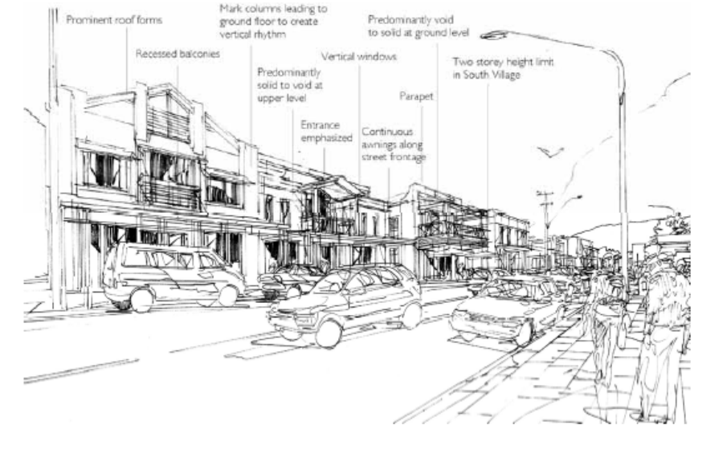
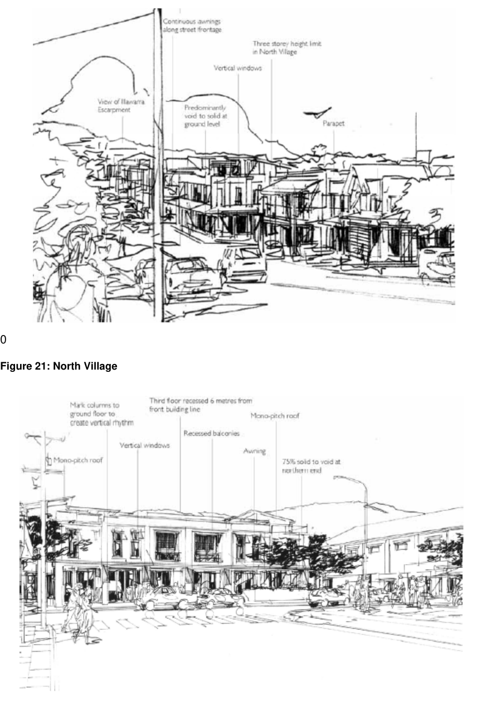

## 19 ARCHITECTURAL CHARACTER

### 19.1 General

1\. A high level of urban design quality is greatly dependent on the design and appearance of buildings. Well-designed buildings not only improve the character and appearance of the streetscape but also contribute to the coherence of the Village Centre.

### 19.2 Objectives

a) To promote high quality architectural design;

b) To ensure building designs reinforce the character of the street; and

c) To ensure building designs reflect the cultural distinctness of the local culture.

### 19.3 Development Controls

a) Express vertical elements within the façade rather than floor levels.

b) Use windows with vertical proportions.

c) Provide predominately glazed shop fronts to all ground floor retail areas and minimise blank walls at street level.

d) Limit opaque or blank walls for ground floor uses to 20% of the street frontage.

e) Highly reflective finishes and curtain wall glazing are not permitted above the ground floor.

f) All buildings must express internal functions in their facade.

g) Adopt vertical emphasis above awnings and avoid horizontal emphasis, particularly broad opaque, blank walls, and horizontal windows above the awning level.

h) Articulate and fragment building walls addressing the street to add visual interest.

i) Emphasise built form corners that are significant in the urban form of the Village Centre without adding additional height or obstructing existing views to the escarpment.

Refer to Figures 20 to 22.

#### 19.3.1 South Village

a) Development must not be more than 2 storeys in height.

b) Maintain the existing built form, characterised by separations between buildings that create framed views of the Illawarra Escarpment.

c) Maintain the existing height and scale of the existing patterns of development along both sides of Lawrence Hargrave Drive.

d) Implement a continuous street wall that maintains the traditional strip retail character of the locality.

Refer to Figure 20.

#### 19.3.2 North Village

a) Development must not be more than 3 storeys in height, with the upper storey set back a minimum of 6 metres from the street.

b) Maintain the architectural character of the Northern part of Thirroul Village by responding to its proximity to Thirroul Beach and also to its surrounding residential areas.

c) Implement a continuous two storey street wall along Lawrence Hargrave Drive; and

d) Three storeys in the area confined to the vicinity of McCauley Street and King Street to increase the vibrancy of Thirroul’s core retail identity.

Refer to Figure 21.

#### 19.3.3 Beaches Hotel

a) Maintain a 75% solid to void at building ends on Lawrence Hargrave Drive frontage.

b) The third floor setback is a minimum of 6 metres recessed from the building line.

c) Balconies addressing the street must be recessed.

d) Third floor roof forms are specified as monopitch skillion sloping to either the east or west.

Refer to Figure 22.

> [Picture on page 37: a picture, saved as a picture (images/chapter-d12-thirroul-village-centre-page-37-11.gif, 150 dpi).]

#### Figure 20: South Village

0

> [Picture on page 38: a picture, saved as a picture (images/chapter-d12-thirroul-village-centre-page-38-2.gif, 150 dpi).]

#### Figure 21: North Village

#### Figure 22: The Beaches Hotel
