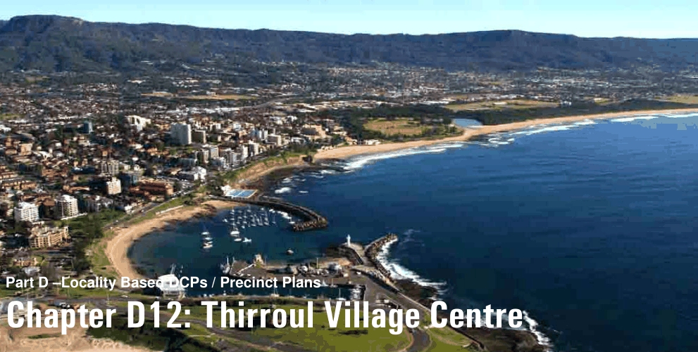

# Wollongong Development Control Plan 2009 - Chapter D12 Thirroul Village Centre

> This chapter is split into 28 section file(s), one per numbered heading, in the order they appear in the PDF.

Source PDF: [Wollongong-DCP-2009-Chapter-D12-Thirroul.pdf](https://planfortomorrow.sharepoint.com/sites/Planfortomorrow/Shared%20Documents/00%20NSW-Planning-Resources/dcp/wollongong-development-control-plan-2009/chapter-d12-thirroul-village-centre/Wollongong-DCP-2009-Chapter-D12-Thirroul.pdf)

> [Picture on page 1: a picture, saved as a picture (images/chapter-d12-thirroul-village-centre-page-1-1.gif, 150 dpi).]

#### Part D –Locality Based DCPs / Precinct Plans

### Chapter D12: Thirroul Village Centre

> The PDF's contents list (page numbers of the printed document) is not repeated here - see Sections below.

i

| 22.1 | Objectives 38 |  |
|---|---|---|
| 22.2 | Development Controls 38 | Figures |
| 23 | BUILDING ENTRANCES 38 | Figure 1: Land to which this DCP applies .......................... 1 |
| 23.1 | Objectives 38 | Figure 2: Context Plan................................................. 7 |
| 23.2 | Development Controls 39 | Figure 3: Structure Plan............................................... 8 |
| 24 | ROOF FORMS 39 | Figure 4: Ocean Views northbound on Lawrence Hargrave Drive |
| 24.1 | Objectives 39 | .......................................................................... 11 |
| 24.2 | Development Controls 39 | Figure 5: Pedestrian and Cycle Movement ....................... 16 Figure 6: Parking facilities .......................................... 17 |
| 25 | MATERIALS AND FINISHES 39 | Figure 7: Public Domain - South.................................... 18 |
| 25.1 | Objectives 39 | Figure 8: Public Domain - North.................................... 18 |
| 25.2 | Development Controls 40 | Figure 9: Public Domain - Sections ................................ 19 |
| 26 | VISUAL AND ACOUSTIC PRIVACY 40 | Figure 10: Building Heights ......................................... 23 |
| 26.1 | Objectives 40 | Figure 11: South Sector block diagram........................... 25 |
| 26.2 | Development Controls 40 | Figure 12: Building Form Control - South......................... 26 |
| 27 | SOLAR ACCESS, OVERSHADOWING AND NATURAL DAYLIGHT 41 | Figure 13: Site coverage - South................................... 27 Figure 14: Indicative Building Envelope - South ................. 28 |
| 27.1 | Objectives 41 | Figure 15: North Sector block Diagram........................... 29 |
| 27.2 | Development Controls 41 | Figure 16: Building Form Control - North ......................... 30 Figure 17: Site Coverage - North .................................. 31 |
| 28 | GLOSSARY OF TERMS 43 | Figure 18: Indicative Building Envelope - North.................. 32 Figure 19: Generic Section/ Building Heights .................... 33 Figure 20: South Village............................................. 35 Figure 21: North Village ............................................. 36 Figure 22: The Beaches Hotel...................................... 36 |

ii

<!-- sections -->
## Sections

1. [1 INTRODUCTION](01-introduction.md)
2. [2 RELATIONSHIP TO OTHER PARTS OF THE DCP](02-relationship-to-other-parts-of-the-dcp.md)
3. [3 AIMS & OBJECTIVES](03-aims-and-objectives.md)
4. [4 EXISTING CHARACTER AND FUTURE DESIRED CHARACTER](04-existing-character-and-future-desired.md)
5. [5 VIEWS](05-views.md)
6. [6 ACTIVITIES](06-activities.md)
7. [7 PUBLIC DOMAIN](07-public-domain.md)
8. [8 PEDESTRIAN AND BICYCLE CIRCULATION](08-pedestrian-and-bicycle-circulation.md)
9. [9 FOOTPATHS AND PARKS](09-footpaths-and-parks.md)
10. [10 PUBLIC TRANSPORT](10-public-transport.md)
11. [11 PARKING FOR VEHICLES AND BICYCLES](11-parking-for-vehicles-and-bicycles.md)
12. [12 BUILT FORM](12-built-form.md)
13. [13 BUILDING HEIGHT](13-building-height.md)
14. [14 BUILDING DEPTH](14-building-depth.md)
15. [15 BUILDING SETBACKS.](15-building-setbacks.md)
16. [16 SITE COVERAGE](16-site-coverage.md)
17. [17 CONTRIBUTORY BUILDINGS](17-contributory-buildings.md)
18. [18 BLOCK DIAGRAMS](18-block-diagrams.md)
19. [19 ARCHITECTURAL CHARACTER](19-architectural-character.md)
20. [20 AWNINGS](20-awnings.md)
21. [21 ADVERTISING AND SIGNAGE](21-advertising-and-signage.md)
22. [22 ACTIVE STREET FRONTAGES](22-active-street-frontages.md)
23. [23 BUILDING ENTRANCES](23-building-entrances.md)
24. [24 ROOF FORMS](24-roof-forms.md)
25. [25 MATERIALS AND FINISHES](25-materials-and-finishes.md)
26. [26 VISUAL AND ACOUSTIC PRIVACY](26-visual-and-acoustic-privacy.md)
27. [27 SOLAR ACCESS, OVERSHADOWING AND NATURAL DAYLIGHT](27-solar-access-overshadowing-and-natural.md)
28. [28 GLOSSARY OF TERMS](28-glossary-of-terms.md)
