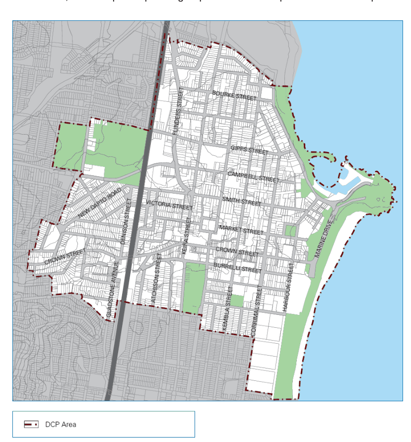

## 1 INTRODUCTION

The Wollongong City Centre precinct applies to all lands contained within the Wollongong City Centre as shown in Figure 1.1.

This part of the DCP provides the site specific planning requirements for development within the Wollongong City Centre precinct. In the event of any inconsistency between this part of the DCP and any other part of the DCP, the site specific planning requirements in this part of the DCP will prevail.

> [Picture on page 3: a picture, saved as a picture (images/chapter-d13-wollongong-city-centre-page-3-7.gif, 150 dpi).]

#### Figure 1.1: Map of DCP Area
