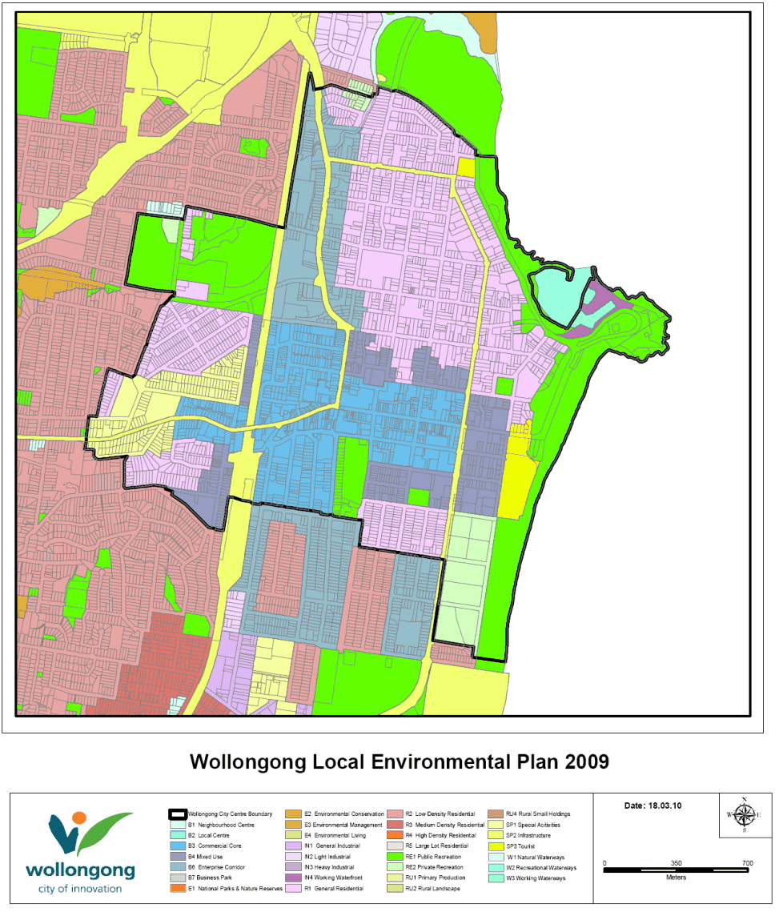

### 1.1 City Centre Character Areas

1\. The future character of the Wollongong city centre is set out within the Wollongong City Centre Plan that includes the Vision, Local Environmental Plan, Civic Improvements Plan and this Development Control Plan.

2\. The character objectives for these land use zones are described below, and the development controls within this DCP aim to develop and reinforce the characteristics of each area, enhance

the vibrancy and activity along streets and provide for sustainable growth within the city centre. See Figure 1.2.

3\. Commercial Core – provides for a wide range of retail, business, office, civic and cultural entertainment and community uses, including tourism and leisure uses, and residential uses within mixed use developments.

4\. The commercial core is the ‘heart of the city’, where the focus is on high quality buildings, streetscapes, public art, outdoor eating and a collection of attractive public spaces such as a new forecourt to the railway station, rejuvenated MacCabe Park and Crown Street Mall, new civic square on Crown Street and an attractive collection of laneways and arcades.  The primary retail focus is Crown Street Mall.  The core retail area along Crown Street is generally characterised by street enclosing buildings forming continuous building facades that provide for an active street frontage to all commercial core streets. Streets are to have continuous awnings to give weather protection to concentrated pedestrian street activity.

5\. Mixed Use (City Edge) – west of the railway station, this area provides for a mixture of compatible land uses to the commercial core, including commercial, retail, cultural, entertainment, tourism, leisure, recreation, social, educational, health and high density residential development.

6\. The upgrading of the railway station will offer a safe and attractive street environment and railway/bus interchange facility.  The scale of new development is to have a transition in scale between the high form at the station to a medium rise to the north and south of Crown Street. Pedestrian activity will focus around the railway station, in Crown Street and along Gladstone Avenue towards the TAFE campus.  New development is to have active frontages and continuous awnings to protect pedestrian activity.

7\. East of Corrimal Street, the Mixed Use (City Edge) provides for a mixture of compatible land uses to the commercial core, including commercial and retail, cultural and entertainment, tourism, leisure and recreation, social, educational, health and higher density residential development. The area is characterised by the relaxed beach character with residential buildings sitting in the landscape with more generous street setbacks.  Buildings along Corrimal Street (between Market and Stewart Streets) and Crown Street (nb. northern side, east of Corrimal Street) are to be built to street alignment and have awnings and active street frontages.

8\. North of Market Street and south of Stewart Street is a transition area between the commercial core and predominately residential areas to the north and south.  It allows for high density residential development that can take advantage of views towards the escarpment and the foreshore, with retail and business uses encouraged at ground level along major streets.  Building heights allow for view sharing and retention of significant views, with higher buildings located on the lower lying land along Burelli Street.

9\. Special Activities – Hospitals and Medical Research and Development – is an area clustered around the Wollongong Hospital and along Crown Street, west of the railway station.

10\. This area has an excellent potential to become a hub of innovation, education and research in the city centre.  The area can be supported by student and nursing staff accommodation, medical centres, doctors’ surgeries, specialise rooms and associated uses.  The upgrading of the railway station will offer a safe and attractive street environment and railway/bus interchange facility.  The scale of new development is to be of a transition scale between the high buildings at the station to medium rise buildings to the north and south of Crown Street.

11\. Enterprise Corridor – will promote business activity along Flinders Street, particularly business uses requiring larger footprint buildings and good vehicular access and exposure.  The area will cater also for the complementary business, office, retail and light industrial uses.  The importance of Flinders Street (the Princes Highway) as a business address is reinforced by increasing the scale and activation of buildings along the street, with service uses such as parking and goods storage away from street frontages.  Residential development incorporated in mixed use developments, is encouraged within walking distance of the North Wollongong rail station and in

areas abutting the general residential zone to the east.  The character of the area will be of an attractive city boulevard lined with trees and high quality buildings of medium scale with large showroom windows fronting the street with landscaped setbacks.

12\. Tourist and Private Recreation – this area is largely occupied by existing entertainment and sporting uses (WIN Stadium).  The precinct is to be activated by complementary uses that address the street and promote extended use of the area during non-event times. Complementary uses include tourist development, tourist facilities (restaurants, gyms) and convention centres.  Improved integration of the area with the city is envisaged, with specific requirements for improved pedestrian linkages between the foreshore and the Mixed Use (City Edge) along Burelli, Stewart and Bank Streets and activation of Crown and Harbour Streets.  The future vision for the area will be focusing on the ‘city beach’ character along the eastern edge of the city centre with alfresco dining and tourist uses facing the beach frontage.

13\. General Residential – the general residential zone in Wollongong city centre is ideally located within easy walking distance to both the commercial core and the major recreational areas along the foreshore.  The topography of the area allows for good view opportunities towards the escarpment and foreshore.  Scale and form of new residential development should be compatible with the character of the locality, providing for higher density residential use, local convenience shops and longer stay tourist accommodation in serviced apartments.

14\. Development controls aim to promote high levels of residential amenity, high quality landscaping and onsite open space provisions, combined with setbacks and building depth controls to ensure that building bulk and scale is compatible with good residential amenity, view sharing and a sustainable living environment.

15\. Working Waterfront and Public Recreation – the waterfront area encompasses the working waterfront land use zone and those parts of the public recreation zone fronting the foreshore. The area offers recreational activities to the city, neighbouring residential areas and the wider Illawarra community.  The natural and historic attributes of the area, including the State significant Belmore Basin Heritage Conservation Area, lighthouse, North Beach and natural features of the foreshore are to be protected commensurate with an increase in tourist and visitor use.

16\. Scale and bulk of development is to consider the natural topography of the setting, with buildings of small scale, sympathetic to the setting.

17\. Foreshore improvement works and enhanced community facilities and buildings are planned to improve visitor amenity and provide for a vibrant beachside and maritime environment.  Boating and marine activities within the working waterfront zone combined with specialist shops and food outlets are encouraged in this area.

> [Picture on page 6: a picture, saved as a picture (images/chapter-d13-wollongong-city-centre-page-6-1.gif, 150 dpi).]

#### Figure 1.2: Land Zoning Map
