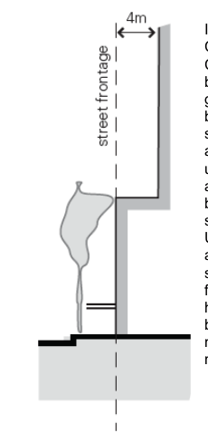
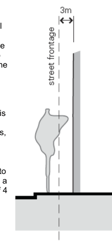
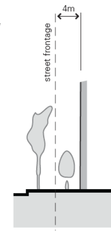
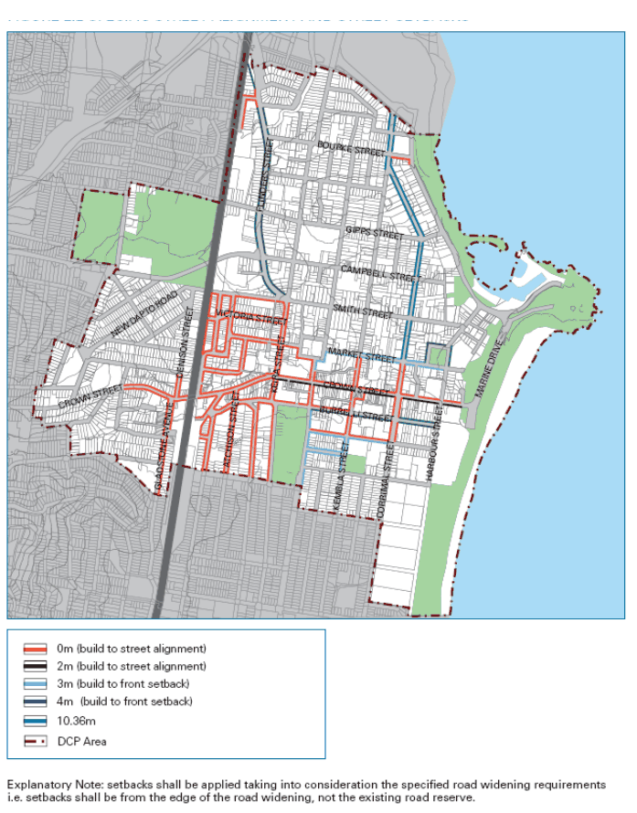

### 2.2 Building to street alignment and street setbacks

#### 2.2.1 General

1\. Street setbacks and building alignments establish the front building line.  They help to create the proportions of the street and can contribute to the public domain by enhancing streetscape character and the continuity of street facades.  Street setbacks can also be used to enhance the setting and address for the building.  They provide for landscape areas, entries to ground floor apartments and deep soil zones.  Street setbacks are measured from the street boundary to the outside face of the external wall of the building.

2\. In the commercial core, buildings are to be built up to the street alignment to reinforce the urban character and improve pedestrian amenity and activity at street level.  Above street frontage height, tall buildings are to be set back to provide for sunlight to streets, and daylight to pedestrian areas and lower levels of other buildings.  They offer comfortable wind conditions,

view corridors, an appropriate building scale for pedestrians, and good growing conditions for street trees.  In the residential locations and some Mixed Use (City Edge) locations, buildings are to be setback to a consistent building line.

3\. The definition of “building line or setback” is provided in the Wollongong City Centre LEP 2007.

#### 2.2.2 Objectives

a) To provide a hierarchy of street edges from commercial core with no street setbacks to residential locations with landscaped setbacks.

b) To establish the desired spatial proportions of the street and define the street edge.

c) To increase a clear transition between public and private space.

d) To locate active uses, such as shopfronts, closer to pedestrian activity areas.

e) To assist in achieving visual privacy to apartments from the street.

f) To create good quality entry spaces to lobbies, foyers or individual dwelling entrances.

g) To allow an outlook to, and surveillance of, the street.

h) To allow for street landscape character, where appropriate.

i) To maintain shared views to the ocean.

j) To maintain sun access to the public domain.

#### 2.2.3 Development Controls

a) Street building alignment and setbacks are specified in Figure 2.1 and Figure 2.2 and, in the following table. These street building lines and setbacks also apply to basement portions of buildings.

#### Table 2.1: Street building alignments and setbacks

| Zone | Building line or setback from street alignment |
|---|---|
| Commercial Core | Build to the street alignment or specified setback with 4m minimum further setback above street frontage height. |
| Mixed Use (City Edge) | Build to 3m from the street alignment. Except in Crown Street (nb. northern side only east of Corrimal Street) and Corrimal Street (between Market and Stewart Streets), where building frontage is to be built to street alignment. A 10.36m setback applies in Corrimal Street between Market and Smith Streets. |
| General Residential | 4m minimum setback. Except in Bourke Street between Kembla and Cliff Road where building frontage is to be built to street alignment. Except in Corrimal Street north of Market Street, and Kembla Street north of Corrimal Street to George Hanley Drive, where a 10.36m setback applies. |
| Enterprise Corridor | 4m minimum setback in Flinders Street. Except in Station Street where building frontage is to be built to street alignment. |

Special Activities:

4m minimum setback for development.

Hospitals & Medical

Research & Development

b) Notwithstanding the above, development is to meet the street building line and setback for specific streets as shown in Figure 2.2.

c) Balconies may project up to 600 mm into front building setbacks, provided the cumulative width of all balconies at that particular level totals no more than 50% of the horizontal width of the building façade, measured at that level.  Balconies are not permitted to encroach above the public road reserve.

d) Minor projections into front building lines and setbacks for sun shading devices, entry awnings and cornices are permissible (see also Building Exteriors at 3.7)

e) The Commercial Core, Mixed Use (city edge) and Enterprise Corridor zones are subject to a requirement for corner properties to provide a 6m x 6m corner splay.

> [Picture on page 9: a picture, saved as a picture (images/chapter-d13-wollongong-city-centre-page-9-15.gif, 150 dpi).]

> [Picture on page 9: a picture, saved as a picture (images/chapter-d13-wollongong-city-centre-page-9-16.gif, 150 dpi).]

> [Picture on page 9: a picture, saved as a picture (images/chapter-d13-wollongong-city-centre-page-9-17.gif, 150 dpi).]

In the General Residential zone buildings are to have a minimum street setback of 4 metres.

In the Mixed Use (city edge) zone buildings are to be built to the specified front setback to reinforce the street edge.

In the Commercial Core buildings are generally to be built to the street alignment, unless an alternative built to line is specified. Upper levels, above the street frontage height, are to be set back a minimum of 4 metres.

#### Figure 2.1: Building lines and street setbacks

> [Picture on page 10: a picture, saved as a picture (images/chapter-d13-wollongong-city-centre-page-10-1.gif, 150 dpi).]

#### Figure 2.2: Specific street alignment and street setbacks
