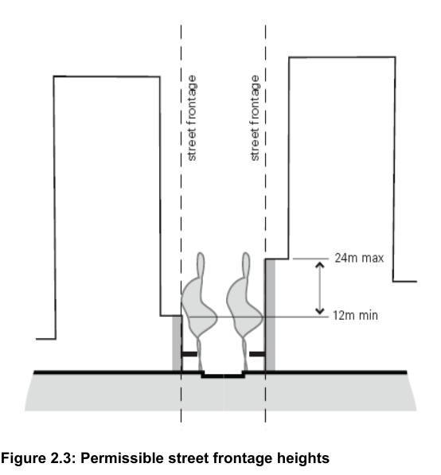

### 2.3 Street frontage heights in commercial core

#### 2.3.1 General

1\. Buildings built to the street alignment and with a height to street width ratio of approximately 1:1 give a sense of enclosure to the street that is appropriate for a city centre.  In Wollongong, streets in the Commercial Core are generally 20 metres wide, generating a preferred street front height of between 12m and 24m, subject to context and sun access requirements.

2\. Controls setting street front heights apply within the commercial core where buildings are to be built to the street alignment.

#### 2.3.2 Objectives

a) To achieve comfortable street environments for pedestrians in terms of daylight, scale, sense of enclosure and wind mitigation as well as a healthy environment for street trees.

b) To reinforce the intrinsic character of Wollongong City Centre while enabling flexibility in building design.

c) To enhance the distinctive character of Special Areas with compatible development.

d) To protect solar access to key streets and public spaces.

#### 2.3.3 Development Controls

The street frontage height of buildings in the Commercial Core are not to be less than 12m or greater than 24m above mean ground level on the street front as shown in Figure 2.3.

Notwithstanding the above, the street front height of new buildings are to be consistent with the sun access controls in Clause 2.9.

> [Picture on page 11: a picture, saved as a picture (images/chapter-d13-wollongong-city-centre-page-11-7.gif, 150 dpi).]

Figure 2.3: Permissible street frontage heights
