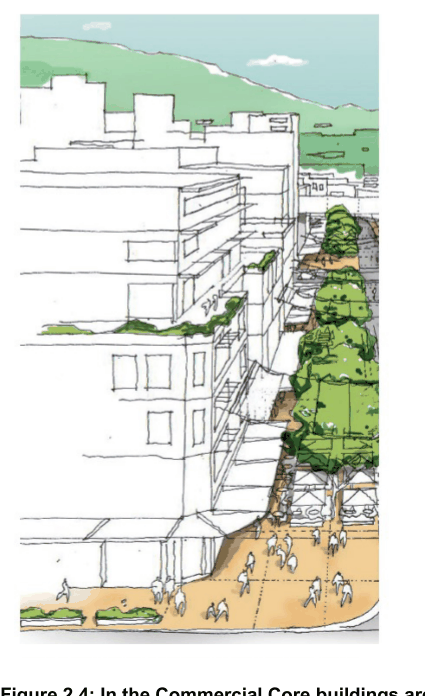
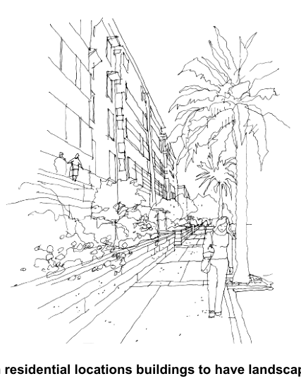
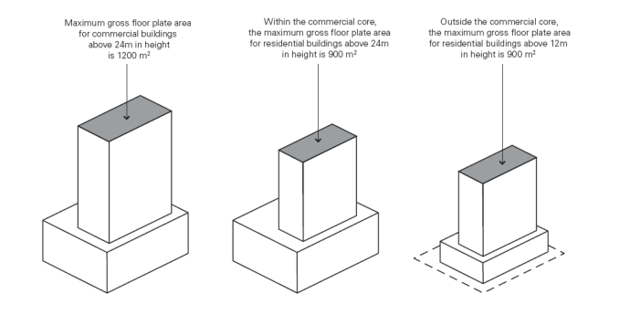
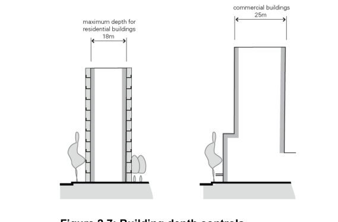

### 2.4 Building depth and bulk

#### 2.4.1 General

1\. Wollongong features a temperate climate and pleasant outdoor conditions for much of the year. Controlling the size of upper level floor plates in new buildings allows for good internal amenity access to natural light and ventilation and mitigates potential adverse effects that tall and bulky buildings may have on the public domain.

2\. Building depth is related to building use.  Typically, mixed use buildings have larger commercial floor plates combined with smaller residential floors.  The following controls are therefore classified into residential or commercial at the detail level.

> [Picture on page 12: a picture, saved as a picture (images/chapter-d13-wollongong-city-centre-page-12-1.gif, 150 dpi).]

Figure 2.4: In the Commercial Core buildings are to be built to street alignment with upper level set back

#### 2.4.2 Objectives

a) To promote the design and development of sustainable buildings.

b) To achieve the development of living and working environments with good internal amenity and minimise the need for artificial heating, cooling and lighting.

c) To provide viable and useable commercial floor space.

d) To achieve usable and pleasant streets and public domain at ground level by controlling the size of upper level floor plates of buildings.

e) To achieve a city skyline sympathetic to the topography and context.

f) To allow for view sharing and view corridors.

g) To reduce the apparent bulk and scale of buildings by breaking up expanses of building wall with modulation of form and articulation of facades.

> [Picture on page 13: a picture, saved as a picture (images/chapter-d13-wollongong-city-centre-page-13-1.gif, 150 dpi).]

Figure 2.5: In residential locations buildings to have landscaped setbacks

#### 2.4.3 Development Controls

a) The maximum floorplate sizes and depth of buildings are specified in Figures 2.6 and 2.7, and in the following table (which does not apply to building frontages up to the street front height in the commercial core):

| Building use | Maximum floor plate size (gross floor area) | Maximum building depth (excludes balconies) |
|---|---|---|
| Non-residential | 1,200m2 |  |
| Commercial Core | above 24m height | 25m |
| Residential and serviced apartments | 900m2 |  |
| in Commercial Core | above 24m height | 18m |
| Residential and serviced apartments | 900m2 |  |
| outside the Commercial Core | above 12m height | 18m |

b) At street frontage height levels, and where development is built from street edge to street edge, articulate buildings using atria, light wells and courtyards to improve internal building amenity and achieve substantial daylighting at every level, and cross ventilation and/or stack effect ventilation.

c) All points on an office floor should be no more than 10m from a source of daylight (eg. window, lightwell or skylight) in buildings less than 24m in height, and no more than 12.5m from a window in buildings over 24m in height.

> [Picture on page 14: a picture, saved as a picture (images/chapter-d13-wollongong-city-centre-page-14-4.gif, 150 dpi).]

#### Figure 2.6: Building bulk controls

> [Picture on page 14: a picture, saved as a picture (images/chapter-d13-wollongong-city-centre-page-14-6.gif, 150 dpi).]

#### Figure 2.7: Building depth controls
