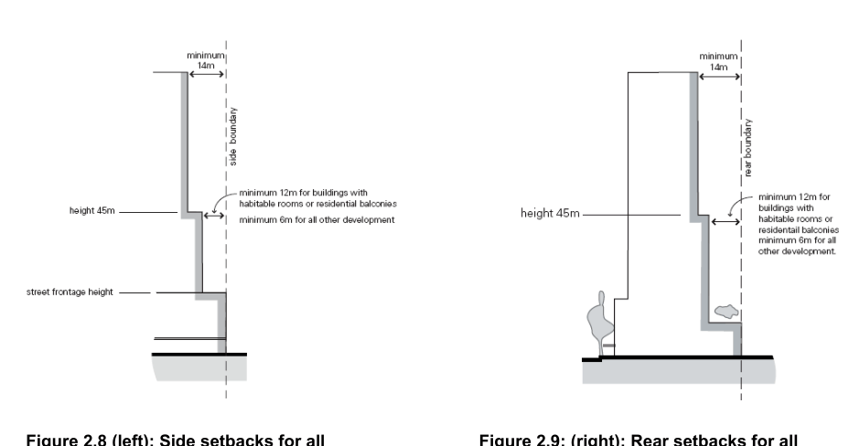

### 2.5 Side and rear building setbacks and building separation

#### 2.5.1 General

1\. Side and rear setbacks, where provided, allow ventilation, daylight access and view sharing, increase privacy, and reduce adverse wind effects.  Building separation increases in proportion to building height to ensure appropriate urban form, amenity and privacy for building occupants.  In residential buildings and serviced apartments, separation between windows on side and rear facades and other buildings is particularly important for privacy, acoustic amenity and view sharing.  Setbacks for residential development in the Commercial Core are different to other zones to reflect the different settings and forms of buildings in the different zones.

2\. For commercial buildings, separation distances are smaller due to the reduced requirement for privacy, noise and daylight access.

3\. Separation for Mixed Use buildings containing residential and commercial uses is to be in accordance with specified distances for each component use.

4\. The definition of “building line or setback” is provided in the Wollongong City Centre LEP 2009.

#### 2.5.2 Objectives

a) To ensure an appropriate level of amenity for building occupants in terms of daylight, outlook, view sharing, ventilation, wind mitigation, and privacy.

b) To achieve usable and pleasant streets and public domain areas in terms of wind mitigation and daylight access.

#### 2.5.3 Development Controls

Note: For the purpose of this section, commercial buildings means all non-residential buildings (including hotel accommodation, but not serviced apartments).  Principal windows and balconies means the main window of a living room or main bedroom, or the edge of primary balcony of a dwelling.

a) The minimum building setbacks from the side and rear property boundaries are specified in Figures

2.8 to 2.11, and in the following table:

b) For multiple buildings on the same site in the Commercial Core and Mixed Use (city edge) zones, minimum separation distances are shown in Figure 2.12.

c) In mixed use buildings, setbacks for the residential component are to be the distances specified above for residential development in the specified zone.

d) If the specified setback distances cannot be achieved when an existing building is being refurbished or converted to another use, appropriate visual privacy levels are to be achieved through other means, for example, the construction of screens.  These will be assessed on merit by the consent authority.

e) In certain circumstances, Council may consider a variation to the side and rear setback requirements through appropriate architectural features (eg splayed windows which achieve oblique outlooks) provided that:

i) A minimum separation between the main walls of 6 metres is maintained,

ii) Separation is between sections of building walls that include only service room windows,

iii) Views are available obliquely to site boundaries; and

iv) Privacy screens are provided to all balconies and windows for all units / suites along the building facade.

| Zone | Building condition | Minimum side setback | Minimum rear setback |
|---|---|---|---|
| Commercial Core | Up to street frontage heights Residential uses (habitable rooms) between street frontage height and 45m All uses (including non-habitable residential) between street frontage height and 45m All uses above 45m | 0m 12m 6m 14m | 0m 12m 6m 14m |
| All other zones | Residential uses up to 12m in height |  |  |
|  | - habitable rooms with openings and balconies | 6m | 6m |
|  | - non-habitable rooms and habitable rooms | 3m | 4.5m |
|  | without openings |  |  |
|  | Residential uses between 12m & 24m |  |  |
|  | - habitable rooms with openings and balconies | 9m | 9m |
|  | -non-habitable rooms and habitable rooms without openings | 4.5m | 4.5m |
|  | Residential uses above 24m |  |  |
|  | - habitable rooms with openings and balconies and up to 45m | 12m | 12m |
|  | - non-habitable rooms and habitable rooms without openings | 6m | 6m |
|  | All residential uses above 45m | 14m | 14m |
|  | Commercial uses up to 24m | 3m | 9m |
|  | Commercial uses above 24m | 6m | 12m |

> [Picture on page 17: a picture, saved as a picture (images/chapter-d13-wollongong-city-centre-page-17-1.gif, 150 dpi).]

Figure 2.8 (left): Side setbacks for all

Figure 2.9: (right): Rear setbacks for all

development in the Commercial Core

development in the Commercial Core
