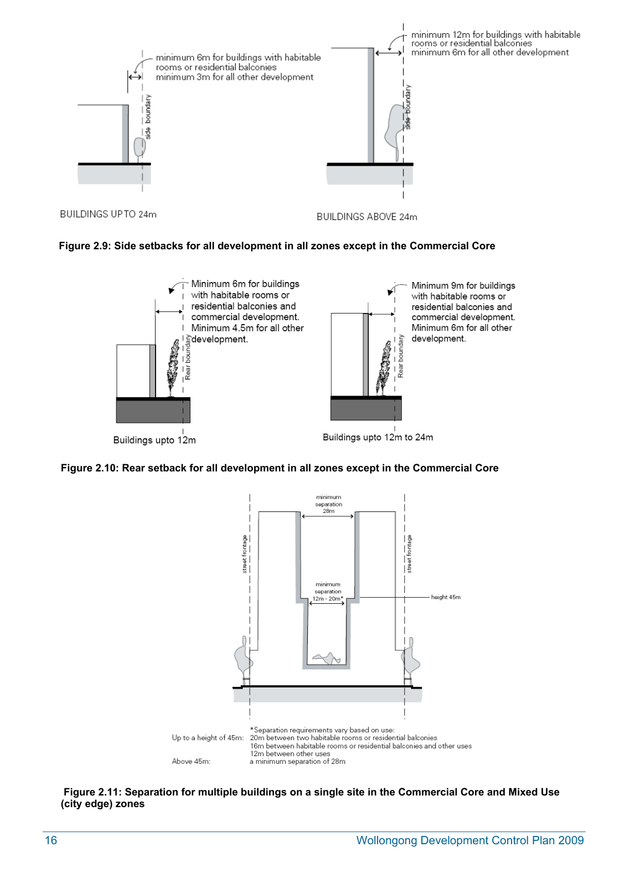
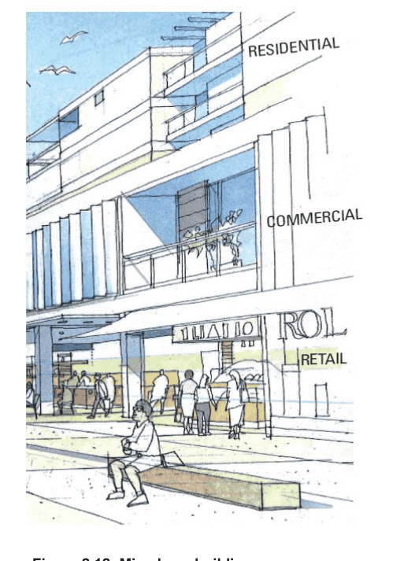

### 2.6 Mixed used buildings

#### 2.6.1 General

1\. Mixed-use developments provide for a variety of uses and activities within city centres, encouraging use of the city outside the working day, adding vibrancy and life to the city streets. Different uses within the same building are best located to a pattern and layout suitable to the mix of uses, with retail and business activity at ground level to assist street activation and residential uses, requiring privacy and noise mitigation, located above street level (see Figure 2.13).

2\. Mixed use development within the city centre is preferred in sustainable locations, close to transport (rail station), and recreational areas (foreshore).

#### 2.6.2 Objectives

a) To encourage a variety of mixed-use developments in the city centre.

b) To create lively streets and public spaces in the city centre

c) To increase the diversity and range of shopping and recreational activities for workers, residents and visitors.

d) To enhance public safety by increasing activity in the public domain on week nights and on weekends.

e) To minimise potential conflicts and achieve compatibility between different uses.

f) To minimise conflicts between permitted land use and heritage buildings.

g) To ensure that the design of mixed-use buildings addresses residential amenity.

h) To create separate, legible and safe access and circulation in mixed use buildings.

i) To ensure that mixed use buildings address the public domain and the street.

> [Picture on page 18: a picture, saved as a picture (images/chapter-d13-wollongong-city-centre-page-18-1.gif, 150 dpi).]
> Words printed on the picture (title and legend, copied from the PDF):
> (city edge) zones

Figure 2.9: Side setbacks for all development in all zones except in the Commercial Core

Figure 2.10: Rear setback for all development in all zones except in the Commercial Core

Figure 2.11: Separation for multiple buildings on a single site in the Commercial Core and Mixed Use

#### 2.6.3 Development Controls

a) Provide flexible building layouts which allow variable tenancies or uses on the first two floors of a building above the ground floor.

b) Minimum floor to ceiling heights are 3.3 metres for commercial office and 3.6 metres for active public uses, such as retail and restaurants in the B3 Commercial Core zone. In the B4 Mixed Use zone, the ground floor and first levels of a building shall incorporate a minimum 3 metre floor to ceiling height clearance, to maximise the flexibility in the future use of the building.

c) Separate commercial service requirements, such as loading docks, from residential access, servicing needs and primary outlook.

d) Locate clearly demarcated residential entries directly from the public street.

e) Clearly separate and distinguish commercial and residential entries and vertical circulation.

f) Provide security access controls to all entrances into private areas, including car parks and internal courtyards.

g) Provide safe pedestrian routes through the site, where required.

h) Front buildings onto major streets with active uses.

i) Avoid the use of blank building walls at the ground level.

j) For mixed use buildings that include food and drink premises uses, the location of kitchen ventilation systems shall be indicated on plans and situated to avoid amenity impacts to residents.

> [Picture on page 19: a picture, saved as a picture (images/chapter-d13-wollongong-city-centre-page-19-19.gif, 150 dpi).]

#### Figure 2.12: Mixed use buildings
