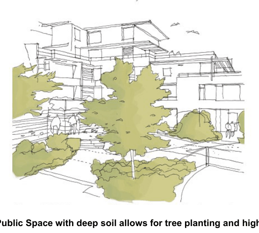

### 2.7 Deep soil zone

#### 2.7.1 General

1\. Deep soil zones are areas of natural ground retained within a development, uninhibited by artificial structures and with relatively natural soil profiles.  Deep soil zones have important environmental benefits, including:

(a) Promoting healthy growth of large trees with large canopies,

(b) Protecting existing mature trees, and

(c) Allowing infiltration of rainwater to the water table and reduction of stormwater runoff.

#### 2.7.2 Objectives

a) To provide an area on sites that enables soft landscaping and deep soil planting, permitting the retention and/or planting of trees that will grow to a large or medium size.

b) To limit building bulk on a site and improve the amenity of developments, allowing for good daylight access, ventilation, and improved visual privacy.

c) To provide passive and active recreational opportunities.

#### 2.7.3 Development Controls

a) All residential developments must include a deep soil zone (See Figure 2.14).

b) The deep soil zone shall comprise no less than 15% of the total site area preferably provided in one continuous block and shall have a minimum dimension (width or length) of 6 metres.

c) For residential components in mixed use developments in the Commercial Core, Mixed Use (city

edge) and Enterprise zones, the amount of deep soil zone may be reduced commensurate with the extent of non-residential uses.  Where non-residential components result in full site coverage and there is no capacity for water infiltration, the deep soil component must be provided on structure, in accordance with the provisions of Section 2.8 and 2.9.  In such cases, compensatory stormwater management measures must be integrated within the development to minimise stormwater runoff.

d) Where deep soil zones are provided, they must accommodate existing mature trees as well as allowing for the planting of trees/shrubs that will grow to be mature trees.

e) No structures, works or excavations that may restrict vegetation growth are permitted in this zone (including but not limited to basements, car parking, hard paving, patios, decks and drying areas).

> [Picture on page 20: a picture, saved as a picture (images/chapter-d13-wollongong-city-centre-page-20-29.gif, 150 dpi).]

Figure 2.13: Communal Public Space with deep soil allows for tree planting and high quality landscape
