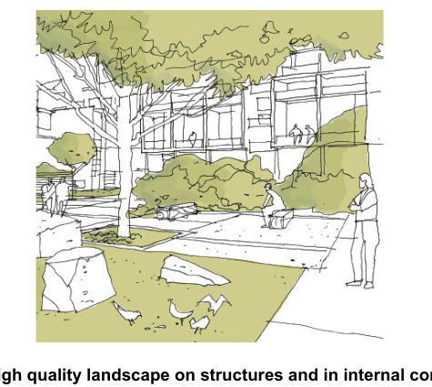
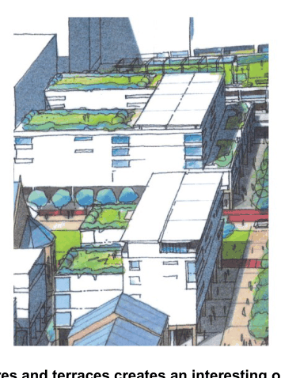

### 2.9 Green roofs, green walls and planting on structures

#### 2.9.1 General

1\. The following controls apply in the Commercial Core, Mixed Use (city edge) and Enterprise zones for planting on roof tops or over car park structures, particularly for communal open space required as a component of mixed use residential development, and in non-residential developments where the landscaping proposed is not on natural ground e.g. green roofs and walls, podiums, rooftop gardens (Figures 2.15 and 2.16).

#### 2.9.2 Objectives

a) To contribute to the quality and amenity of open space on roof tops and internal courtyards.

b) To encourage the establishment and healthy growth of trees in urban areas.

c) To encourage the use of green walls and roofs in communal open space, and to enhance the environmental performance of the development.

> [Picture on page 22: a picture, saved as a picture (images/chapter-d13-wollongong-city-centre-page-22-1.gif, 150 dpi).]

Figure 2.14: Encourage high quality landscape on structures and in internal communal courtyards

> [Picture on page 22: a picture, saved as a picture (images/chapter-d13-wollongong-city-centre-page-22-3.gif, 150 dpi).]

Figure 2.15: Planting on root structures and terraces creates an interesting outlook from adjacent adjoining

buildings

#### 2.9.3 Development Controls

a) Design for optimum conditions for plant growth by:

i) Providing soil depth, soil volume and soil area appropriate to the size of the plants to be established,

ii) Providing appropriate soil conditions and irrigation methods, and

iii) Providing appropriate drainage.

b) Design planters to support the appropriate soil depth and plant selection by:

i) Ensuring planter proportions accommodate the largest volume of soil possible and soil depths to ensure tree growth, and

ii) Providing square or rectangular planting areas rather than narrow linear areas.

c) Increase minimum soil depths in accordance with:

i) The mix of plants in a planter for example where trees are planted in association with shrubs, groundcovers and grass,

ii) The level of landscape management, particularly the frequency of irrigation,

iii) Anchorage requirements of large and medium trees, and

iv) Soil type and quality.

d) Provide sufficient soil depth and area to allow for plant establishment and growth.  The following minimum standards are recommended:

Minimum soil standards for planting on structures or podiums

| Plant type | Definition | Soil volume | Soil Depth | Soil area |
|---|---|---|---|---|
| Large trees | 12-18m high, up to 16m crown spread at maturity | 150m3 | 1,200mm | 10m x 10m or equivalent |
| Medium trees | 8-12m high, up to 16m crown spread at maturity | 36m3 | 1,000mm | 6 x 6m or equivalent |
| Small trees | 6-8m high, up to 16m crown spread at maturity | 16m3 | 800mm | 4 x 4m or equivalent |
| Shrubs |  |  | 500-600mm |  |
| Ground cover |  |  | 300-450mm |  |
| Turf |  |  | 300 mm |  |

\*Sub-surface drainage requirements are in addition to the above minimum soil depths.
