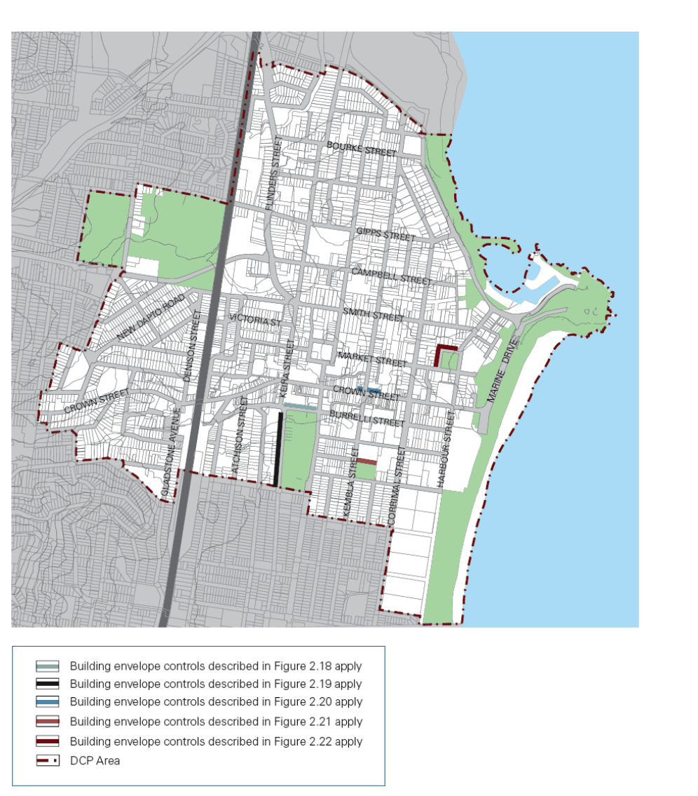
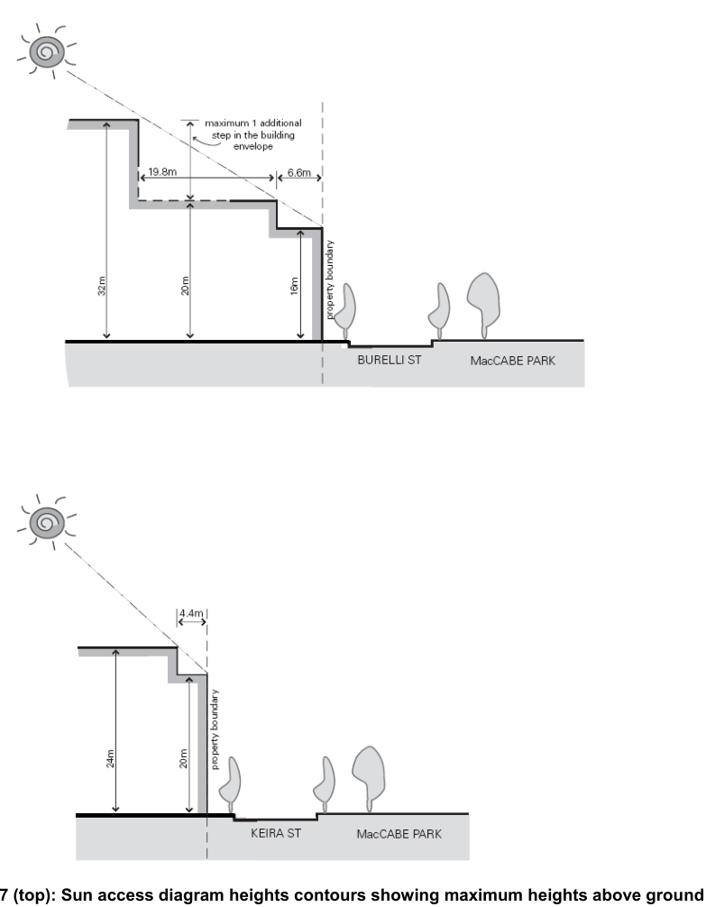
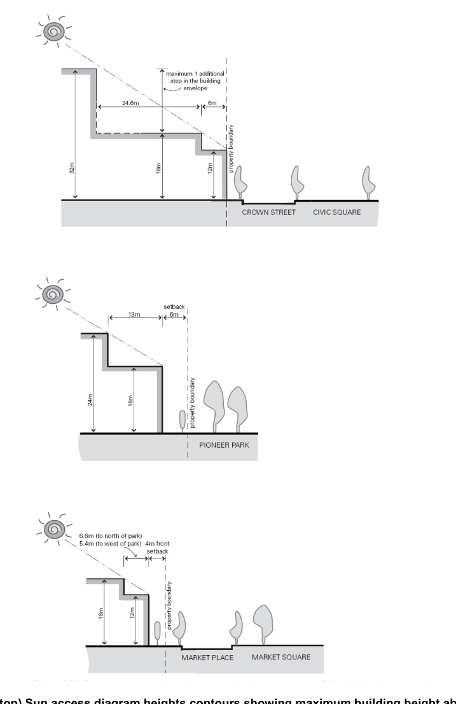
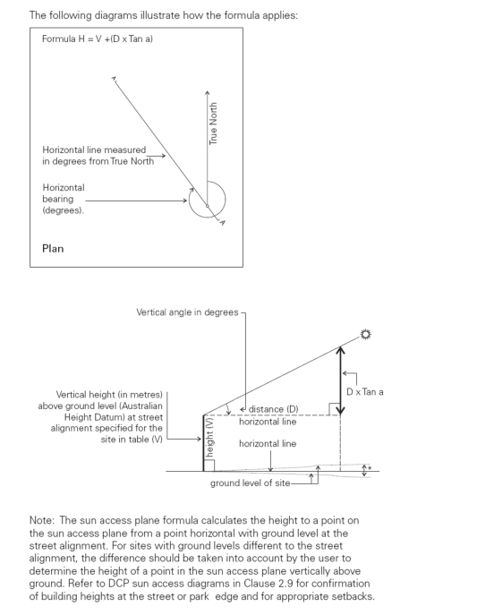

### 2.10 Sun access planes

Sun access planes establish building heights around the following parks and community places:

MacCabe Park on 21 June from 12 noon to 2pm.

Civic Square on 21 June from 11am to 3pm.

Market Square on 21 June from 12 noon to 2pm.

Pioneer Park on 21 June from 12 noon to 2pm.

#### 2.10.1 Sun Access Diagrams

The sun access diagrams show building height contours that will achieve well scaled buildings enclosing these key public spaces with building frontage heights and setbacks required to protect sun access.

The sun access diagrams also provide controls for an appropriate transition of building heights from the street frontage height to the maximum development height permissible in the LEP by controlling the number of setbacks.

#### 2.10.2 Objectives

a) To allow sunlight access to significant public spaces in the city centre.

b) To provide for an appropriate transition in building heights from key public spaces.

c) To provide well scaled enclosure to the significant public spaces.

#### 2.10.3 Development Controls

a) Refer to Figure 2.17 and sun access diagrams in Figures 2.18 to 2.22 for relevant height and setback controls for development adjacent to key public spaces.

#### 2.10.4 Sun Access Planes

The height contours are based on sun access planes for mid winter.

A sun access plane projects above land shown as affected by the plan on the Sun Plane Protection Map and is located by applying the following formula:

H = V + (D x tan a)

Where:

‘H’ is the height, measured in metres, of a point in a sun access plan.

‘V’ is the height, specified for this factor in the sun access planes table and measured in metres above ground level, at the part of the street alignment specified in the sun access planes table for the relevant sun access plane.

‘D’ is the horizontal distance, from that part of the street alignment to the point in the sun access plane, measured in metres away from the relevant park or community place along the horizontal bearing measured from true north, specified in the sun access planes table for the relevant sun access plane.

‘a’ is the vertical angle in degrees, specified for this factor in the sun access planes table, corresponding to the horizontal bearing for the relevant sun access plane.

> [Picture on page 25: a picture, saved as a picture (images/chapter-d13-wollongong-city-centre-page-25-1.gif, 150 dpi).]

#### Figure 2.16: Special building envelope control locations

> [Picture on page 26: a picture, saved as a picture (images/chapter-d13-wollongong-city-centre-page-26-1.gif, 150 dpi).]

Figure 2.17 (top): Sun access diagram heights contours showing maximum heights above ground

Figure 2.18 (bottom) Sun access diagram, height contours showing maximum building heights above ground

> [Picture on page 27: a picture, saved as a picture (images/chapter-d13-wollongong-city-centre-page-27-1.gif, 150 dpi).]

Figure 2.19: (top) Sun access diagram heights contours showing maximum building height above ground

Figure 2.20: (middle) Sun access diagram height contours showing maximum building height above ground

Figure 2.21: (bottom) Sun access diagram height contours showing maximum building height above ground

#### Table 2.2: Sun access planes

| Park or | Time | Horizontal | Vertical angle | Vertical height above ground |
|---|---|---|---|---|
| community |  |  |  | level as part of street |
| place | (21 June) | Bearing (degrees) | (degrees) (a) (metres) (v) | alignment |
| MacCabe | 12 noon | 359.30 | 32.08 | 16m on the northern alignment |
| Park | 2pm | 329.02 | 25.18 | of Burelli Street between Keira Street and Church Street 20m on the western alignment of Keira Street between Ellen Street and Burelli Street. |
| Civic Square | 11am 3pm | 15.30 316.37 | 30.30 17.49 | 12m on the northern alignment of Crown Street. |
| Market | 12 noon | 359.30 | 30.08 | 12m on the northern and |
| Square | 2pm | 329.02 | 25.18 | western alignment of Market Place. |
| Pioneer Park | 12 noon 2pm | 359.30 329.02 | 32.08 25.18 | 16m on the northern boundary of the park. |

> [Picture on page 28: a picture, saved as a picture (images/chapter-d13-wollongong-city-centre-page-28-3.gif, 150 dpi).]

#### Figure 2.22: The sun access plane formula diagram
