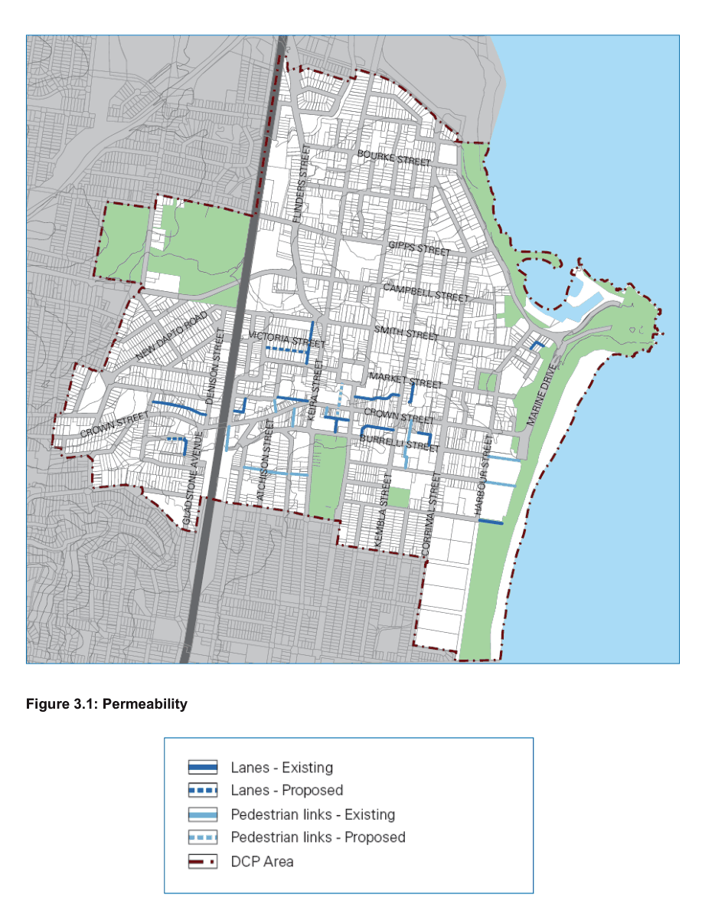
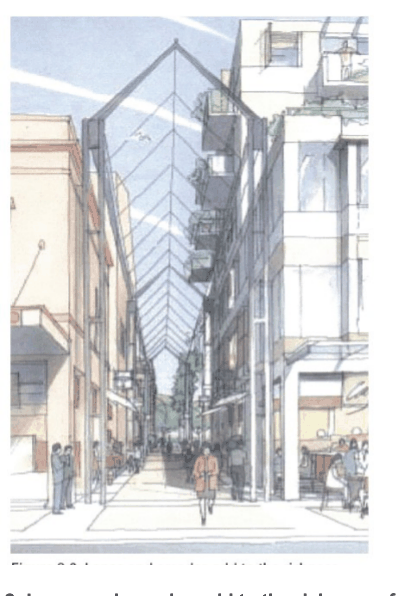

### 3.2 Permeability

Through site links provide access connections between the long sides of street blocks for pedestrian and vehicular access at street level.  These links provide an important function in the form of lanes, shared zones, arcades and pedestrian ways.

#### 3.2.1 Objectives

a) To improve access in the city centre by providing through site links as redevelopment occurs.

b) To ensure that through site links have active frontages along their length where possible.

c) To provide for pedestrian amenity and safety.

d) To encourage removal of vehicular entries from primary street frontages.

e) To retain and develop lanes as useful and interesting pedestrian connections as well as for service access.

#### 3.2.2 Development Controls

a) Through site links, arcades, shared ways and laneways are to be provided as shown in Figure 3.1.

b) Where possible, existing dead end lanes are to be extended through to the next street as redevelopment occurs.

c) New through site links should be connected with existing and proposed through block lanes, shared zones, arcades and pedestrian ways and opposite other through site links.

d) Existing publicly and privately owned lanes are to be retained.

e) The design and finish of new through site links need to be provided in accordance with Council’s City Centre Public Domain Manual.

#### 3.2.3 Pedestrian Links

Through site links (arcades) for pedestrians are to be provided as shown in Figure 3.1, and:

a) Have active frontages,

b) Be clear and direct throughways for pedestrians,

c) Provide public access at all business trading times or as otherwise stipulated by Council’s conditions of approval,

d) Have a minimum width of 4m non-leasable space clear of all obstructions (including columns, stairs and escalators),

e) Where practicable, have access to natural light for at least 30% of their length,

f) Where air conditioned, have clear glazed entry doors comprising at least 50% of the entrance,  and

g) Have signage at street entries indicating public accessibility and the street to which the through site link connects.

> [Picture on page 31: a picture, saved as a picture (images/chapter-d13-wollongong-city-centre-page-31-1.gif, 150 dpi).]

#### Figure 3.1: Permeability

Internal arcades will not be approved in preference to activation of an existing or required lane.  Where developments front a lane that is also a pedestrian route, provide an active frontage and design details that create visual interest such as landscaping, awnings, paved finishes and good lighting.

#### 3.2.4 Lanes

a) New through site laneways for pedestrians and vehicles are to be provided as indicated in Figure 3.1.

b) Lanes are to:

i) have active frontages,

ii) be clear and direct throughways for pedestrians,

iii) provide public access at all times or as otherwise stipulated by Council’s conditions of approval,

iv) have a minimum width of 6m clear of all obstructions,  and

v) have signage indicating public accessibility and the street to which the lane connects.

c) Where lanes are primarily used for building access and servicing, ‘safer by design’ principles must

> [Picture on page 32: a picture, saved as a picture (images/chapter-d13-wollongong-city-centre-page-32-6.gif, 150 dpi).]

be demonstrated (refer to Section 3.3).

#### Figure 3.2: Lanes and arcades add to the richness of a city
