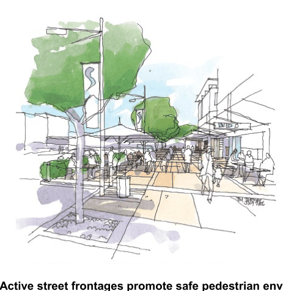
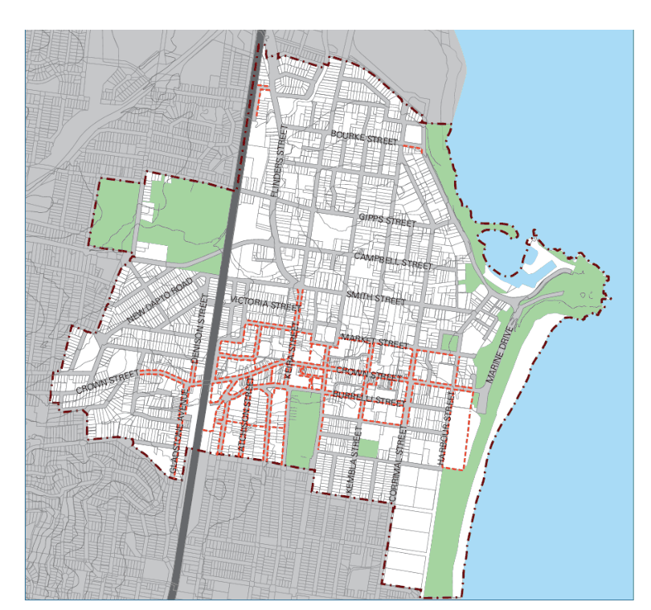

### 3.3 Active street frontages

Active street frontages promote an interesting and safe pedestrian environment.  Busy pedestrian areas and non-residential uses such as shops, studios, offices, cafes, recreation and promenade opportunities promote the most active street fronts (Figure 3.3).

Residential buildings can also activate the street by providing a clear street address, direct access from the street and direct outlook over the street.

#### 3.3.1 Objectives

a) To promote pedestrian activity and safety in the public domain.

b) To maximise active street fronts in Wollongong city centre.

c) To define areas where active streets are required or are desirable.

Active frontage uses are defined as one or a combination of the following at street level:

Entrance to retail.

Shop front.

Glazed entries to commercial and residential lobbies occupying less than 50% of the street frontage, to a maximum of 12 metres frontage.

Café or restaurant if accompanied by an entry from the street.

Active office uses, such as reception, if visible from the street.

Public building if accompanied by an entry.

> [Picture on page 33: a picture, saved as a picture (images/chapter-d13-wollongong-city-centre-page-33-6.gif, 150 dpi).]

#### Figure 3.3: Active street frontages promote safe pedestrian environment

#### 3.3.2 Development Controls

a) In commercial and mixed use development, active street fronts are encouraged in the form of non-residential uses on ground level.

b) Active street fronts in the form of non-residential uses on ground level are required along streets, lanes and through site links shown in Figure 3.4 for all buildings in the Commercial Core and Tourist zones, and for mixed use buildings in the Mixed Use (city edge) and Enterprise zones.

c) Active ground floor uses are to be at the same general level as the footpath and be accessible directly from the street.

d) For all non-residential ground floor frontages outside the streets shown in Figure 3.4, provide clear glazing where ever possible to promote passive surveillance and contribute to street activity.

e) Restaurants, cafes and the like are to consider providing openable shop fronts.

f) Residential developments are to provide a clear street address and direct pedestrian access off the primary street front, and allow for residents to overlook all surrounding streets.

g) Provide multiple entrances for large developments including an entrance on each street frontage.

> [Picture on page 34: a picture, saved as a picture (images/chapter-d13-wollongong-city-centre-page-34-1.gif, 150 dpi).]

#### Figure 3.4: Active street frontages
