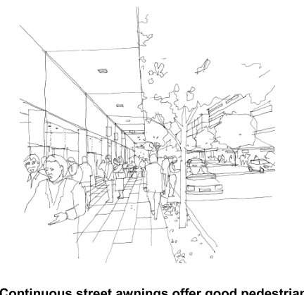

### 3.4 Safety and security

A safe and secure environment encourages activity, vitality and viability, enabling a greater level of security.  Planning and design can identify and address safety and security issues through the use of environmental and technical measures.

#### 3.4.1 Objectives

a) Address safety, security and crime prevention requirements in the planning and design of development (including the NSW Police ‘Safer by Design’ crime prevention through environmental design (CPTED) principles).

b) Reduce opportunities for crime through environmental design and the provision of natural and technical surveillance opportunities.

c) Control access through the provision of physical or implied barriers which can be used to attract, channel or restrict the movement of people.

d) Implement territorial reinforcement by encouraging community ownership of public space.

e) Promote space management by ensuring that public open space is effectively utilised and maintained.

#### 3.4.2 Development Controls

a) Ensure that the building design allows for casual surveillance of accessways, entries and driveways.

b) Avoid creating blind corners and dark alcoves that provide concealment opportunities in pathways, stairwells, hallways and carparks.

c) Provide entrances which are in visually prominent positions and which are easily identifiable, with visible numbering.

d) Where private open space is located within the front building alignment any front fencing must be of a design and/or height which allows for passive surveillance of the street.

e) Provide adequate lighting of all pedestrian access ways, parking areas and building entries.  Such lighting should be on a timer or movement detector to reduce energy consumption and glare nuisance.

f) Provide clear lines of sight and well-lit routes throughout the development.

g) Where a pedestrian pathway is provided from the street, allow for casual surveillance of the pathway.

h) For large scale retail and commercial development with a GFA of over 5,000m², provide a ‘safety by design’ assessment in accordance with the CPTED principles.

i) Provide security access controls where appropriate.

j) Ensure building entrance(s) including pathways, lanes and arcades for larger scale retail and commercial developments are directed to signalised intersections rather than mid-block in the Commercial zone, Mixed Use (city edge) and Enterprise Corridor zones.

> [Picture on page 35: a picture, saved as a picture (images/chapter-d13-wollongong-city-centre-page-35-20.gif, 150 dpi).]

#### Figure 3.5: Continuous street awnings offer good pedestrian amenity
