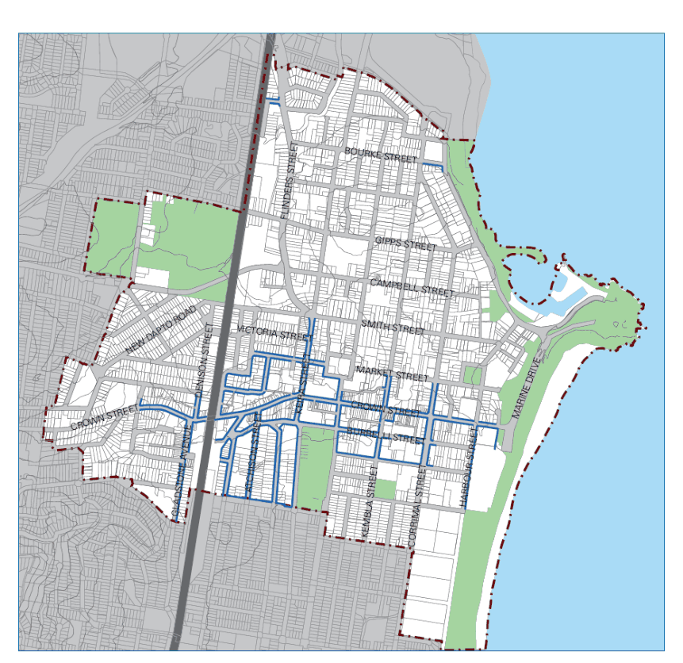

### 3.5 Awnings

Awnings increase the useability and amenity of public footpaths by protecting pedestrians from sun and

rain.  They encourage pedestrian activity along streets and in conjunction with active edges such as retail frontages, support and enhance the vitality of the local area.  Awnings, like building entries, provide a public presence and interface within the public domain and contribute to the identity of a development.

#### 3.5.1 Objectives

a) To provide shelter for public streets where most pedestrian activity occurs.

b) To address the streetscape by providing a consistent street frontage in the city centre.

#### 3.5.2 Development Controls

a) Continuous street frontage awnings are to be provided for all new developments as indicated in Figure 3.6.

b) Awning design must match building facades and be complementary to those of adjoining buildings.

c) Wrap awnings around corners for a minimum six metres from where a building is sited on a street corner.

d) Awnings dimensions should generally be:

i) Minimum soffit height of 3.3 metres,

ii) Low profile, with slim vertical facias or eaves (generally not to exceed 300mm height),

iii) Setback a minimum of 1.2 metres from the kerb, and

iv) Generally minimum 2.4 metres deep.

e) To control sun access/protection, canvas blinds along the street edge may be permitted, subject to design merit and assessment.

f) Signage on blinds is not permitted.

g) Provide under awning lighting to facilitate night use and to improve public safety.

> [Picture on page 37: a picture, saved as a picture (images/chapter-d13-wollongong-city-centre-page-37-1.gif, 150 dpi).]

#### Figure 3.6: Awnings
