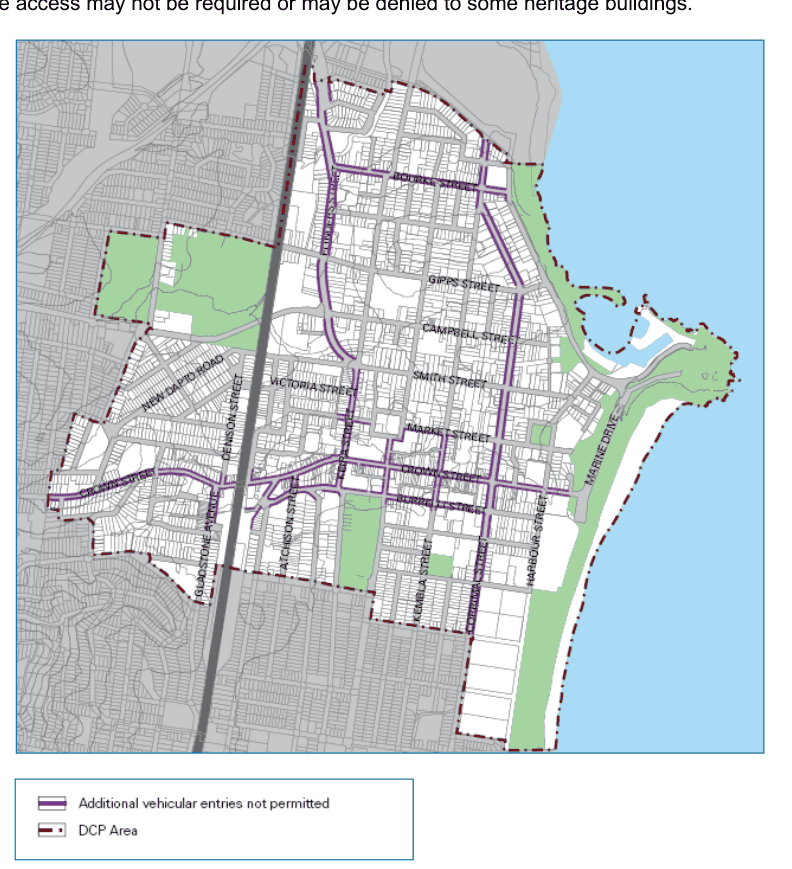
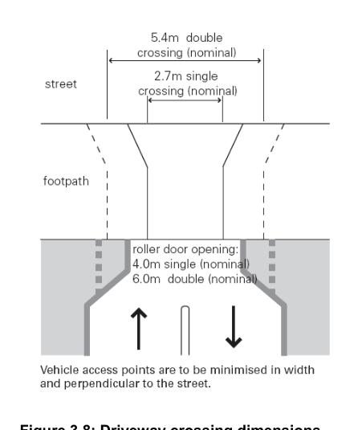

### 3.6 Vehicular footpath crossings

Vehicle crossings over footpaths disrupt pedestrian movement and threaten safety.  The design of vehicle access to buildings also influences the quality of the public domain.  Overly wide and high vehicle access points detract from the streetscape and the active use of street frontages.

The design and location of vehicle access to developments should minimise both conflicts between pedestrians and vehicles on footpaths, particularly along pedestrian priority places, and visual intrusion and disruption of streetscape continuity.

Design of driveways and vehicle access is to be in accordance with the provision of section 4.2.

#### 3.6.1 Objectives

a) To make vehicle access to buildings more compatible with pedestrian movements and the public domain.

b) To ensure vehicle entry points are integrated into building design and contribute to high quality architecture.

#### 3.6.2 Development Controls Location of Vehicle Access

a) No additional vehicle entry points will be permitted into the parking or service areas of development along those streets identified as significant pedestrian circulation routes in Figure 3.7.

b) In all other areas, one vehicle access point only (including the access for service vehicles and parking for non-residential uses within mixed use developments) will be generally permitted.

c) Where practicable, vehicle access is to be from lanes and minor streets rather than primary street fronts or streets with major pedestrian and cyclist activity.

d) Where practicable, adjoining buildings are to share or amalgamate vehicle access points.  Internal on-site signal equipment is to be used to allow shared access.  Where appropriate, new buildings should provide vehicle access points so that they are capable of shared access at a later date.

> [Picture on page 38: a picture, saved as a picture (images/chapter-d13-wollongong-city-centre-page-38-12.gif, 150 dpi).]

e) Vehicle access may not be required or may be denied to some heritage buildings.

#### Figure 3.7: Restrictions on vehicular entries

#### Design of Vehicle Access

a) Wherever practicable, vehicle access is to be a single lane crossing with a maximum width of 2.7 metres over the footpath, and perpendicular to the kerb alignment.  In exceptional circumstances, a double lane crossing with a maximum width of 5.4 metres may be permitted for safety reasons (refer Figure 3.8).

b) Vehicle access ramps parallel to the street frontage will not be permitted.

c) Doors to vehicle access points are to be roller shutters or tilting doors fitted behind the building façade.

d) Vehicle entries are to have high quality finishes to walls and ceilings as well as high standard detailing.  No service ducts or pipes are to be visible from the street.

> [Picture on page 39: a picture, saved as a picture (images/chapter-d13-wollongong-city-centre-page-39-11.gif, 150 dpi).]

#### Figure 3.8: Driveway crossing dimensions

#### Porte Cocheres

Porte cocheres disrupt pedestrian movement and do not contribute to active street frontage.  They may only be permitted in exceptional circumstances for hotels and major tourist venues subject to a high quality urban design, streetscape, heritage and pedestrian amenity considerations.  They are not permitted in those streets shown with significant pedestrian circulation at Figure 3.7.

If justified, porte cocheres should preferably be internal to the building with one combined vehicle entry and exit point, or one entry and one exit point on two different street fronts of the development.

In exceptional circumstances for the buildings with one street frontage only, an indented porte cochere with separate entry and exit points across the footpath may be permitted, as long as it:

Is constructed entirely at the footpath level,

Provides active street frontage uses in addition to any hotel entry or lobby at its perimeter,

Is of high quality design and finish, and

Provides for safe and clear pedestrian movement along the street.
