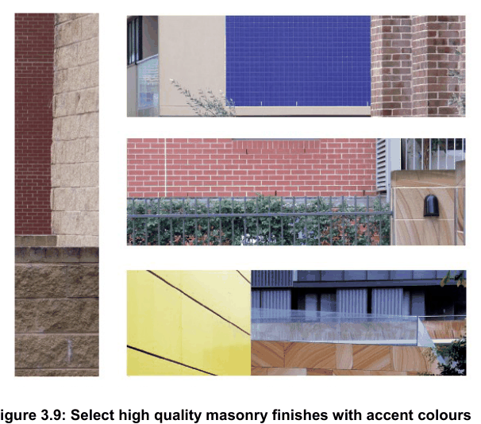

### 3.8 Building exteriors

Wollongong’s cityscape and public domain is defined by its buildings, streets and public places.  The maintenance and improvement of the public domain is dependent on a consistent approach to the design of new development including the articulation and finish of building exteriors.

#### 3.8.1 Objectives

To ensure that new buildings in Wollongong:

a) Contribute positively to the streetscape and public domain by means of high quality architecture and robust selection of materials and finishes.

b) Provide richness of detail and architectural interest especially at visually prominent parts of buildings such as lower levels and roof tops.

c) Present appropriate design responses to nearby development that complement the streetscape.

d) Clearly define the adjoining streets, street corners and public spaces and avoid ambiguous external spaces with poor pedestrian amenity and security.

e) Maintain a pedestrian scale in the articulation and detailing of the lower levels of the building.

f) Contribute to a visually interesting skyline.

#### 3.8.2 Development Controls

#### a) Adjoining buildings (particularly heritage buildings) are to be considered in the design of new

buildings in terms of:

i) Appropriate alignment and street frontage heights.

ii) Setbacks above street frontage heights.

iii) Appropriate materials and finishes selection.

iv) Façade proportions including horizontal or vertical emphasis.

v) The provision of enclosed corners at street intersections.

b) Balconies and terraces should be provided, particularly where buildings overlook parks and on low rise parts of buildings.  Gardens on the top of setback areas of buildings are encouraged.

c) Articulate facades so that they address the street and add visual interest.

d) External walls should be constructed of high quality and durable materials and finishes with ‘self-cleaning’ attributes, such as face brickwork, rendered brickwork, stone, concrete and glass.

e) Finishes with high maintenance costs, those susceptible to degradation or corrosion from a coastal or industrial environment or finishes that result in unacceptable amenity impacts, such as reflective glass, are to be avoided.

f) To assist articulation and visual interest, avoid expanses of any single material.

g) Limit opaque or blank walls for ground floor uses to 30% of the street frontage.

h) Maximise glazing for retail uses, but break glazing into sections to avoid large expanses of glass.

i) Highly reflective finishes and curtain wall glazing are not permitted above ground floor level (see Section 5.3).

j) A materials sample board and schedule is required to be submitted with applications for development over $1 million or for that part of any development built to the street edge.

k) Minor projections up to 450mm from building walls in accordance with those permitted by the Building Code of Australia may extend into the public space providing it does not fall within the definition of gross floor area and there is a public benefit, such as:

i) Expressed cornice lines that assist in enhancing the streetscape,

ii) Projections such as entry canopies that add visual interest and amenity,  and

iii) Provided that the projections do not detract from significant views and vistas (see Figure 3.12).

l) The design of roof plant rooms and lift overruns is to be integrated into the overall architecture of the

#### building.

> [Picture on page 42: a picture, saved as a picture (images/chapter-d13-wollongong-city-centre-page-42-1.gif, 150 dpi).]

Figure 3.9: Select high quality masonry finishes with accent colours
