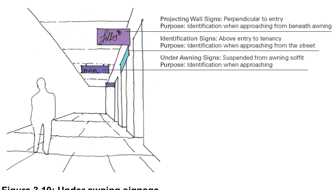
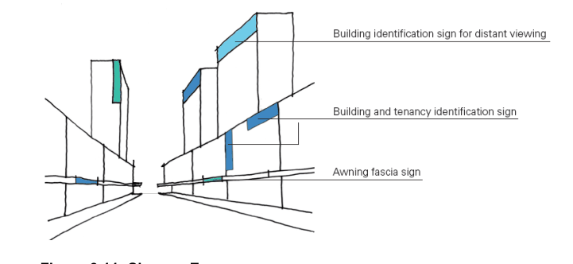

### 3.9 Advertising and signage

Advertisements and advertising structures are an important element of the built environment.  These provisions are intended to protect the significant characteristics of buildings, streetscapes, vistas and the city skyline and to encourage well designed and well positioned signs which contribute to the vitality and legibility of Wollongong city centre and which respect the amenity of residents and pedestrians and the safety of motorists. (Figures 3.10 and 3.11).

> [Picture on page 42: a picture, saved as a picture (images/chapter-d13-wollongong-city-centre-page-42-8.gif, 150 dpi).]

#### Figure 3.10: Under awning signage

> [Picture on page 43: a picture, saved as a picture (images/chapter-d13-wollongong-city-centre-page-43-1.gif, 150 dpi).]

#### Figure 3.11: Signage Zones

In considering innovative design proposals for signs not envisaged by these provisions or where there are issues of interpretation, the consent authority will consider the design excellence of the proposed design and the degree to which it meets the objectives of this section.

#### 3.9.1 Objectives

a) To ensure that all advertising achieves a very high level of design quality in terms of graphic design, its relationship to the architectural design of buildings and the character of streetscapes.

b) To limit the overall amount of advertising through the provision of fewer, more effective signs, to avoid the creation of visual clutter on buildings and streetscapes.

c) To promote signs that add character to the streetscape and assist with way finding and the pedestrian useability of the city.

d) To promote signs that complement the architectural style and use of buildings.

e) To consider the amenity of residential development and the visual quality of the public domain.

f) To encourage corporate logos and colours in signs that achieve a high degree of compatibility with the architecture of the building.

g) To ensure that the location and design of signs are consistent with road safety principles.

#### 3.9.2 Development Controls

General location and design of signs.

a) Signs are to be designed and located to:

i) Relate to the use of the building,

ii) Be visually interesting and exhibit a high level of design quality,

iii) Be integrated and achieve a high degree of compatibility with the architectural design of the supporting building having regard to its composition, fenestration, materials, finishes, and colours, and ensure that architectural features of the building are not obscured,

iv) Have regard to the view of the sign and any supporting structure, cabling and conduit from all angles, including visibility from the street level and nearby higher buildings and against the skyline, and

v) Have only a minimal projection from the building.

b) Signs that contain additional advertising promoting products or services not related to the approved use of the premises or site (such as the logos or brands of products eg soft drinks, brewers, photographic film, etc) are not permitted.

c) Signs painted on or applied on the roof are prohibited.

d) Corporate colours, logos and other graphics are encouraged to achieve a very high degree of compatibility with the architecture, materials, finishes and colours of the building and the streetscape.

e) In considering applications for new signs the consent authority must have regard to the number of existing signs on the site and in its vicinity and whether that signage is consistent with the provisions of this section and whether the cumulative impact gives rise to visual clutter.

f) A signage strategy shall be submitted with a development application for a building where the signage details are not known for future uses within the building.  The strategy shall include elevations that indicate signage zones on the building into which future signs will be located and details of other controls relating to theme, illumination and size, where appropriate.

#### 3.9.3 Illuminated signs

a) Illuminated signs are not to detract from the architecture of the supporting building during daylight.

b) Illumination (including cabling) of signs is to be:

i) Concealed, or

ii) Integral with the sign, or

iii) Provided by means of carefully designed and located remote or spot lighting.

c) The ability to adjust the light intensity of illuminated signs is to be installed where the consent authority considers necessary.

d) A curfew may be imposed on the operation of illuminated signs where continuous illumination may impact adversely on the amenity of residential buildings, serviced apartments or other visitor accommodation, or have other adverse environmental effects.

e) Up-lighting of signs is prohibited.  Any external lighting of signs is to be downward pointing and focused directly on the sign and is to prevent or minimise the escape of light beyond the sign.

#### 3.9.4 Signs and Road Safety

a) Signs are regarded as prejudicial to the safety of the travelling public if they:

i) Obscure or interfere with road traffic signs and signals or with the view of a road hazard, oncoming vehicles, or any other vehicle or person, or an obstruction which should be visible to drivers or other road users,

ii) Give instructions to traffic by use of the word ‘stop’ or other directions, which could be confused with traffic signs,

iii) Are of such a design or arrangement that any variable messages or intensity or lighting impair drivers’ vision or distract drivers’ attention,  and

iv) Are situated at locations where the demand on drivers’ concentration due to road conditions are high such as at major intersection or merging and diverging lanes.
