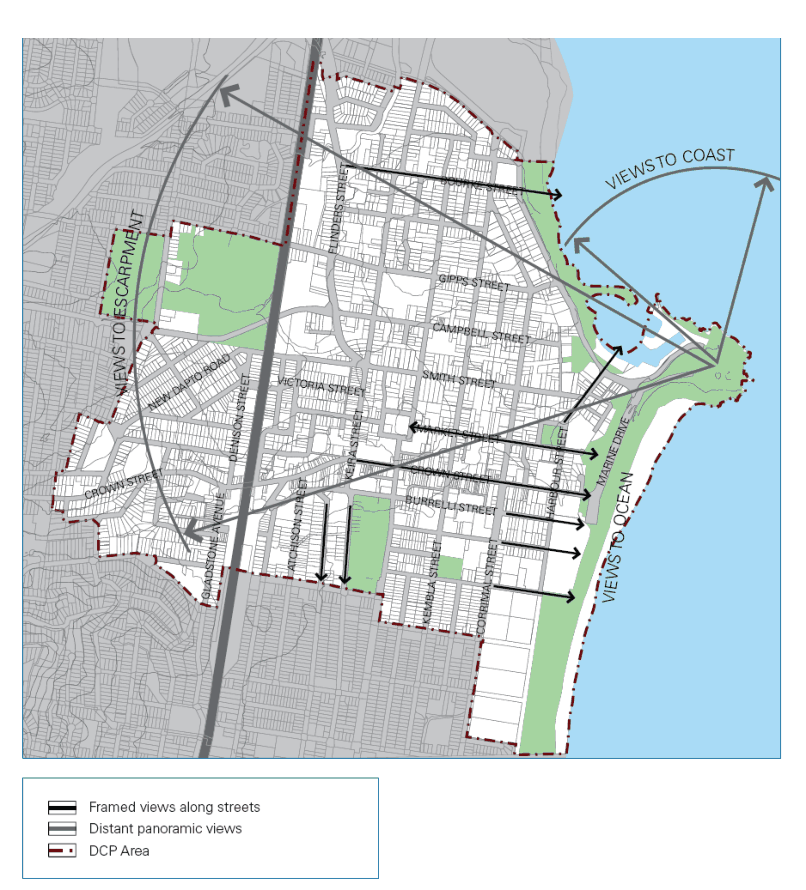

### 3.10 Views and view corridors

Views contribute to the character and amenity of a city, enhancing the sense of place and identity. The physical setting of the Wollongong city centre between the coast and escarpment provides for special views of this natural setting and associated elements.

It is important that views to the ocean and the escarpment be maintained from as many points as possible at street level. In the redevelopment of some sites consideration should be given to opening up new significant views. Views are regarded as significant when they terminate at places of architectural, landscape, or cultural significance.  This may include views of the foreshore, major parks or publicly significant objects or heritage buildings.

A silhouette is the outline of a building against the sky. The silhouettes of many buildings are significant and contribute to the identity of the commercial core of the city and its skyline. The massing and

arrangement of the skyline and existing building silhouettes should be carefully considered and proposed development should be carefully designed so that its appearance complements the city skyline.

#### 3.10.1 Objectives

a) To maintain and enhance views from the city centre to the foreshore, escarpment and significant objects (such as the lighthouse) wherever possible.

b) To enhance views along city streets.

c) To protect silhouettes of the tops of major buildings or structures as seen against the sky or backdrop of the escarpment or foreshore.

#### 3.10.2 Development Controls

a) Existing views shown in Figure 3.12 are to be protected to the extent that is practical in the planning and design of development.

b) The redevelopment of sites with potential to open a blocked view shown in Figure 3.12 must take into account the restoration of that view.

c) Align buildings to maximise view corridors between buildings.

d) Remove or avoid installation of built elements that obstruct significant views.

e) Carefully consider tree selection to provide views along streets in Figure 3.12 and keep under storey planting low where possible.

f) Site analysis must address views with the planning and design of building forms taking into account existing topography, vegetation and surrounding development.

> [Picture on page 46: a picture, saved as a picture (images/chapter-d13-wollongong-city-centre-page-46-1.gif, 150 dpi).]

#### Figure 3.12: Significant views
