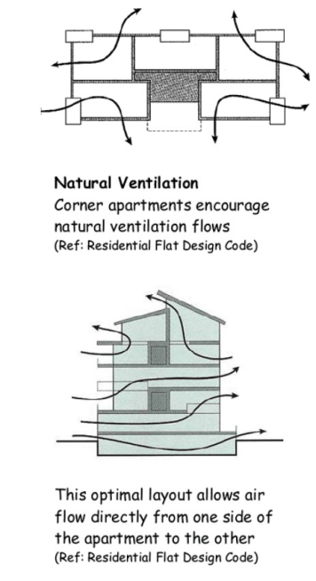

### 6.11 Natural ventilation

#### 6.11.1 Objective

a) Encourage apartment design which allows for natural ventilation of habitable rooms.

b) Provide natural ventilation in non-habitable rooms, where possible.

c) Reduce energy consumption by minimising the use of mechanical ventilation.

#### 6.11.2 Development Controls

a) Provide residential apartment buildings with a building depth of between 10 and 18m.  The depth is measured across the shortest dimension of the building.  Dwellings should be a maximum depth of 21m measured from the outside of the balcony.

b) Variation to this standard will only be considered where it can be demonstrated that apartments will achieve the minimum requirements with regard to natural ventilation.  This may be achieved where apartments have a wider frontage, or increased ceiling and window height to allow for greater penetration of natural light.  The building depth is measured across the shortest access, excluding the depth of any unenclosed balconies.

c) A minimum of sixty percent (60%) of all residential apartments shall be naturally cross ventilated.

> [Picture on page 62: a picture, saved as a picture (images/chapter-d13-wollongong-city-centre-page-62-1.gif, 150 dpi).]

#### Figure 6.1: Natural ventilation

d) Twenty five percent (25%) of kitchens within a development must have access to natural ventilation. Where kitchens do not have direct access to a window, the back of the kitchen must be no more than 8m from a window.

e) Single aspect apartments must be limited in depth to 8m from a window.
