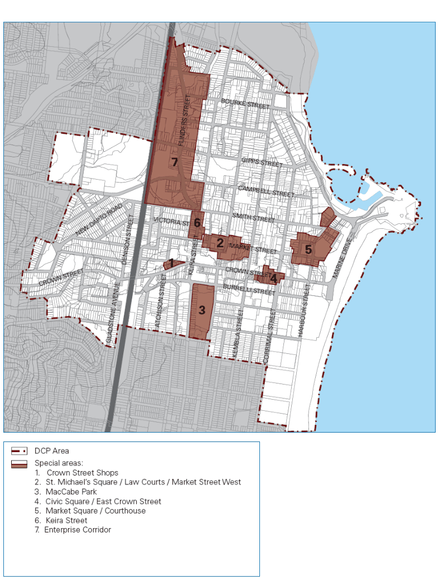

## 7 PLANNING CONTROLS FOR SPECIAL AREAS

The following controls are in addition to the general controls elsewhere in this part of the DCP. Controls for special areas apply to Heritage Conservation Areas and to special areas, including the Enterprise Corridor Zone, the Railway Precinct and the Civic and Cultural Precinct as identified in Figure 7.1.

> [Picture on page 66: a picture, saved as a picture (images/chapter-d13-wollongong-city-centre-page-66-1.gif, 150 dpi).]

#### Figure 7.1: Areas with special control/ principles
