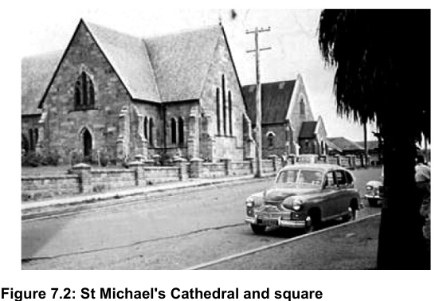

### 7.1 Special areas with heritage items

#### 7.1.1 Development of Heritage Items Generally

Heritage items are identified in Schedule 5 of the Wollongong Local Environmental Plan 2009 (LEP). Works to listed heritage items, or development on listed heritage sites, or within Heritage Conservation Areas, are subject to the provisions of Clause 35 of the LEP 2009.  As part of the assessment process, the consent authority must have regard to:

Heritage provisions in the City Centre LEP,

Wollongong Heritage DCP,

Heritage objectives as listed below,

The relevant Statement of Significance for each item,

The development principles and controls contained in this section,

Any conservation management plan, heritage impact statement or study required by the consent authority in response to proposed development of these areas, and

For development that affects a heritage item, information addressing relevant issues must be included in a Statement of Heritage Impact submitted with the development application (DA).

Development within the curtilage of a listed item, or a Heritage Conservation Area, or which will impact upon the setting of a heritage item or Heritage Conservation Area is also subject to the following provisions.  Where there is a discrepancy with general controls elsewhere in the DCP the following objectives and controls are to apply.

#### Objectives

a) To facilitate the conservation and protection of heritage items and Heritage Conservation Areas and their settings.

b) To reinforce the special attributes and qualities of heritage items by ensuring that development has regard to the fabric and prevailing character of the item or special area e.g., scale, proportions, materials and finishes.

c) To conserve, maintain and enhance existing views and vistas to buildings and places of historic and aesthetic significance.

> [Picture on page 67: a picture, saved as a picture (images/chapter-d13-wollongong-city-centre-page-67-20.gif, 150 dpi).]

Figure 7.2: St Michael's Cathedral and square

#### Conservation Criteria

As new development within the study area must ensure that the significance of heritage items and their setting are retained and enhanced. Development applications relating to heritage listed sites or sites within Heritage Conservation Areas must demonstrate how the proposed work will not adversely affect the heritage significance of the site and the area around it.

For sites in the vicinity of heritage items or Heritage Conservation Areas, an assessment of the impact of the proposal on the setting of nearby heritage items or Heritage Conservation Areas is to be undertaken.

Relevant criteria to be considered will vary for each proposal depending on the nature of development, the proximity of the development to surrounding heritage items and conservation areas as well as other factors. For this reason, each proposal will need to be considered on a case by case basis using the following general principles:

a) Scale. The scale and bulk of any new building or work must be in scale with the original building and new development must not obstruct important views or vistas of the item.  In the case of infill work in a conservation area, the scale of the new building must be similar to those around it. Where this is not feasible, sufficient curtilage around the heritage item must be included to assist interpretation of its heritage significance. In some circumstances, where site depth would allow, a higher building could be erected behind a heritage shopfront.

b) Siting. If the existing street façade of the building is sympathetic to the character of the street, then alteration must be avoided. New work is best located to the rear or side of the building.

c) Architectural form. The basic architectural form of any new work needs to respect what exists. Issues to consider are the roof form, proportion and location of windows and doors.

d) Architectural detailing. It is important to be aware of the particular era and architectural style of the building or buildings and make sure that any proposed changes are contextual to the period.  For example, it is not appropriate to mix Victorian features with a California Bungalow.  Overuse of historical architectural features on new work should be avoided, with preference given to uncomplicated interpretive forms and detailing.

e) Materials and finishes. Reuse existing materials where possible.  New materials and detailing must be compatible with the original and consideration must be given to the colour, texture and type of materials and finishes.

f) Use. The best use for a building is usually the one for which it is built.  Where this is not possible, a use sympathetic to the layout of the building and requiring minimal alterations will be more compatible.

g) Original fabric. It is important to minimise alterations to the original fabric and where possible, repair rather than replace individual elements, such as windows and doors.

h) The aging process. The patina of age on a building adds much to its character and significance.  A worn step for example demonstrates the many years of feet crossing a threshold.  Such features add to the uniqueness and character of a place and must be retained wherever this does not present a public safety risk.

i) Curtilage. There are three types of heritage curtilage:

i) Lot boundary. The lot boundary is the most common type of curtilage. It may contain associated buildings, gardens, walls, fences and the like which contribute to the significance of the property. The majority of built items in Wollongong are listed within their lot boundary curtilage.

ii) Reduced curtilage. This curtilage is less than the lot boundary of the property and it arises where the significance of the item and its interpretation is not dependant on having a large curtilage extending to a lot boundary. Examples are a large estate with sufficient land on the lot that can be subdivided independent of the heritage significance of any item on that land, or a new dwelling adjacent but not impacting on the existing heritage item on that land. In such cases, it is necessary to identify a curtilage that enables the heritage significance of the item to be retained, and

iii) Expanded curtilage. This curtilage is greater than the property boundary. An expanded curtilage may be required to protect that landscape setting or visual catchment of an item. For example, the significance of some properties includes a visual link between the property itself and a harbour, river or topographical feature.

j) Infill development. The key to successful infill development adjacent to a heritage item is reflected in design where the infill is of similar mass and character to the adjacent heritage building/s.  This may comprise use of the vertical (versus square) windows, verandas, balconies, positive roof pitches (i.e. 25 to 35 degrees) and general façade detailing. Buildings and landscaping may establish a character of an area and provide a sense of continuity and recognised community value. Unsympathetic infill will disrupt the unity of a group of buildings and may spoil the existing character. Architectural ‘good manners’ are important in areas of special character.  An infill building must not precisely imitate its neighbour but use recognisable tools such as massing, scale, setback and orientation, detailing and materials, roof forms and coursing lines to complement adjacent heritage items.

Refer to the joint NSW Heritage Office and RAIA publication “Designing in Context: Guidelines for infill Development in the Historic Environment” (2005) for further guidance.
