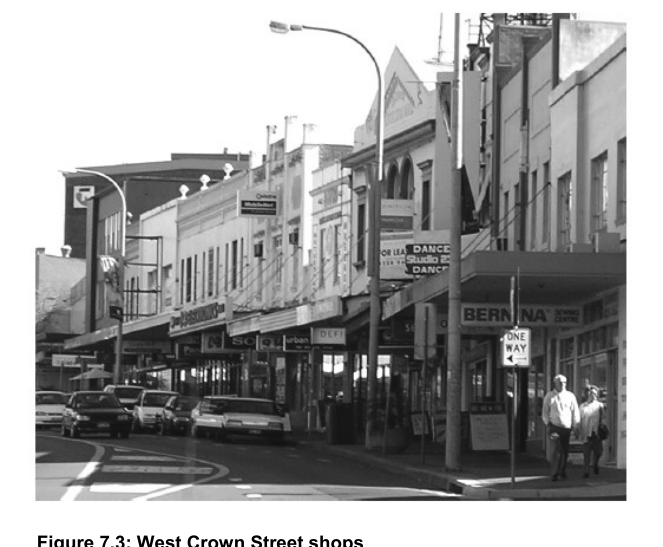
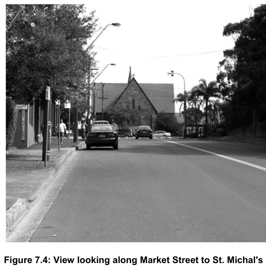
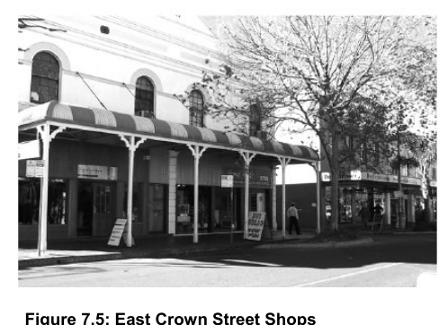
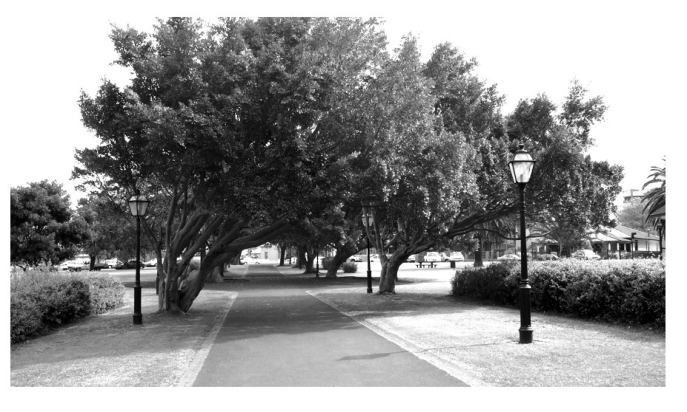
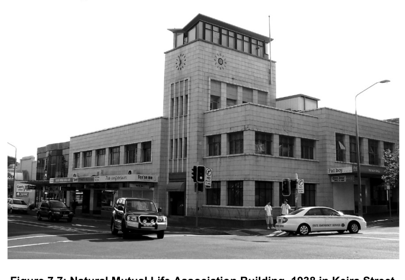

### 7.2 Special areas and Development Standards

These special areas are parts of the city centre that encompass one or more of the following:

A cluster of heritage items,

An important public domain area, or

A place that has strong community recognition as being linked to the origins of the city, its first plan and settlement.

These are identified in figure 7.1. Each area has its own set of objectives linked to the relevant development controls. These controls must be considered in addition to the other requirements of this section.

For the purposes of applying appropriate development controls, the North Beach Precinct and Belmore Basin Heritage Conservation Area which is listed as a State significant item in the WLEP 2009 and the North Beach Heritage Precinct which is listed on the State Heritage Register are considered under the controls established in the Conservation Management Plans.

#### 7.2.1 Area 1: West Crown Street Shops Objectives

a) Promote conservation of early federation row of two-storey shops.

b) Preserve the curvature of Crown Street to the point where it connects to West Crown Street.

c) Preserve existing narrow lot layout as a reflection of early city subdivision patterns.

d) Reduce number of over-scaled and inappropriate advertising signs.

e) Encourage conservation of shop façade (including paintwork and possible restoration of classical detailing below awning level).

f) Alleviate overshadowing and wind impacts on the streetscape.

g) Promote consistency of street treatments such as awnings and lighting.

#### Development Standards

a) Development in Area 1 must comply with the conservation criteria and development controls provided under Section 7.1.

b) New development must retain and interpret the existing shopfront facades as part of the building design.

c) New development and renovation of buildings must be designed by a suitably qualified registered architect.

d) Shopfronts must be a maximum of six metres wide to retain fine grain of built form.

e) Any other heritage conservation requirements of Council must be addressed.

#### Height

i) A two-storey street wall must be retained with a minimum setback of four metres at the third storey.

ii) Maximum building height to comply with the LEP 2007 and the sun access requirements.

#### Signage (refer also section 3.8 Advertising and Signage)

i) Outdoor advertising signs and lighting must complement and be compatible with the building design in scale, style and colour.

ii) Late 19th/early 20th Century style of outdoor advertising signs is required.

iii) No signage is permitted on the roof of awnings or on structures extending above the awning.

iv) Signs relating to products are not permissible over street awnings.

> [Picture on page 70: a picture, saved as a picture (images/chapter-d13-wollongong-city-centre-page-70-7.gif, 150 dpi).]

Figure 7.3: West Crown Street shops

#### 7.2.2 Area 2: St Michael’s Square/Law Courts/Market St West Objectives

a) To maintain the established moderate scale and civic nature of the square and civic buildings.

b) To preserve the significant view looking West along Market Street to St Michael’s Cathedral and east along Market Street towards the coast.

c) To maintain the view of the square from Church Street and the mall looking north.

d) To maintain the courthouse clock tower and Cathedral steeples as the highest structures on the hill.

#### Development Controls

a) Development in Area 2 must comply with the conservation criteria and development controls provided under section 7.1.

b) The view of the cathedral against the skyline looking west along Market Street must be maintained. Future developments that propose to penetrate this view will not be permitted.

c) The height of new developments immediately west of St Michael’s must not exceed the existing ridgeline of the cathedral (R.L 43.45 AHD).

d) Development surrounding St Michael’s Square must be designed so as not to compromise the existing views to be appreciated to and from the site in other directions.

e) Building lines for any future development within and surrounding this site (such as land to the north of St Michael’s Square) must align with the existing zero front setback of the cathedral and its associated buildings.

f) Four metre front setback to all new development fronting Market Street east of St Michael’s Church.

g) New development and renovation of buildings must be designed by a suitability qualified registered architect.

h) Shopfronts must be a maximum of six metres wide to retain fine grain of built form.

#### 7.2.3 Area 3: MacCabe Park Objectives

a) To enhance the spatial definition of the edges of MacCabe Park.

b) To encourage a high level of daylight access to the public domain.

c) To promote passive surveillance and greater utilisation of the park.

d) To promote active and passive recreation opportunities.

#### Development Controls

a) Development in Area 3 must comply with the conservation criteria and development controls provided under section 7.1

b) Any development surrounding the park must comply with the street edge height requirements shown in sun access diagrams in Figure 2.17 of this DCP.

c) Any development of MacCabe Park must be in accordance with a plan of management for the park.

> [Picture on page 71: a picture, saved as a picture (images/chapter-d13-wollongong-city-centre-page-71-17.gif, 150 dpi).]

Figure 7.4: View looking along Market Street to St. Michal's Cathedral

#### 7.2.4 Area 4: East Crown Street Objectives

a) To consolidate the remaining heritage character along east Crown Street between Kembla and Corrimal Streets.

b) To promote appropriate and pleasant spatial links between the railway station and the foreshore.

c) To alleviate overshadowing and undesirable wind action on prominent public and private open spaces.

d) To encourage tourism, recreational and cultural uses and activities in appropriate locations, especially east of Corrimal Street.

#### Development Controls

a) Development in Area 4 must comply with the conservation criteria and development controls provided under Section 7.1.

b) New Development and renovation of buildings must be designed by a suitably qualified registered architect.

c) Residential development is only permitted in the form of mixed use development with at least the ground floor providing for shops, restaurant or commercial premises.

#### Building Height

a) A 9m high street wall must be retained with a minimum setback of at least 10 metres at the third storey and above on the northern side of the street (to maintain winter sunlight to the street).

b) Maximum building height must not exceed the height specified in the LEP 2007.

> [Picture on page 72: a picture, saved as a picture (images/chapter-d13-wollongong-city-centre-page-72-14.gif, 150 dpi).]

Figure 7.5: East Crown Street Shops

#### Façade

a) Ground and first floor frontages of new buildings along East Crown Street from Kembla Street to Corrimal Street must be sympathetic to the late 19th Century Victorian and Italianate shop front styles without creating repetition of such styles.

b) The appearance of building external finishes and colour must promote a sense of unity and character that consolidates the heritage environment.

#### Signage (refer also section 3.8 Advertising and Signage)

a) Outdoor advertising signs and lighting must complement and be compatible with the building design in scale, style and colour.

b) 19th Century styles of outdoor advertising signs may be considered along Crown Street between Kembla and Corrimal Streets.

c) Signs relating to products are not permissible over street awnings.

d) No signage is permitted on the roof of awnings or on structures extending above the awning.

> [Picture on page 73: a picture, saved as a picture (images/chapter-d13-wollongong-city-centre-page-73-1.gif, 150 dpi).]

#### Figure 7.6: Market Square

#### 7.2.5 Area 5: Market Square Objectives

a) To retain the established residential character and moderate scale of development on land surrounding Market Square.

b) To maintain a high level of daylight access to the public domain.

#### Development Controls

a) Development in Area 5 must comply with the conservation criteria and development controls provided under section 7.1.

b) The maximum height of all development must not exceed heights defined in the LEP 2007.

c) A minimum front setback of four metres for new development is required to enhance the spatial definition of the edges of Market Square.

#### 7.2.6 Area 6: Keira Street Objectives

a) Reinforce and emphasise the historical street proportions and street wall of main street shop typologies along Keira Street.

b) Retain the fine grain of shop front facades.

c) Encourage further agglomeration of active uses (day and night) such as boutique restaurants, speciality shops, grocery stores, clubs and pubs (that characterise land north and south of Victoria Street).

d) New development is to complement and not compete with the existing landmark on the northeast corner of Market and Keira Streets (formerly the National Mutual Life Association Building).

#### Development Controls

a) Development in Area 6 must comply with the conservation criteria and development controls provided under Section 7.1.

#### Building Height

a) Maximum building height must not exceed 24 metres.

#### Setbacks

b) Front setback for two-storeys to be zero metres.  Zero setback on the ground floor is to be strictly enforced for 100% of the street frontage.

c) Front setback for third storey to be minimum four metres. New development on corner sites must maintain zero metres setback for 8m to 12m from the corner on the third storey.

d) Side setbacks to be zero metres for a depth of 18m from the front boundary.

#### Façade

a) Finished floor level of ground to be no greater than 500m above the footpath level at any point on the street façade.

b) Non-structural verandah posts located minimum 500mm from the road are encouraged.

c) The top of the three-storey base to Keira Street is to finish with a parapet wall. If the building is only three storeys high a pitched roof of 25 to 35 degrees is also allowable.

d) External materials are to be rendered brickwork painted with at least two colours, face brickwork or tiles.  If face brickwork is used it is to match the colour of the bricks used at the Illawarra Hotel or upper floors of 135-145 Keira Street.  The principal colour of any paintwork is to be in the heritage colour palette of brown or cream.

e) The ground floor façade is to include fenestration detailing to emulate the five metres grain of shop fronts existing on Keira Street.

#### Signage (refer also Section 3.8 Advertising and Signage)

a) No signage permitted on the roof of awnings or on structures extending above the awning.

b) Signs relating to products are not permissible over street awnings.

c) Outdoor advertising signs and lighting must be compatible with the building design, style and colour.

> [Picture on page 74: a picture, saved as a picture (images/chapter-d13-wollongong-city-centre-page-74-22.gif, 150 dpi).]

#### Figure 7.7: Natural Mutual Life Association Building, 1938 in Keira Street
