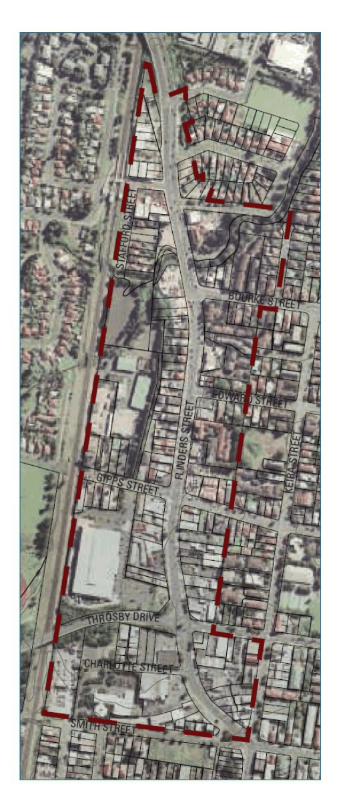

### 7.3 Non-residential development in the enterprise corridor zone

The Enterprise Corridor zone is identified as Area 7 in Figure 7.3. It allows for a range of commercial uses including industrial/warehouse uses, commercial offices and retailing as well as residential uses. The following controls seek to ensure that new development is compatible with existing land uses, and provide for a mix of business and employment uses and retail development as well as individual/warehouse development appropriate to its setting along a major approach to the city’s commercial core.

The following controls apply to all non-residential development and are in addition to controls elsewhere in this part of the DCP. Where the controls in this section differ (except in relation to residential development), they shall override the requirement elsewhere in this part of the DCP.

#### 7.3.1 Objectives

a) To ensure that new development is compatible with surrounding land uses.

b) To promote streets with pedestrian activity, amenity and safety.

c) To promote high quality well designed buildings.

d) To provide for buildings fronting the street and legible street addresses and access.

e) To ensure that high quality materials and finishes are used for buildings and the public domain.

f) To provide for infiltration of stormwater below the ground surface and reduce stormwater runoff.

g) To improve pedestrian and vehicle access and connections within the zone and with the city centre.

h) To minimise and control vehicle access off Flinders Street (Princes Highway).

i) To promote Flinders Street as a ‘boulevard’ providing a gateway entrance to the commercial core.

j) To ensure that new development has appropriate access.

k) To discourage subdivisions of land into small lots without a detailed plan.

#### 7.3.2 Development Controls Land use

a) In determining a development application, Council is to consider the suitability of proposed development in terms of its compatibility with existing development and impact on the amenity of surrounding properties relating to noise, vibration, odour, fumes, smoke, dust, waste and light spillage.

b) Preferred areas for residential and mixed development are in 400m radius of North Wollongong Railway Station, to the eastern side of the area, abutting the general residential zone, and near open space areas (refer figure 7A).

c) Preferred areas for commercial, retail and enterprise uses are fronting Flinders Street and on the southern part of the zone away from open space.

d) Commercial office uses and retail uses in new mixed use development are to be located at ground level addressing the street frontage.

#### Building form

a) Buildings are to front the street and provide a clear street address.

b) Buildings are to present legible vehicle and pedestrian access points.

c) Servicing areas and mechanical/electrical plants are to be screened from view from the public domain.

d) A maximum of two advertising signs is allowed per building.  Each sign is to relate to the use of the building.  Refer to Section 3.7 of this part of the DCP for further controls and guidelines for signs.

#### Landscaping

a) Front building setbacks, including any car parking areas, are to include landscaping.

b) Use existing and new drainage lines and channels for landscaped open space and stormwater management measures such as detention.

c) No fences are to be provided on street frontages.

#### Access, road connections and parking

a) Vehicle and pedestrian access points are to be clear and legible.

b) Driveways should be located more than 6m from an intersection or break in median strip, 25m from traffic lights and 1.5m to side boundaries.

c) Car parking for commercial office and retail buildings, service areas and storage yards are to be located to the rear of buildings in basements – not on the street frontage.

d) Industrial/warehouse buildings may have some car parking located in the front street setback subject to being integrated with approved landscaping.

#### Subdivision

a) The minimum site area for subdivision that is not part of a development application for building envelopes is 1,000 square metres.

> [Picture on page 77: a picture, saved as a picture (images/chapter-d13-wollongong-city-centre-page-77-1.gif, 150 dpi).]

#### Figure 7.8: Enterprise Corridor
