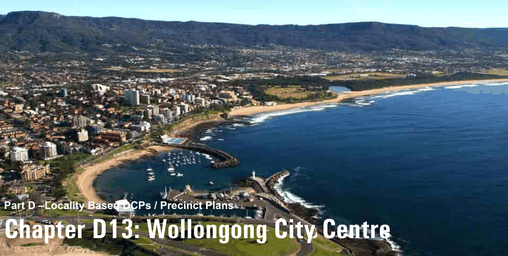
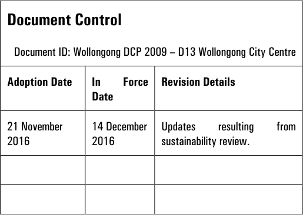

# Wollongong Development Control Plan 2009 - Chapter D13 Wollongong City Centre

> This chapter is split into 56 section file(s), one per numbered heading, in the order they appear in the PDF.

Source PDF: [Wollongong-DCP-2009-Chapter-D13-Wollongong-City-Centre-Precinct.pdf](https://planfortomorrow.sharepoint.com/sites/Planfortomorrow/Shared%20Documents/00%20NSW-Planning-Resources/dcp/wollongong-development-control-plan-2009/chapter-d13-wollongong-city-centre/Wollongong-DCP-2009-Chapter-D13-Wollongong-City-Centre-Precinct.pdf)

> [Picture on page 1: a picture, saved as a picture (images/chapter-d13-wollongong-city-centre-page-1-1.gif, 150 dpi).]

#### Part D –Locality Based DCPs / Precinct Plans

### Chapter D13: Wollongong City Centre

> The PDF's contents list (page numbers of the printed document) is not repeated here - see Sections below.

i

| 7.3 | Non-residential development in the enterprise corridor |  |
|---|---|---|
|  | zone | 72 |
| 7.4 | Special area design guidelines | 75 |
| 7.5 | Design excellence | 76 |
| 8 | WORKS IN THE PUBLIC DOMAIN | 77 |
| 9 | GLOSSARY / DEFINITIONS | 78 |

### Figures

Figure 2.22: The sun access plane formula diagram ............ 26 Figure 3.1: Permeability ............................................. 29 Figure 3.2: Lanes and arcades add to the richness of a city .. 30

#### Figure 3.3: Active street frontages promote safe pedestrian

environment ........................................................... 31 Figure 3.4: Active street frontages ................................ 32

#### Figure 3.5: Continuous street awnings offer good pedestrian

amenity ................................................................ 33 Figure 3.6: Awnings ................................................. 35 Figure 3.7: Restrictions on vehicular entries ..................... 36 Figure 3.8: Driveway crossing dimensions ....................... 37

Figure 1.1: Map of DCP Area ........................................ 1 Figure 1.2: Land Zoning Map ......................................... 4 Figure 2.1: Building lines and street setbacks ..................... 7 Figure 2.2: Specific street alignment and street setbacks ...... 8

#### Figure 3.9: Select high quality masonry finishes with accent

colours ................................................................. 40 Figure 3.10: Under awning signage ............................... 40 Figure 3.11: Signage Zones ......................................... 41 Figure 3.12: Significant views ..................................... 44 Figure 6.1: Natural ventilation ..................................... 60 Figure 7.1: Areas with special control/ principles ............... 64 Figure 7.2: St Michael's Cathedral and square .................. 65 Figure 7.3: West Crown Street shops ............................. 68

#### Figure 7.4: View looking along Market Street to St. Michal's

Cathedral .............................................................. 69 Figure 7.5: East Crown Street Shops ............................. 70 Figure 7.6: Market Square .......................................... 71 Figure 7.7: Natural Mutual Life Association Building, 1938 in Keira Street ........................................................... 72 Figure 7.8: Enterprise Corridor ..................................... 75

> [Picture on page 2: a picture, saved as a picture (images/chapter-d13-wollongong-city-centre-page-2-34.gif, 150 dpi).]

### Document Control

#### Document ID: Wollongong DCP 2009 – D13 Wollongong City Centre

| Adoption Date | In Date | Force | Revision Details |  |
|---|---|---|---|---|
| 21 November | 14 December |  | Updates resulting | from |
| 2016 | 2016 |  | sustainability review. |  |

Figure 2.3: Permissible street frontage heights ................... 9 Figure 2.4: In the Commercial Core buildings are to be built to street alignment with upper level set back ...................... 10

#### Figure 2.5: In residential locations buildings to have landscaped

setbacks ............................................................... 11 Figure 2.6: Building bulk controls .................................. 12 Figure 2.7: Building depth controls ................................ 12 Figure 2.8 (left): Side setbacks for all development in the Commercial Core ..................................................... 15

#### Figure 2.9: Side setbacks for all development in all zones except

in the Commercial Core.............................................. 16

#### Figure 2.10: Rear setback for all development in all zones except

in the Commercial Core.............................................. 16 Figure 2.11: Separation for multiple buildings on a single site in the Commercial Core and Mixed Use (city edge) zones ........ 16 Figure 2.12: Mixed use buildings .................................. 17 Figure 2.13: Communal Public Space with deep soil allows for tree planting and high quality landscape ......................... 18 Figure 2.14: Encourage high quality landscape on structures and in internal communal courtyards ................................... 20 Figure 2.15: Planting on root structures and terraces creates an interesting outlook from adjacent adjoining buildings .......... 20 Figure 2.16: Special building envelope control locations ....... 23

#### Figure 2.17 (top): Sun access diagram heights contours showing

maximum heights above ground ................................... 24

#### Figure 2.18 (bottom) Sun access diagram, height contours

showing maximum building heights above ground .............. 24

#### Figure 2.19: (top) Sun access diagram heights contours showing

maximum building height above ground ........................... 25

#### Figure 2.20: (middle) Sun access diagram height contours

showing maximum building height above ground ................ 25

#### Figure 2.21: (bottom) Sun access diagram height contours

showing maximum building height above ground ................ 25

ii

<!-- sections -->
## Sections

1. [1 INTRODUCTION](01-introduction.md)
2. [1.1 City Centre Character Areas](02-1-1-city-centre-character-areas.md)
3. [2.1 General](03-2-1-general.md)
4. [2.2 Building to street alignment and street setbacks](04-2-2-building-to-street-alignment-and-street.md)
5. [2.3 Street frontage heights in commercial core](05-2-3-street-frontage-heights-in-commercial.md)
6. [2.4 Building depth and bulk](06-2-4-building-depth-and-bulk.md)
7. [2.5 Side and rear building setbacks and building separation](07-2-5-side-and-rear-building-setbacks-and.md)
8. [2.6 Mixed used buildings](08-2-6-mixed-used-buildings.md)
9. [2.7 Deep soil zone](09-2-7-deep-soil-zone.md)
10. [2.8 Landscape design](10-2-8-landscape-design.md)
11. [2.9 Green roofs, green walls and planting on structures](11-2-9-green-roofs-green-walls-and-planting-on.md)
12. [2.10 Sun access planes](12-2-10-sun-access-planes.md)
13. [2.11 Development on classified roads](13-2-11-development-on-classified-roads.md)
14. [3.1 General](14-3-1-general.md)
15. [3.2 Permeability](15-3-2-permeability.md)
16. [3.3 Active street frontages](16-3-3-active-street-frontages.md)
17. [3.4 Safety and security](17-3-4-safety-and-security.md)
18. [3.5 Awnings](18-3-5-awnings.md)
19. [3.6 Vehicular footpath crossings](19-3-6-vehicular-footpath-crossings.md)
20. [3.7 Pedestrian overpasses, underpasses and encroachments](20-3-7-pedestrian-overpasses-underpasses-and.md)
21. [3.8 Building exteriors](21-3-8-building-exteriors.md)
22. [3.9 Advertising and signage](22-3-9-advertising-and-signage.md)
23. [3.10 Views and view corridors](23-3-10-views-and-view-corridors.md)
24. [4.1 General](24-4-1-general.md)
25. [4.2 Pedestrian access and mobility](25-4-2-pedestrian-access-and-mobility.md)
26. [4.3 Vehicular driveways and manoeuvring areas](26-4-3-vehicular-driveways-and-manoeuvring.md)
27. [4.4 On-site parking](27-4-4-on-site-parking.md)
28. [4.5 Site facilities and services](28-4-5-site-facilities-and-services.md)
29. [5.1 General](29-5-1-general.md)
30. [5.2 Energy efficiency and conservation](30-5-2-energy-efficiency-and-conservation.md)
31. [5.3 Water conservation](31-5-3-water-conservation.md)
32. [5.4 Reflectivity](32-5-4-reflectivity.md)
33. [5.5 Wind mitigation](33-5-5-wind-mitigation.md)
34. [5.6 Waste and recycling](34-5-6-waste-and-recycling.md)
35. [6.1 SEPP 65 and Apartment Design Guide](35-6-1-sepp-65-and-apartment-design-guide.md)
36. [6.2 Housing choice and mix](36-6-2-housing-choice-and-mix.md)
37. [6.3 Dwelling houses](37-6-3-dwelling-houses.md)
38. [6.4 Multi dwelling housing](38-6-4-multi-dwelling-housing.md)
39. [6.5 Dual occupancy](39-6-5-dual-occupancy.md)
40. [6.6 Basement Car parks](40-6-6-basement-car-parks.md)
41. [6.7 Communal open space](41-6-7-communal-open-space.md)
42. [6.8 Private open space](42-6-8-private-open-space.md)
43. [6.9 Overshadowing](43-6-9-overshadowing.md)
44. [6.10 Solar access](44-6-10-solar-access.md)
45. [6.11 Natural ventilation](45-6-11-natural-ventilation.md)
46. [6.12 Visual privacy](46-6-12-visual-privacy.md)
47. [6.13 Acoustic Privacy](47-6-13-acoustic-privacy.md)
48. [6.14 Storage](48-6-14-storage.md)
49. [7 PLANNING CONTROLS FOR SPECIAL AREAS](49-7-planning-controls-for-special-areas.md)
50. [7.1 Special areas with heritage items](50-7-1-special-areas-with-heritage-items.md)
51. [7.2 Special areas and Development Standards](51-7-2-special-areas-and-development-standards.md)
52. [7.3 Non-residential development in the enterprise corridor zone](52-7-3-non-residential-development-in-the.md)
53. [7.4 Special area design guidelines](53-7-4-special-area-design-guidelines.md)
54. [7.5 Design excellence](54-7-5-design-excellence.md)
55. [8 WORKS IN THE PUBLIC DOMAIN](55-8-works-in-the-public-domain.md)
56. [9 GLOSSARY / DEFINITIONS](56-9-glossary-definitions.md)
