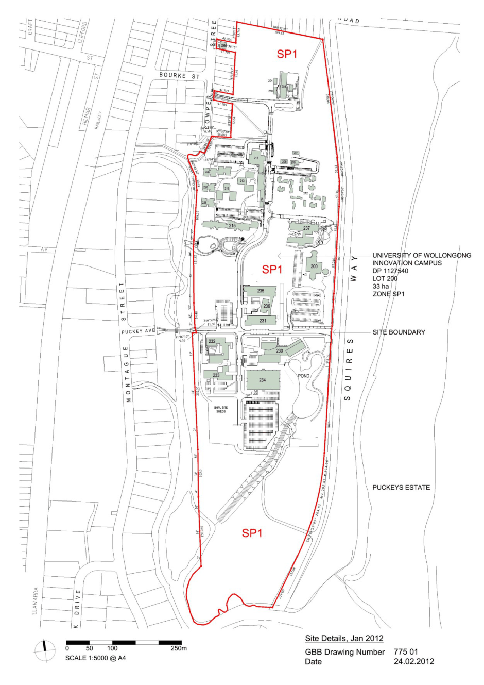

## 1 INTRODUCTION

### 1.1 Key Master Plan Outcomes

1\. The key outcomes of the Wollongong Innovation Campus Precinct Plan are to:

(a) Generate employment and promote economic growth in the Illawarra Region;

(b) Promote and foster collaborative research and development initiatives involving tenants of the Wollongong Innovation Campus, the University of Wollongong and other enterprises in the Illawarra Region;

(c) Encourage creative interaction between organisations and individuals on the campus and the development of a sense of community;

(d) Provide offices and facilities for organisations involved in a range of research and development activities;

(e) Integrate workplace and educational environments with social, retail, service and recreational facilities in a landscaped campus setting; and

(f) Provide on-site residential accommodation linked to the University student accommodation and Wollongong Innovation Campus facilities.

### 1.2 Innovation Evidence

1\. Innovation will be evident:

(a) In the research and development processes and outcomes from activities on the site;

(b) In the stimulus for new high technology businesses to establish in the region;

(c) In the development partnership for the project involving the University of Wollongong, Wollongong City Council and the NSW State Government;

(d) In the relationship between the Precinct plan and the various statutory planning requirements;

(e) In the integration of commercial workplace environments with social, retail, residential, service and recreational facilities in a landscaped campus setting;

(f) In the physical development of the site including: (a) landscaping / riparian setback (b) rehabilitation (c) transport strategy initiatives (d) incorporation of ecologically sustainable development initiatives (e) water sensitive urban design; and

(g) In architectural and built environment outcomes.

### 1.3 Precinct Plan Objectives

1\. The key objectives of the Precinct plan are:

a) To state the goals of the planning process in support of the project vision;

b) To establish the intended future character of the development;

c) To provide the site with a sense of place that proclaims its purpose, distinction and domain;

d) To provide a planning framework to facilitate the staged development of the site by the University of Wollongong;

e) To establish a framework flexible enough to accommodate changing circumstances and conditions;

f) To provide a plan to facilitate and ensure that physical resources are effectively managed; and

g) To provide guidelines for the development of individual buildings.

> [Picture on page 10: a picture, saved as a picture (images/chapter-d14-wollongong-innovation-campus-page-10-1.gif, 150 dpi).]

#### Figure 1: Land to which the Precinct Plan applies.
