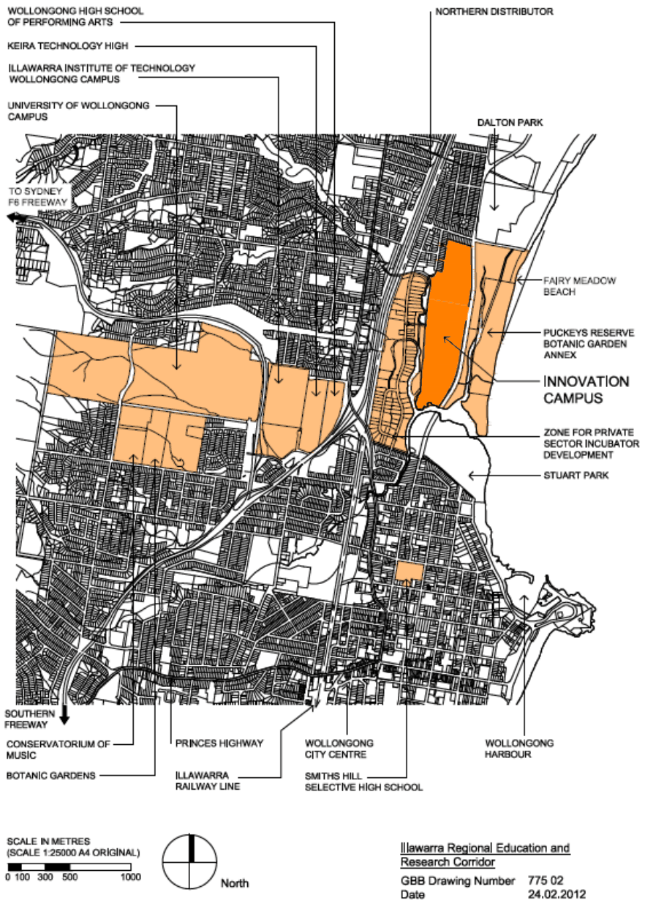
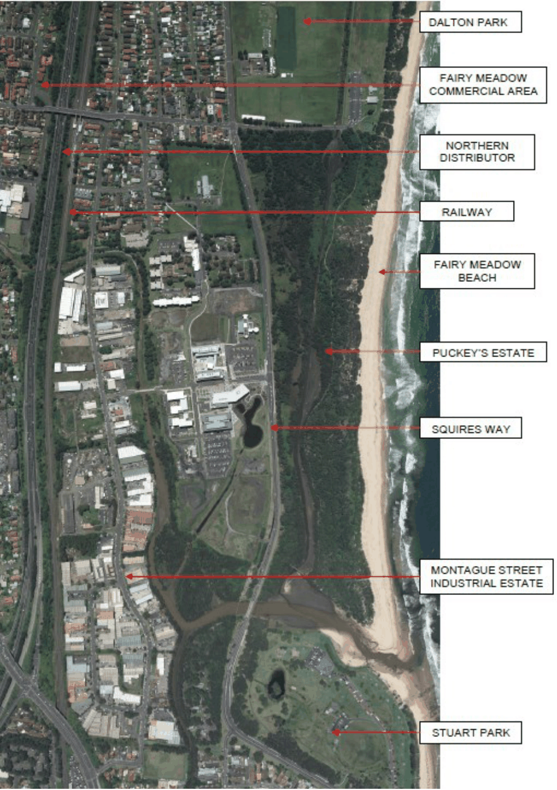
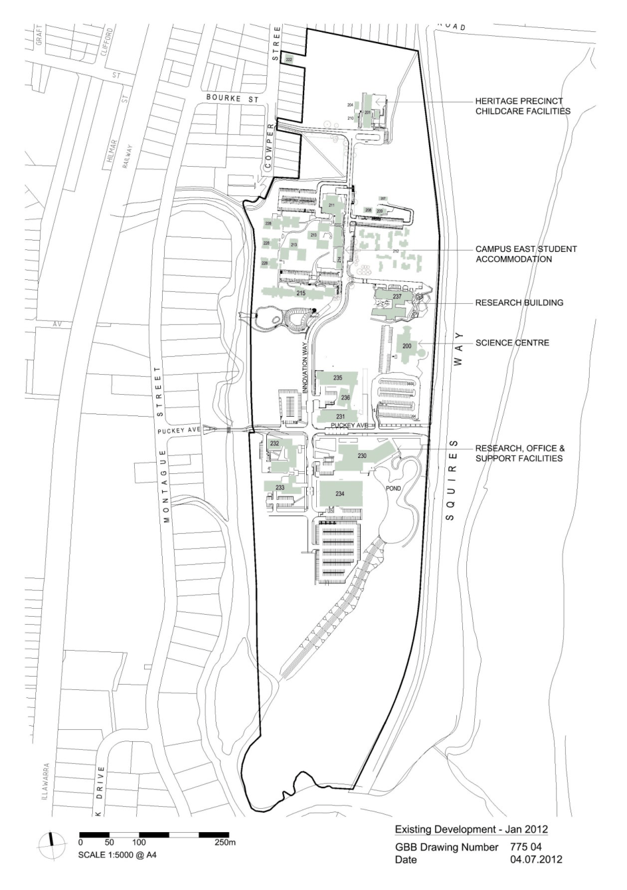
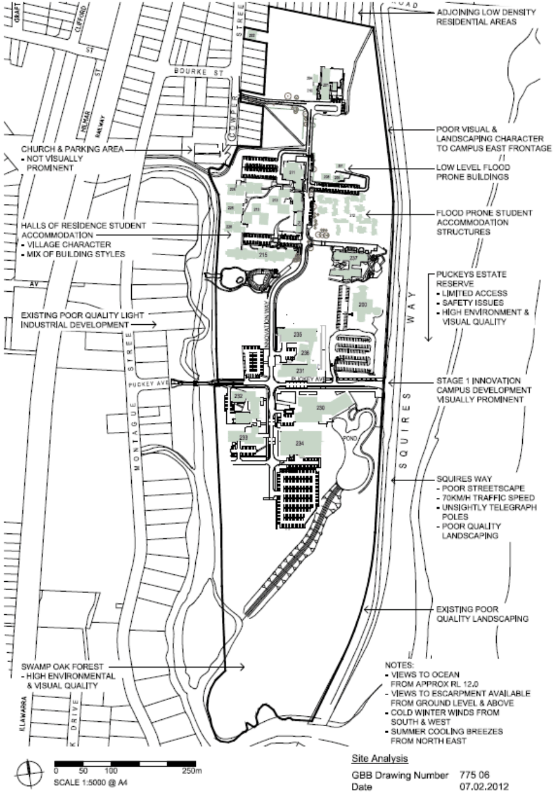

## 3 ENVIRONMENTAL PLANNING CONTEXT AND SITE ANALYSIS

### 3.1 Site investigations

1\. A number of site investigations and reports have been undertaken in the preparation of the Precinct plan and development (since 2003). Current reports which are relevant to further development are noted below (Note: for site reference locations refer to Fig. 10):

#### Geotechnical and Environmental Assessment:

Preliminary Geotechnical Investigation Brandon Park Fairy Meadow, Coffey Geosciences (August 2002)

Stage 1 Geotechnical Investigations and Environmental Assessment, Innovation Campus, Volume 1 of 2, Coffey Geosciences (July 2004)

Stage 1 Geotechnical Investigations and Environmental Assessment, Innovation Campus, Volume 2 of 2, Coffey Geosciences (July 2004)

Acid Sulfate Soil management plan, Innovation Campus, Coffey GeoSciences (Oct 2004)

Additional Geotechnical Investigations Central Facilities Building, Pond and Waterway, Innovation Campus, Coffey GeoSciences (January 2007)

Site C3 Geotech Investigations, Innovation Campus, Coffey GeoSciences (August 2007)

Site C5 and W6, Geotech Investigations, Innovation Campus, Douglas Partners (Nov 2007)

Site W6, Phase 2 Contamination Report, Innovation Campus, Douglas Partners (Jan 2008)

Site W5, Geotech Investigations, Innovation Campus, Douglas Partners (Dec 2008)

Waste Classification Assessment, Southern Stockpile, Innovation Campus, Douglas Partners (June 2010)

Electrical Resistivity Testing, Innovation Campus, Coffey GeoSciences (August 2004)

Groundwater Inflow Assessment, Central Facilities Building, Innovation Campus, Coffey GeoSciences (April 2005)

Stage 2.1 GeoTechnical Investigations, Stormwater Pond, Innovation Campus, Douglas Partners (August 2009)

Stage 2.1 Geotechnical Investigations, Road Extensions, Innovation Campus, Douglas Partners (August 2009)

Stage 2.1 GeoTechnical Investigations, Pond Basin Lab Testing, Innovation Campus, Douglas Partners (September 2009)

Wind Turbine, GeoTechnical Investigations, Coffey GeoTechnics (Nov 2009)

Site C5 GeoTech Investigations, Innovation Campus, Douglas Partners (August 2009)

Site C2 GeoTech Investigations, Innovation Campus, Douglas Partners (Sept 2009)

Site SBRC GeoTech Investigations, Innovation Campus, Coffey GeoTechnics (June 2011)

Puckey Avenue Bridge, Contamination Assessment Rht, Innovation Campus, Douglas Partners (Dec 2011)

Puckey Avenue Bridge, GeoTech Investigations, Innovation Campus, Douglas Partners (Dec 2011)

#### Heritage

Assessment Study of European Heritage, Brandon Park, Fairy Meadow, Colin Brady Architect & Planning (August 2002)

Aboriginal archaeological Assessment, Navin Officer Heritage Consultants (July 2002)

Assessment of Heritage Significance, Nissen Huts, Campus East, Civic Lucas Stapleton & Partners (Aug 2002)

Statement of Assessment (Preliminary) proposed options, Nissen Type Huts, Borst Architects Pty Ltd (Nov 2002)

#### Flora and Fauna

Flora and Fauna Assessment, Innovation Campus, Kevin Mills & Associates (July 2002)

Cabbage Tree Creek, Vegetation Management Plan, Southern Habitat (June 2008)

Stage 2.1 Flora and Fauna Assessment, Innovation Campus, Kevin Mills & Associates (June 2009)

Puckey Avenue Bridge, Flora and Fauna Assessment, Innovation Campus, Kevin Mills & Associates (Dec 2011)

#### Flood Management

Flood Management Study, Masterplan Review 2011-12, Innovation Campus, Cardno (July 2012)

Flood Management Strategy, Innovation Campus, Cardno (July 2016)

#### Transportation and Traffic

Transport Study (original) Innovation Campus, Forbes Rigby (Dec 2002)

Car Parking Strategy, Innovation Campus, Cardno FR (March 2008)

Traffic and Transport Assessment Innovation Campus, AECOM (March 12)

Paramics Base Year Model Calibration and Validation Report, AECOM (March 12)

#### Sustainability

Water Sensitive Design Issues, Innovation Campus, Forbes Rigby (Dec 2002)

Water Sensitive Urban Design, Innovation Campus, Cardno (May 2012)

2\. The attached: Figure 2, Figure 3, Figure 4,indicate a summary of the existing conditions.

> [Picture on page 15: a picture, saved as a picture (images/chapter-d14-wollongong-innovation-campus-page-15-2.gif, 150 dpi).]

#### Figure 2: Illawarra Regional Education and Research Corridor

> [Picture on page 16: a picture, saved as a picture (images/chapter-d14-wollongong-innovation-campus-page-16-1.gif, 150 dpi).]

#### Figure 3: Site Context

> [Picture on page 17: a picture, saved as a picture (images/chapter-d14-wollongong-innovation-campus-page-17-1.gif, 150 dpi).]

#### Figure 4: Existing Development

> [Picture on page 18: a picture, saved as a picture (images/chapter-d14-wollongong-innovation-campus-page-18-1.gif, 150 dpi).]

#### Figure 5: Site Analysis
