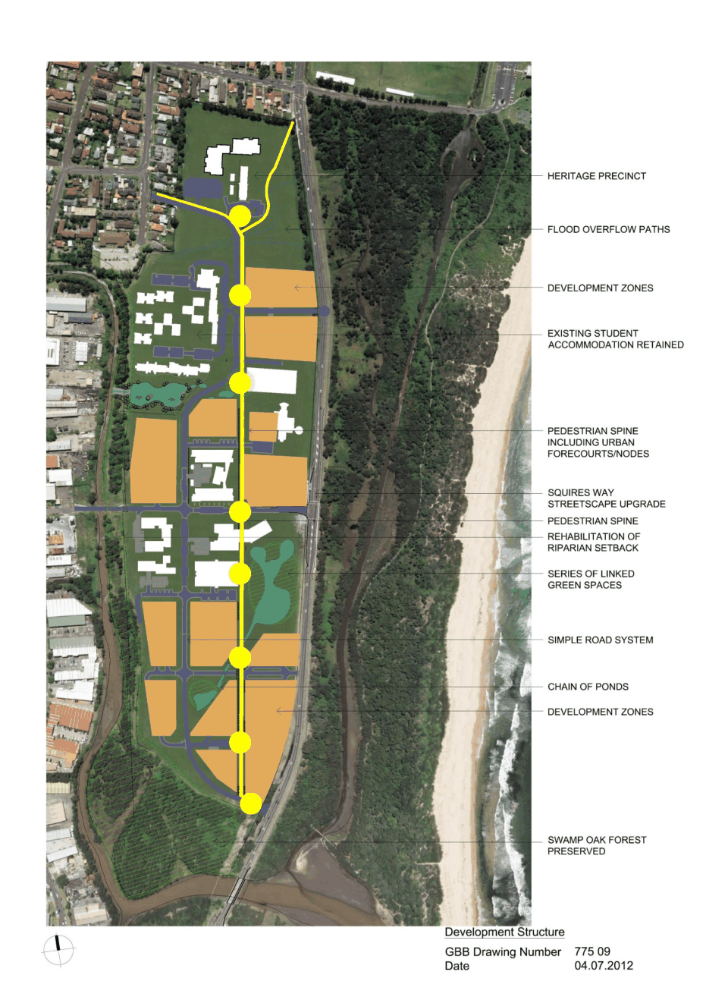
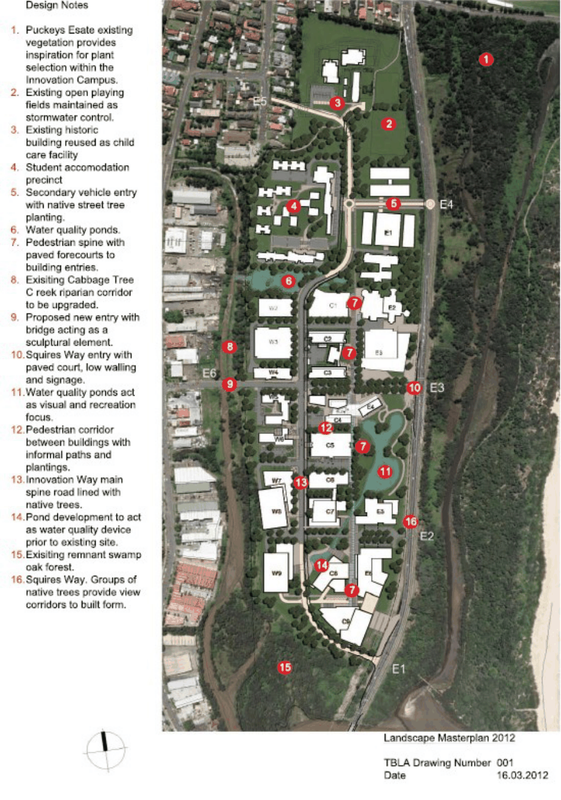
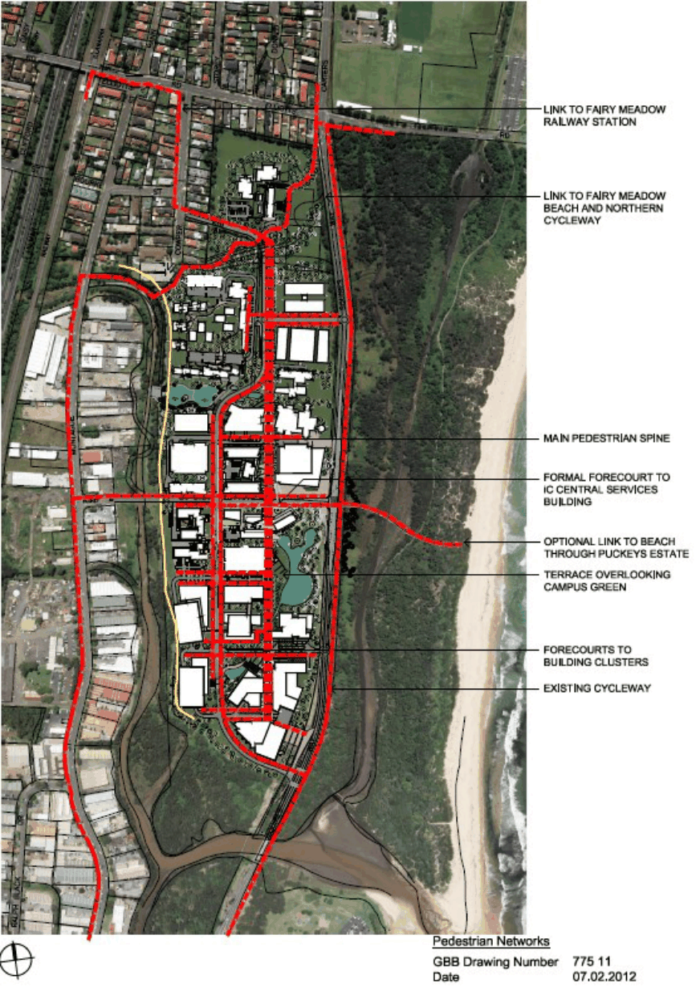
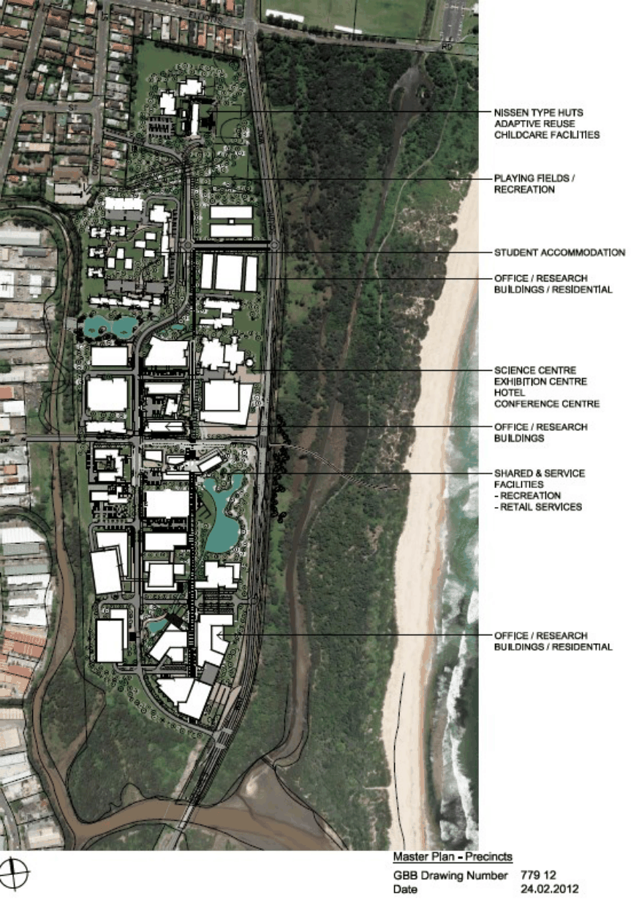
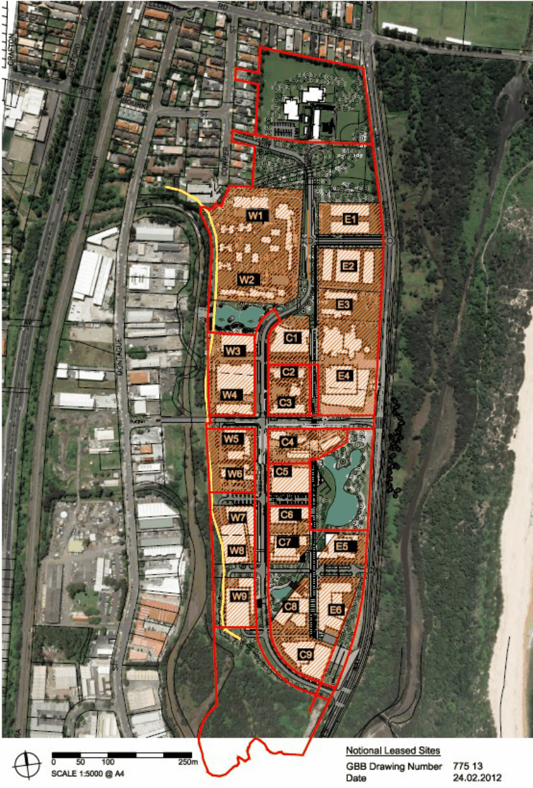

## 4 DEVELOPMENT CONCEPT

#### Objectives

1\. The key development concept objectives of the Wollongong Innovation Campus are:

a) To create a university campus environment supportive of research, business and development activities;

b) To achieve an appropriate campus scale and character by:

i) Providing buildings in a landscaped setting;

ii) Providing a well defined pedestrian spine and network to link activity zones and precincts and a series of landscaped features including: − Playing fields; − Parks; − Building forecourts / plazas; − Sculpture forecourt; − Campus green; − Rainforest gully / creek; − Swamp oak forest.

iii) Developing a chain of ponds / stormwater management system as an integral feature of the campus;

iv) Reducing the visual impact of surface parking by provision of carparks under buildings and multi storey parking facilities;

v) Consistency of landscape detail including street furniture, paving, lighting, signage and other elements;

vi) Landscaping used as a positive element to unify site;

vii) Consistency in architectural design taking into account project objectives and commercial realities;

viii) Consistency of buildings scale and height;

ix) Providing an accessible and legible campus structure.

c) To provide opportunities for formal and informal interaction;

d) To develop a sense of community;

e) To provide a stimulating working environment integrated with social, recreation, cultural and support services;

f) To encourage a positive lifestyle mix of ‘work, live and play’ activities;

g) To incorporate best practice ecologically sustainable development principles;

h) To create a physical setting which helps to reshape the image of Wollongong as a City of Innovation;

i) To ensure the Wollongong Innovation Campus becomes an integral part of the life of the region;

j) To rehabilitate riparian corridors to Cabbage Tree Creek, preserve the existing Swamp Oak forest and reinforce the landscaped character of Puckey’s Estate;

k) To implement a transport and access strategy to encourage pedestrian and cycle access to the site and reduce the dependence on private cars;

l) To develop and improve the streetscape character of Squires Way as the main entry to the site;

m) To reinforce the community character of the existing Campus East student accommodation;

n) To develop residential development to meet the short, medium and long term needs of students, staff, employees, tenants, visitors and others involved in the activities of the University of Wollongong and the Wollongong Innovation Campus.

2\. The development is to be undertaken in stages generally as shown in the Precinct plan.

#### Performance Guidelines

1\. The development of the site must be consistent with the Precinct plan – Development Concept which is shown in the following: Figure 6, Figure 7, Figure 8, Figure 9 and Figure 10.

> [Picture on page 21: a picture, saved as a picture (images/chapter-d14-wollongong-innovation-campus-page-21-1.gif, 150 dpi).]

#### Figure 6: Development Structure

> [Picture on page 22: a picture, saved as a picture (images/chapter-d14-wollongong-innovation-campus-page-22-1.gif, 150 dpi).]

#### Figure 7: Precinct Plan - Landscape Structure

> [Picture on page 23: a picture, saved as a picture (images/chapter-d14-wollongong-innovation-campus-page-23-1.gif, 150 dpi).]

#### Figure 8: Precinct Plan - Pedestrian Network

> [Picture on page 24: a picture, saved as a picture (images/chapter-d14-wollongong-innovation-campus-page-24-1.gif, 150 dpi).]

#### Figure 9: Precinct Plan - Precincts

> [Picture on page 25: a picture, saved as a picture (images/chapter-d14-wollongong-innovation-campus-page-25-1.gif, 150 dpi).]

#### Figure 10: Notional Development Sites
