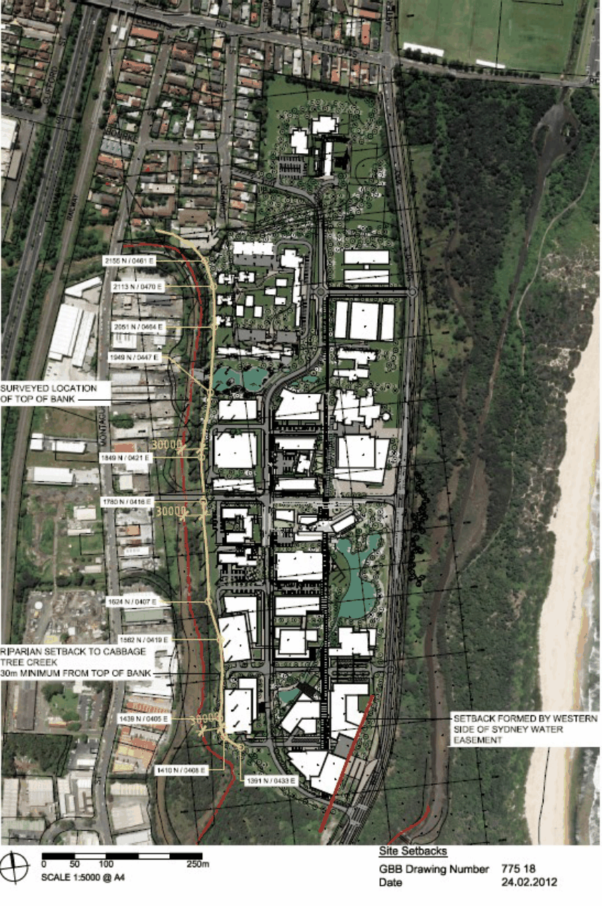
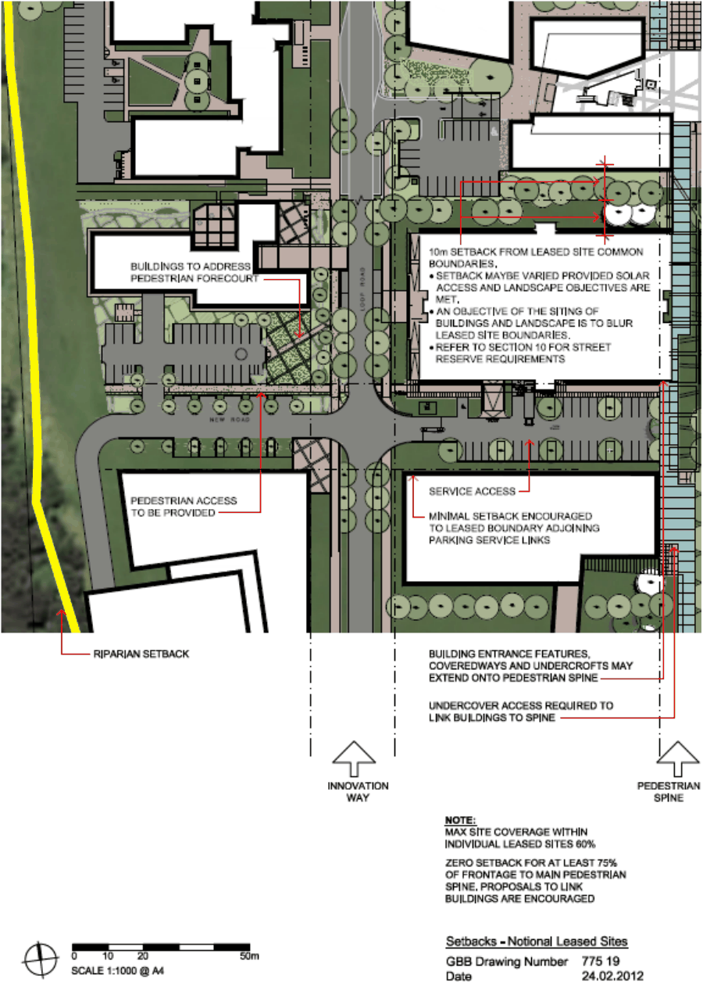

## 8 SETBACKS

#### Objectives

a) To achieve a university campus character of buildings in a landscaped setting;

b) To provide riparian corridors to Cabbage Tree Creek and Fairy Creek; and

c) To locate buildings to reinforce activity on the main pedestrian spine and East / West link.

#### Performance Guidelines

a) Buildings and associated site development must be setback from Cabbage Tree Creek and Fairy Creek as shown in Figure 11 of the approved Precinct plan.

b) Works within riparian setbacks are to be carried out in accordance with the Vegetation Management Plan.

c) Works within the riparian setback must be consistent with the Plan of Management and may include:

i) Stormwater and floodway improvements;

ii) Pedestrian access;

iii) Landscaping rehabilitation works;

iv) Vehicular, pedestrian and cyclist access to Puckey Avenue and Montague Street;

d) Setbacks should be provided from notional leased site boundaries as shown in Figure 12 and as follows:

i) Buildings adjacent to the main pedestrian spine must have a zero setback for at least 75% of the frontage.

ii) Buildings sharing common leased site boundaries should be setback 10 metres to preserve solar access and environmental conditions.

iii) Site coverage within individual leased sites should not exceed 60%.

iv) Buildings must address main pedestrian links and forecourts.

v) Buildings must reinforce the street character objectives described in section 9.10 of the approved Precinct plan.

e) The connection of buildings across leased sites at various levels may be considered provided the following is demonstrated:

The connection is primarily to improve access for occupants of the Wollongong Innovation Campus;

The physical size, height and architectural appearance of the connection is consistent with the building character and appearance objectives outlined in the approved Precinct plan; and

The connection does not significantly impact on solar access or environmental conditions to adjoining buildings or public areas.

f) Buildings adjacent to the main pedestrian spine must provide covered access in the form of undercrofts, covered ways and the like for a minimum width of 2500mm.

> [Picture on page 30: a picture, saved as a picture (images/chapter-d14-wollongong-innovation-campus-page-30-1.gif, 150 dpi).]

#### Figure 11: Site Setbacks

> [Picture on page 31: a picture, saved as a picture (images/chapter-d14-wollongong-innovation-campus-page-31-1.gif, 150 dpi).]

#### Figure 12: Setbacks - Notional Leased Sites
