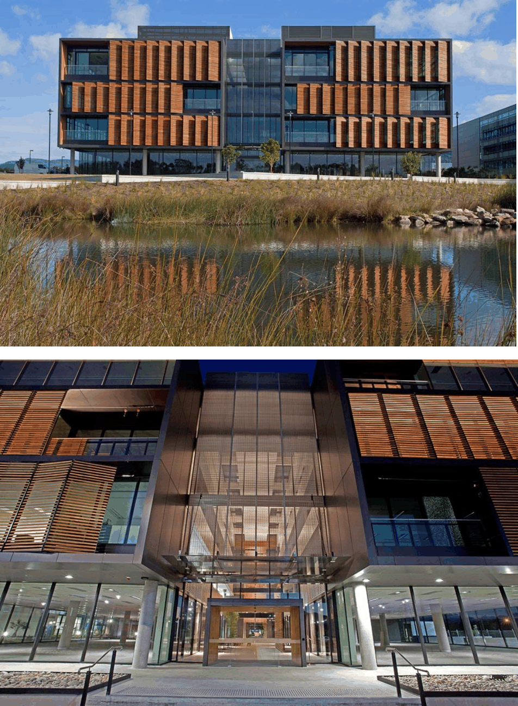
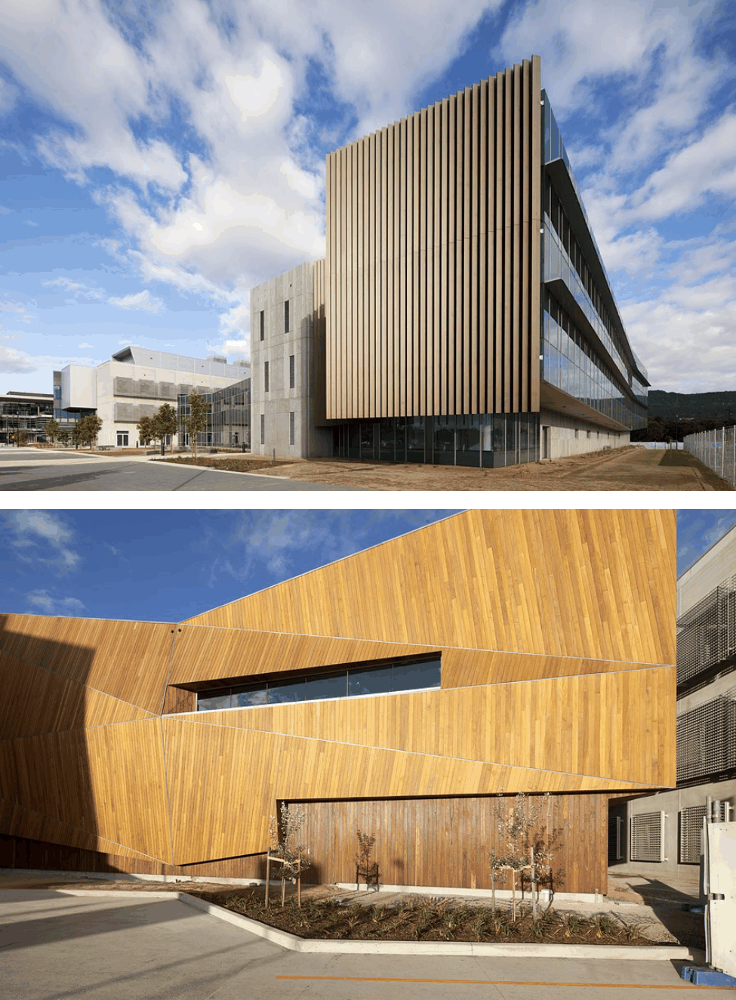
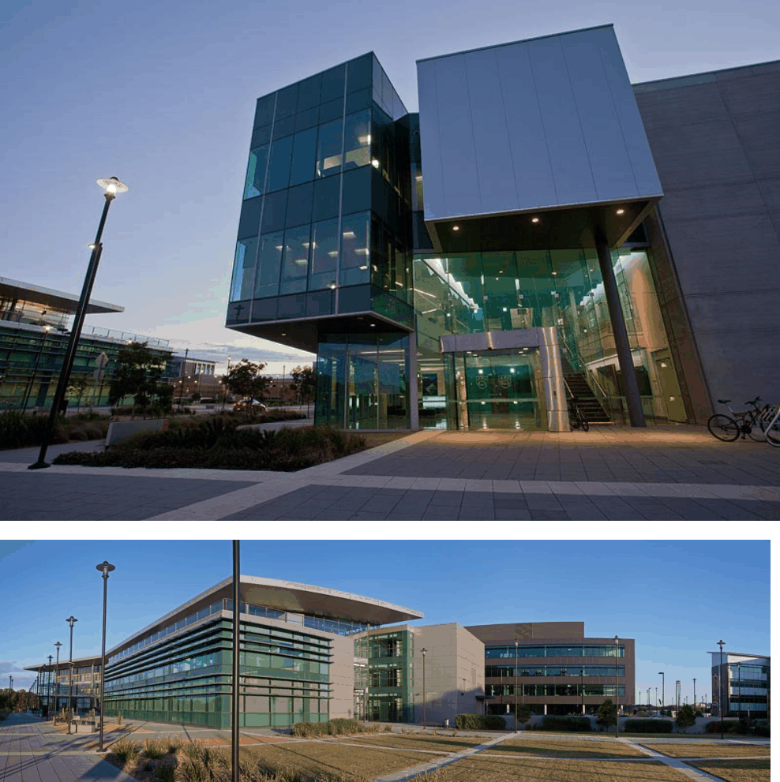
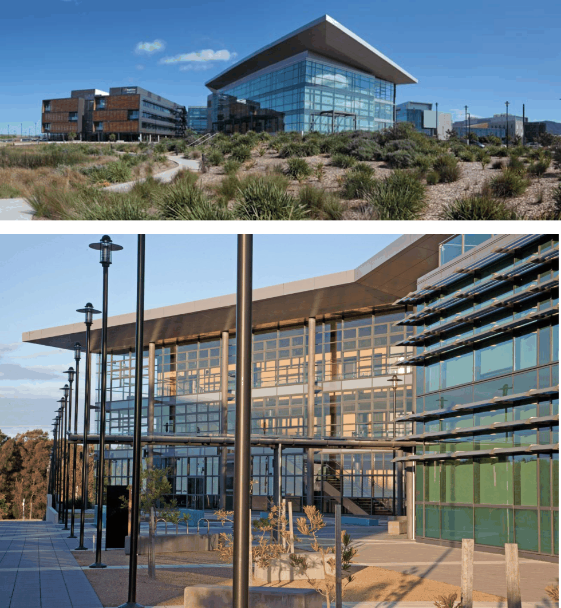

## 9 BUILDING CHARACTER AND APPEARANCE

#### Objectives

a) To ensure a high standard of urban and architectural design in the development of the site and buildings;

b) To ensure buildings contribute architecturally to the university campus character of the development;

c) To achieve an overall consistency in the design of buildings and the selection of façade systems, materials and finishes; and

d) To encourage innovative design solutions.

#### Performance Guidelines

a) Buildings must be designed by a qualified and registered architect.

b) The siting and design of individual buildings should incorporate the following ‘campus character’ unifying elements:

i) Common scale of buildings;

ii) Use of landscape as a unifying feature;

iii) Use of common landscape elements including paving, lighting, street furniture and the like;

iv) Provision of multiple entries to buildings and simple access to the site pedestrian structure;

v) Linking of forecourts and landscaped areas across leased site boundaries;

vi) Use of undercrofts and covered ways to facilitate all weather pedestrian access particularly along the main pedestrian spine and East / West link;

vii) All sides of the building must have a positive relationship to the streetscape, landscape and pedestrian areas.

c) Building design should incorporate the following elements:

i) Extensive use of glass, expressed steelwork and louvers;

ii) Use of panelised materials for general external cladding;

iii) A generally monochromatic colour scheme based generally on the use of off-white / light greys / natural / aluminium / stainless steel tones;

iv) Contrast or feature elements should be generally organic in character and may include:

timber;

stone faced cladding;

terracotta tiles cladding;

bronze or other metal finish colours.

v) Use of strong colours should be generally restricted and considered on merit for each proposed building and application.

d) The visual impact of facades should be reduced by detailed architectural treatment which may include:

i) Use of podiums and forecourts at ground level;

ii) Attached structures at main access levels;

iii) Setbacks and articulation of facades;

iv) Modulation of sun-shading and other façade elements.

e) For each development, a site analysis must consider:

i) The location, height and use of existing buildings surrounding the development;

ii) Views and solar access to surrounding buildings;

iii) Private open space and windows of habitable rooms of nearby properties which have an outlook to the proposed building;

iv) Location, height and materials of walls built to the boundaries;

v) Major and significant trees or landscape features;

vi) Street frontage features including poles, trees, kerbs, crossovers, bus stops and other services

vii) The built form, scale and character of surrounding and nearby development, including fencing and landscaping;

viii) Any significant local noise, odour or pollution sources;

ix) Pedestrian amenity for each building and its surroundings.

The image, character and appearance of buildings should be consistent with the recent development at Innovation Campus shown in the attached, Figure 13, Figure 14, Figure 15 and  Figure 16, to the approved Precinct plan.

> [Picture on page 34: a picture, saved as a picture (images/chapter-d14-wollongong-innovation-campus-page-34-1.gif, 150 dpi).]

#### Figure 13: Building Image Office/ Research

> [Picture on page 35: a picture, saved as a picture (images/chapter-d14-wollongong-innovation-campus-page-35-1.gif, 150 dpi).]

#### Figure 14: Building Image - Research

> [Picture on page 36: a picture, saved as a picture (images/chapter-d14-wollongong-innovation-campus-page-36-1.gif, 150 dpi).]

#### Figure 15: Examples - building character and appearance

> [Picture on page 37: a picture, saved as a picture (images/chapter-d14-wollongong-innovation-campus-page-37-1.gif, 150 dpi).]

#### Figure 16: Examples - building character and appearance
