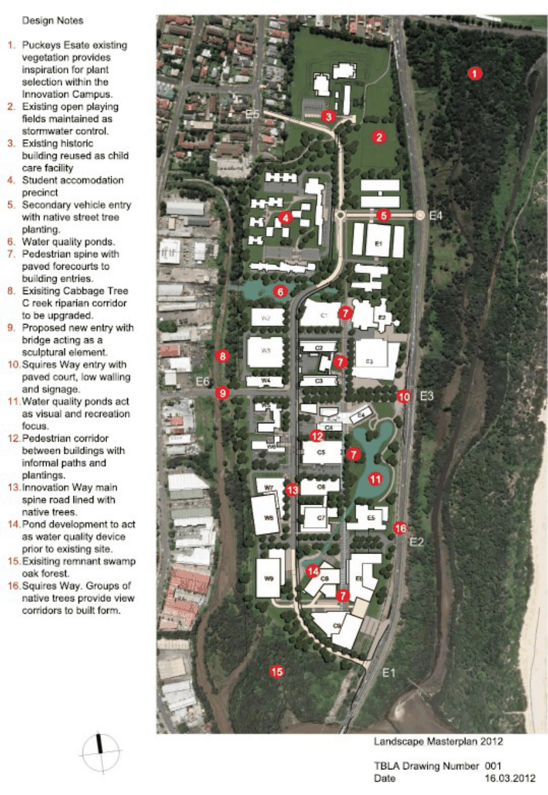
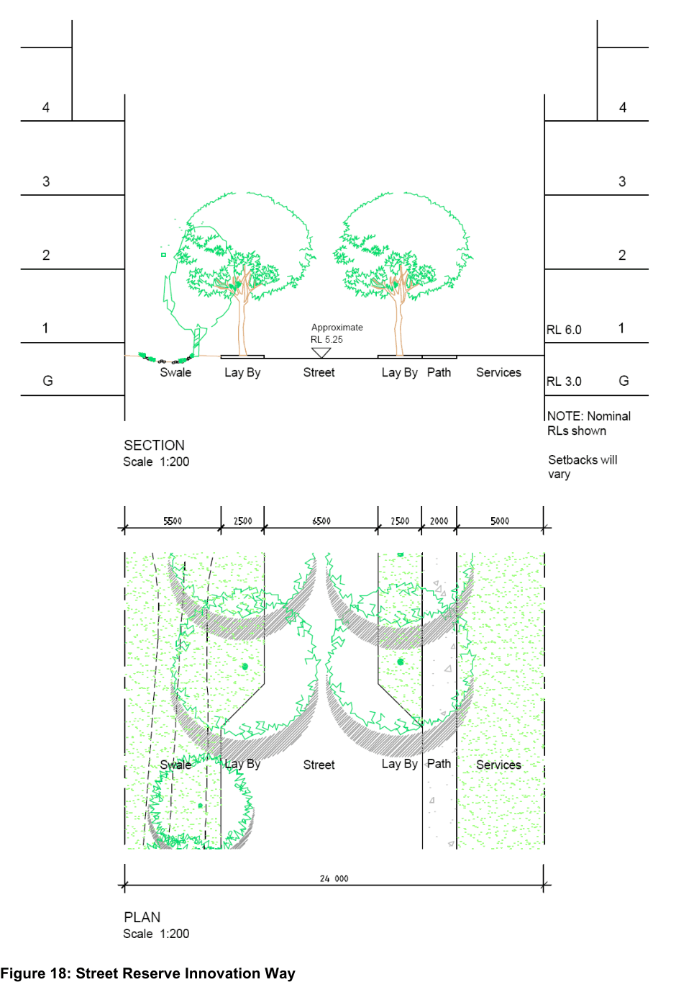
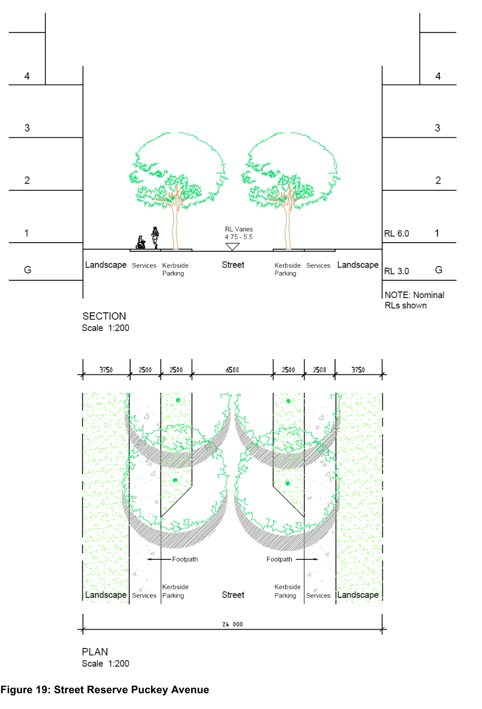
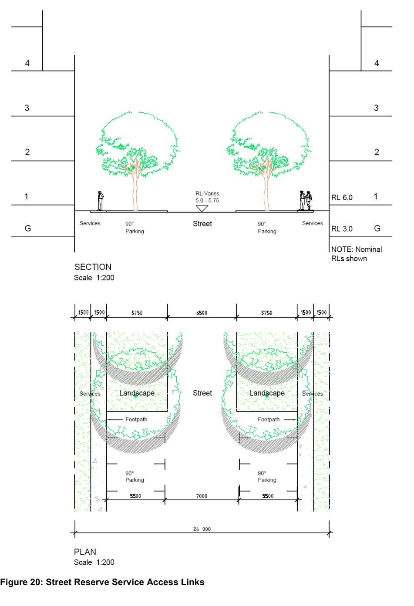
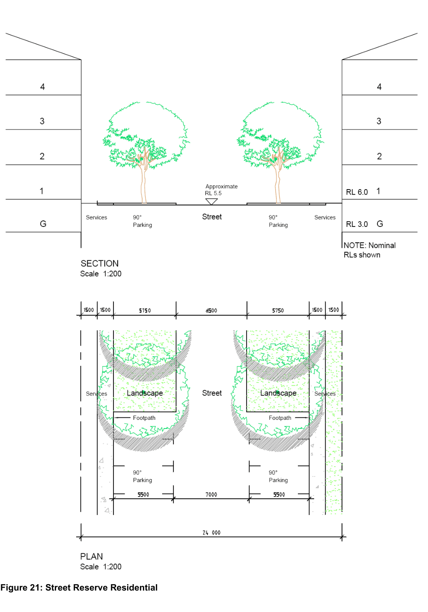
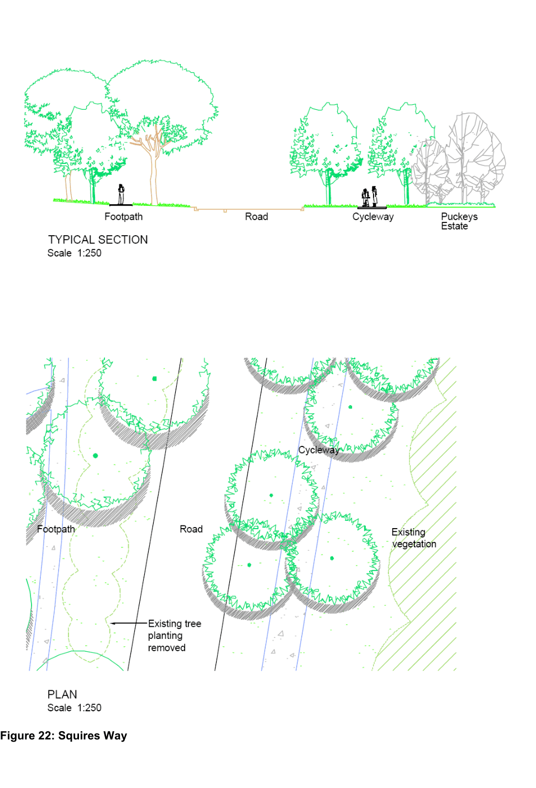
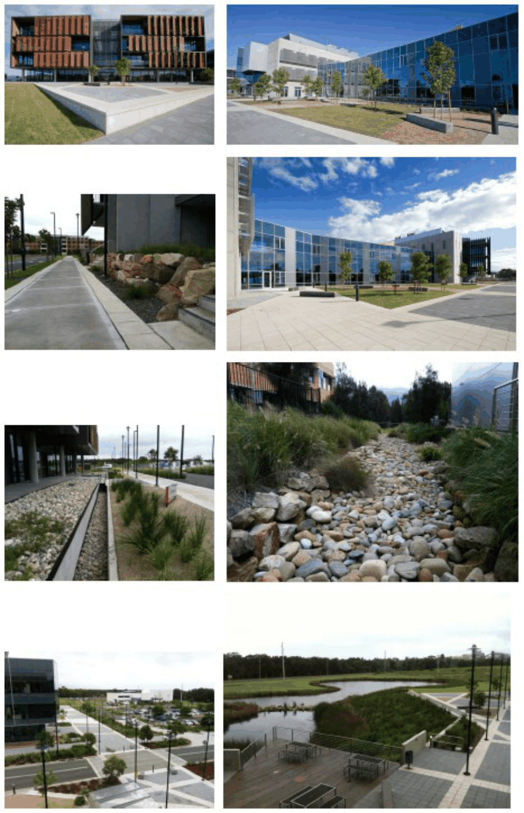

## 10 LANDSCAPE

### 10.1 Landscape Character

#### Background

1\. The Wollongong Innovation Campus is a unique coastal site within an urban context. The landscape Precinct plan reflects the character of the site and its context, the objectives of the Wollongong Innovation Campus and provide a linkage to the landscape qualities of the existing University of Wollongong campus.

#### Objectives

a) To reinforce the site as part of the regional coastal landscape particularly in its relationship to Puckeys Estate, surrounding creeks and its visual connection to the Illawarra escarpment;

b) To promote the relationship of the character of the Wollongong Innovation Campus to the landscape character of the University of Wollongong;

c) To create a landscape setting that reflects the campus scale and character qualities of the project;

d) To create a landscape setting which encourages the public to interact visually and physically with the Wollongong Innovation Campus; and

e) To establish a landscape framework which unifies the various elements and structures of the development.

f) To reinforce ESD principles in landscape design, plant selection and built form.

#### Performance Guidelines

a) The landscape character of the development must be consistent with the requirements of the approved DCP.

b) The plant species selected must be consistent with those found on-site and in the immediate local environment. Plant species should be suited to the existing site conditions and environment.

c) Public artwork should be considered for key points  within the Campus to act as visual and physical focus for pedestrian activity.

d) A chain of ponds should play a positive role in stormwater management. The ponds provide an opportunity for a consistent landscape approach through the Campus and relate to the character of the main University of Wollongong campus.

e) Landscaping between and around buildings should blur the leased site boundaries and create the sense of an informal campus setting. Landscaping should enhance building entrances and forecourts and facilitate pedestrian movement between built structures.

### 10.2 Open Space

#### Background

1\. Open space forms a key component in the overall Wollongong Innovation Campus site planning. The intent is to provide a central “Campus Green” with a pedestrian spine linking a series of parks and pedestrian plazas in association with consistent  landscape themes.

#### Objectives

a) To provide a central open space or “Campus Green” as a focal point for the Wollongong Innovation Campus;

b) To create a visually strong, attractive and safe series of public open spaces;

c) To create a series of pedestrian forecourts and green spaces linked by a pedestrian spine;

d) To provide positive and safe linkages to open spaces adjoining the Innovation Campus;

e) To integrate open space and stormwater design to create a functional and aesthetic landscape; and

f) To provide both passive and active recreation opportunities.

#### Performance Guidelines

a) Open space must be consistent with the Landscape Precinct plan (Figure 17).

b) Within main communal landscaped areas active recreation should be included in the form of open grassed areas for informal sporting activities.

### 10.3 Vegetation

#### Background

1\. The existing site was originally devoid of significant vegetation except for the “Swamp Oak Forest” at the southern end and some riparian vegetation associated with Cabbage Tree Creek.

#### Objectives

a) To preserve the “Swamp Oak Forest” at the southern end of the site;

b) To preserve, revegetate and rehabilitate the riparian corridor to Cabbage Tree Creek adjoining the site;

c) To create a “green campus” by use of appropriate native vegetation;

d) To integrate the proposed vegetation with that found in Puckeys Estate, the escarpment and the existing University of Wollongong;

e) To consider planting locations to maximise solar access to key areas.

#### Performance Guidelines

a) The perseveration of the Swamp Oak Forest and works to the riparian corridor shall be carried out in accordance with the Cabbage Tree Creek Vegetation Management Plan (prepared by Southern Habitat – June 2008 – for WCC and UOW);

b) Riparian plant species should be planted along the embankment of the creek.

c) Planting design should comply with the Crime Prevention through Environmental Design (CPTED) principles.

d) Indicative plant species should be in accordance with;

| Botanical Name | Common Name |
|---|---|
| Street Trees |  |
| Acmena Smithii | Lilly Pilly |
| Alphitonia excelsa | Red Ash |
| Banksia integrifolia | Coastal Banksia |
| Glochidon ferdinandi | Cheese Tree |
| Syzygium paniculatum | Brush Cherry |
| Cupaniopsis Anacardioides | Tuckeroos |
| Significant / Landmark Trees |  |
| Ficus rubiginosa | Port Jackson Fig |
| Ficus macrophylla | Moreton Bay Fig |
| Syzygium paniculatum | Brush Cherry |

| Syzygium australe | Brush Cherry |
|---|---|
| Tree Planting |  |
| Banksia integrifolia | Coastal Banksia |
| Banksia serrata | Old Man Banksia |
| Casuarina glauca | Swamp Oak |
| Eucalyptus amplifolia | Cabbage Gum |
| Eucalyptus botryoides | Bangalay |
| Eucalyptus robusta | Swamp Mahogany |
| Euroschinus falcata | Ribbonwood |
| Ficus rubiginosa | Port Jackson Fig |
| Hibiscus heterophyllus | Native Hibiscus |
| Melaleuca ericfolia | Swamp Paperbark |
| Melaleuca linariifolia | Narrow-leaved Paperbark |
| Synoum glandulosum | Rosewood |
| Pittosporum undulatum | Sweet Pittosporum |
| Shrubs and Groundcovers |  |
| Correa alba | White Correa |
| Indigofera australis | Austral Indigo |
| Leptospermum laevigatum | Coast Tee Tree |
| Myoporum acuminatum | Boobialla |
| Hardenbergia Violacea | Native Sarsaparilla |
| Hibbertia scandens | Twining Guinea Flower |
| Kennedia rubicund | Dusky Coral-pea |
| Lomandra longifolia | Spiny-headed Mat-rush |
| Riparian Planting |  |
| In accordance with Cabbage Tree Creek Vegetation Management Plan (prepared by Southern Habitat – June 2008 |  |
| Wetlands |  |
| Baumea articulate (At pond wet edge only) | Jointed twig rush |
| Bolboschoenus caldwelli | Club Rush |
| Carex appressa | Tussock Sedge |
| Isolepis nodosa | Isolepis |
| Juncus kraussi | Common Rush |
| Phragmites australis | Common Reed |

### 10.4 Safety and Security

#### Background

1\. The Wollongong Innovation Campus is to be designed to provide a safe and secure environment.

#### Objectives

a) To incorporate “Crime Prevention through Environmental Design (CPTED) principles into the detailed site landscaping; and

b) To provide a safe environment for the Campus Community and Campus Visitors.

#### Performance Guidelines

a) Planting, lighting and furniture design should be co-ordinated to ensure maximum pedestrian safety.

b) Tall dense planting should be kept clear of pathways to ensure pedestrian safety.

c) Open spaces and courtyards should be developed to minimise concealment opportunities.

d) Crime Prevention through Environmental Design (CPTED) principles should be considered In the design process.

e) Well lit pathways with clear sight lines must be provided particularly where providing access to accommodation and public transport.

f) Safe, well lit routes must be provided from carparks to buildings for evening and late night access.

g) Clear identification and lighting at the entries to the Wollongong Innovation Campus must be provided.

h) CCTV to internal road and pedestrian areas and all pedestrian and vehicle entrances should be provided.

i) Natural surveillance of carparks must be provided.

j) Bollards or protective structures should be provided to prevent ram raid type offences or accidental collisions.

k) Building materials should be selected to deter criminal activity and provide protection from criminal actions.

l) Critical service supply points and installations should be secured against vandalism.

### 10.5 Furniture

#### Background

1\. Furniture design is an integral part of the landscape infrastructure for Wollongong Innovation Campus. A furniture theme reinforces the project identity and provides a further layer of detail to the landscape.

#### Objectives

a) To provide a consistent range of furniture and detailing to the landscape;

b) To incorporate furniture into the landscape as part of the landscape development;

c) To ensure furniture is located in useful and safe areas; and

d) To integrate furniture design with public art opportunities.

#### Performance Guidelines

a) Furniture should be located in areas that permit maximum surveillance during day and night.

b) Furniture should be of a consistent theme and high quality.

c) Furniture should be designed to be comfortable, aesthetically pleasing and to be low maintenance / vandal resistant.

### 10.6 Lighting

#### Background

1\. Lighting of outdoor areas is essential to provide a safe and pleasing environment for pedestrians at night and can be used as a feature in the landscaping.

#### Objectives

a) To provide attractive and functional lighting of outdoor spaces in order to provide a safe and pleasant pedestrian environment.

#### Performance Guidelines

a) Lighting must be consistent to reduce any contrast between shadows and illuminated areas.

b) Lighting must be integrated with proposed vegetation / planting schemes.

c) Public areas must be lit in accordance with Australian Standard 1158.3.1.

d) “Safe” routes such as the pedestrian spine must be lit at higher levels than the code.

e) Lighting must provide clear identification of building entrances.

### 10.7 Public Art

#### Background

1\. The incorporation of public artwork is an important component of the Wollongong Innovation Campus landscape development.

#### Objectives

a) To facilitate and incorporate the creation of artworks throughout the site as a component of the landscape development of the Innovation Campus;

b) To use public art as a means of promoting and celebrating the identity of the Innovation Campus;

c) To ensure that public art is an ongoing component of the Innovation Campus;

d) To ensure that any artwork contributes to the “Innovation” aspect of the project;

e) To provide a character linkage to the existing University of Wollongong main campus;

f) To integrate aspects of heritage interpretation of the Campus East site with an artworks strategy;

g) To identify opportunities for significant artworks which may include:

i) Entrance statements to the site;

ii) Interpretative artworks in association with the heritage buildings retained on the site;

iii) Artworks integrated with the chain of ponds and site water features;

iv) Artworks developed in association with the Science Centre which may form the basis of school student interaction with the Wollongong Innovation Campus;

v) Artworks integrated with Energy Management and ESD initiatives;

vi) A sculpture forecourt to the central services facilities; and

vii) Artworks incorporating aspects of wind, music, Light and movement as a focus to building forecourts; and

h) To provide opportunities for artworks by the University of Wollongong, School of Creative Arts.

#### Performance Guidelines

a) Public art should be incorporated into the landscape and architecture of the Innovation Campus.

b) The provision of public art should be demonstrated at each Precinct plan review.

### 10.8 Signage

#### Background

1\. Integrated and consistent signage is a critical element in a University campus.

#### Objectives

a) Signage should contribute to the campus character of the development and be uncluttered and reserved in appearance.

b) Signage should provide clear and legible instructions for staff, students and visitors.

c) Entry statement and other main signage should convey the significance of the Wollongong Innovation Campus.

#### Performance Guidelines

a) Signage must be consistent across the campus and conform with the following general guidelines:

b) Significant entrance statement structures and signage should be provided at the main entry points to Innovation Campus:

c) Campus way finding signage should be in the form of monolith signs

d) Campus directories and the like should be standardised and located at critical locations on the campus

e) Building signage must:

i) Integrate with the architectural character of the subject building and adjacent buildings

ii) Harmonise with other features, particularly the size and placement of other signs in the immediate vicinity

iii) Not threaten the safety of pedestrians and traffic

iv) Enhance the attractiveness and character of the streetscape

v) Consider the visibility of the sign from street level and other public areas

f) Signage should be illuminated by lighting in the landscape.  Neon type signage is not permitted.

g) The Signage Suite should include international symbols where possible and include the following safety information:

i) The location of telephones, public transport and toilets

ii) Expected behaviour throughout the campus

iii) Where help can be found in the case of an emergency

iv) Location of walking/cycling routes

### 10.9 Fencing

#### Background

1\. The intention of the campus is to provide for a fence free environment. Localised fencing is permitted in locations where security or legislation requirements determine it appropriate.

2\. In other areas of the campus a safe environment will be provided by implementing strategies outlined in other sections of this Precinct Plan.

#### Objectives

a) To reinforce the existing well defined and secure environment for students in the halls of residence style accommodation, Childcare Facilities and areas requiring security (such as the Science Centre).

#### Performance Guidelines

a) Security fencing  should be integrated with the building and landscape design

b) Fencing of the individual leased sites elsewhere on the campus is not permitted

c) Where particular parts of buildings require access control or security enclosure the installations must be integrated with the building design

### 10.10 Streets

#### Objectives

a) To create an accessible, safe, legible and permeable system for vehicular and pedestrian traffic

b) To create a hierarchy of streets with characteristics as follows:

Innovation Way

i) Primary functional access through the site

ii) Formal and regular tree planting to both sides of the street

iii) Swales, building forecourts and other landscaping to reinforce image of a ‘leafy’ campus street

iv) Limited kerbside parking provided for taxis, couriers and other short stay vehicles

Puckey Avenue

i) The main entrance to the Wollongong Innovation Campus

ii) Landscaping, paving, lighting and other elements to provide an appropriate sense of entry.

Service/Parking Links

i) Provision of surface parking for visitors and users of the Wollongong Innovation Campus and access to basement parking and service facilities

ii) Pedestrian access provided to both sides of street

Residential

i) ‘Leafy’ streets providing on street parking for residents and visitors and access to under building parking and other service functions

#### Performance Guidelines

a) Streets should be constructed to create the street system indicated in Figure 17

b) Street sections should be constructed according to the sections set out in Figures 18 - 22 (inclusive)

> [Picture on page 45: a picture, saved as a picture (images/chapter-d14-wollongong-innovation-campus-page-45-1.gif, 150 dpi).]

#### Figure 17: Landscape Precinct Plan

> [Picture on page 46: a picture, saved as a picture (images/chapter-d14-wollongong-innovation-campus-page-46-1.gif, 150 dpi).]

Figure 18: Street Reserve Innovation Way

> [Picture on page 47: a picture, saved as a picture (images/chapter-d14-wollongong-innovation-campus-page-47-1.gif, 150 dpi).]

Figure 19: Street Reserve Puckey Avenue

> [Picture on page 48: a picture, saved as a picture (images/chapter-d14-wollongong-innovation-campus-page-48-1.gif, 150 dpi).]

Figure 20: Street Reserve Service Access Links

> [Picture on page 49: a picture, saved as a picture (images/chapter-d14-wollongong-innovation-campus-page-49-1.gif, 150 dpi).]

Figure 21: Street Reserve Residential

> [Picture on page 50: a picture, saved as a picture (images/chapter-d14-wollongong-innovation-campus-page-50-1.gif, 150 dpi).]

Figure 22: Squires Way

> [Picture on page 51: a picture, saved as a picture (images/chapter-d14-wollongong-innovation-campus-page-51-1.gif, 150 dpi).]

#### Figure 23: Landscape themes
