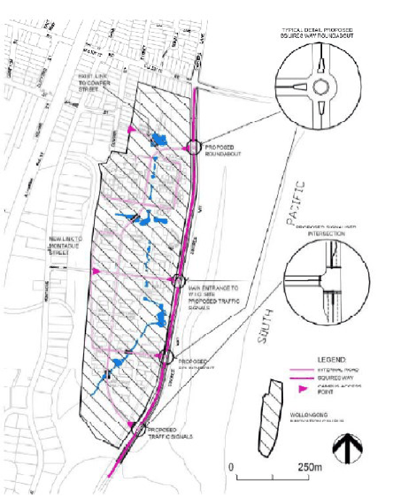
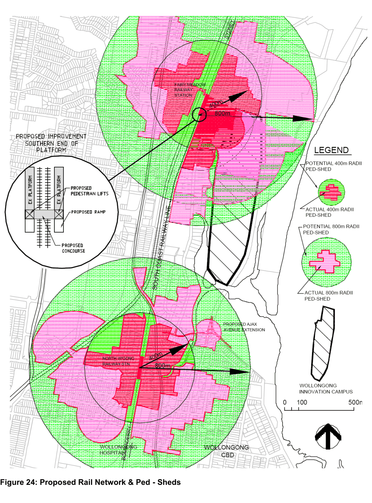

## 11 TRANSPORT AND ACCESS

#### Background

1\. A number of transport studies and reports have been prepared to assess the capacity and characteristics of the existing transport network impacted by the growth, over time, of the Innovation Campus. A brief summary of these studies is outlined below;

i. 2002 : TRANSPORT STUDY – iC – Prepared by Forbes Rigby and Gabites Porter.

This initial Transport Study was undertaken by Forbes Rigby (now Cardno) and Gabites Porter in 2002 to support the initial Masterplan. It was completed prior to any research or commercial development and included an assessment of: A review of local and state planning initiatives which emphasised the need for an integrated approach to transport planning, increased use of public transport and a reduction in car dependency, Traffic modelling outcomes based on a range of development scenarios, Proposed local intersection treatments, Parking demand, Safety impacts, Public transport opportunities, and Pedestrian and cycle access opportunities. This report formed the basis of the objectives and performance guidelines, defined in the initial Masterplan and subsequent 2009 DCP, which guided the initial stages of the transport and access development at iC.

ii. 2008 : CAR PARKING STRATEGY REPORT – iC – Prepared by Cardno (Forbes Rigby)

By 2008 the Stage 1 development at iC was well advanced with over 30,000 sqm of new development completed or underway. The operational requirements of the iC required a detailed strategy for vehicle parking control and growth, beyond the Objectives and Performance guidelines outlined in the original Masterplan. This Strategy Report was approved by Wollongong City Council (DA-2008/568) and included; Operational parameters for centralised car parking areas for the different User types that permitted a payment and practical enforcement structure, and Staged growth strategies for parking spaces that met the Masterplan Objectives.

iii. 2010-2012 : iC TRANSPORT AND TRAFFIC MASTERPLAN REVIEW, TRAFFIC AND TRANSPORTATION ASESSMENT – Prepared by AECOM (2012)

During 2010 to 2012 a comprehensive review of traffic and transportation was carried out by the University in consultation with Wollongong City Council and the NSW Roads and Maritime Services. The review included; Traffic counts to validate traffic simulation models, Updated staged modelling for forecast years 2016 (Stage 2) and 2026 (Ultimate Development), and Assessment of alternative access scenarios (via Squires Way only or Squires Way and Montague Street).

Updated staged TRACKS modelling was presented to Wollongong City Council and RMS in December 2010. This modelling assessed two network scenarios for local area roads / intersections for the iC ultimate growth (forecast year 2026);

Option 1 : Existing surrounding road network, access to the Innovation Campus via Squires Way and Cowper Street, and

Option 2 : Existing surrounding road network, access to the Innovation Campus via Squires Way, Cowper Street and Montague Street (at Puckey Ave);

The University’s preference was for Option 2. This was generally supported by the RMS as this option distributes traffic to different locations and reduces the number of access points required on Squires Way (Note: whilst the Notional Ultimate Masterplan Drawing illustrates up to 6 vehicle entrances to iC with 4 shown along Squires Way - Option 2 only requires up to 3 entrances off Squires Way).

The 2012 Traffic and Transport Assessment therefore provides for iC growth to 2016 (or approximately a further 20,000 sqm of development to circa 75,000 sqm). The outcome of the assessment supports the traffic growth via the adoption of the Montague Street Access Bridge (on the Puckey Ave. alignment) as the second major entrance to iC – in line with the ultimate Option 2 solution.

A future iC Transport Review is required when the development is at 75,000 sqm (GFA).

2\. A number of organisations and authorities including the University of Wollongong, Wollongong City Council and State Government Agencies are responsible for the implementation of the initiatives.

3\. The initiatives need to be integrated with Wollongong CBD traffic and access studies and other regional transport proposals.

#### Objectives

1\. Access and transport objectives for the Wollongong Innovation Campus include:

a) To provide a convenient and safe transport system for users of the Wollongong Innovation Campus

b) To reduce car dependency by encouraging alternative modes of transport

c) To cater for non-vehicular transport such as cycling and walking

d) To minimise the environmental impact of transport

e) To improve air quality

f) To maintain the transport network in good order

g) To maximise the efficient use of transport infrastructure – both existing and proposed

#### Performance Guidelines

#### Integration of Transport and Access Planning

a) Transport and access planning must be integrated and implemented to include the following initiatives:

i) Bus priority measures along major trunk roads and “hail and ride”/demand responsive bus services as part of a WIC/UOW/CBD Shuttle

ii) Locating bus stops to maximise the patronage catchment and to consider personal safety, lighting and traffic management

iii) Providing sheltered bus stops with seats, adequate lighting and timetable information for people with disabilities

iv) Providing street, footpath and open space networks for multiple pedestrian and cycle routes

v) Providing within each building suitable facilities including storage, shower and changing facilities at work and other end-of-trip locations to encourage greater use of bicycles

vi) Providing parking incentives such as cheaper rates or reserved spaces for high occupancy vehicles including car pools and community buses

vii) Encouraging cycle routes and providing bike facilities at public transport interchanges

viii) Providing an integrated network of on and off road cycleways and walkways

ix) Shaping parking policies to support public transport use, walking and cycling

x) Progressively reducing the availability of car parking within the Wollongong Innovation Campus

xi) Promoting car pooling and park and ride transport options

xii) Providing incentives to employees to encourage journey to work by public transport

xiii) Promoting and/or subsidising cheaper off peak travel by public transport

xiv) Preparation of workplace travel plans

The status of measures that have been introduced to satisfy the Performance Guidelines for Transport and Access Planning integration (at the time of the 2012 Precinctplan review) include;

The “Gong Shuttle” was introduced in 2009 by the NSW Government as a public transport initiative for the Illawarra and directly serves the Innovation Campus. Currently two bus stops, on the “Gong “Shuttle” route serve the Innovation Campus providing good catchment for the current development. Bus stops are provided with shelters and lighting.

New development from 2006 to 2012 incorporates end-of-trip bicycle facilities which are promoted and gaining in patronage.

The street, footpath and pedestrian spine network is expanding from the central area north and south with development. The existing Campus East student residential area is now connected by both road and pathway.

A parking payment regime has been introduced which promotes the use of public transport as an alternative journey to work.

#### Traffic

a) A number of road network changes should be implemented to offset the impact of traffic generated by the Innovation Campus and background growth in the local road network.  The timing and nature of the works is subject to detailed evaluation of the traffic growth and Innovation Campus vehicle trip generation.

Evaluation and works completed or underway (at the time of the 2012 Precinct plan review) include;

Detailed evaluation of an additional vehicle access point was completed in 2011 which led to a bridge between the Innovation Campus and Montague Street (along the Puckey Ave alignment) being adopted. The proposed Bridge received separate Development Approval

from WCC (DA-2012/5 on 6th July 2012) and is programmed to be open to traffic in 2014.

#### Pedestrian and Cycle Access

a) The pedestrian and cycle infrastructure should be extended and upgraded.  The following proposed pedestrian and cycleway connections options shall be considered:

i) Montague Street Pedestrian/Cycleway

ii) Puckey Avenue Extension

iii) Porter Street Cycleway

iv) Stuart Park Cycleway

v) George Hanley Drive

b) Storage, shower and changing facilities for cyclists must be provided within each building.

The status of measures that have been introduced to satisfy the Performance Guidelines for Pedestrian and Cycle Access (at the time of the 2012 Precinct plan review) include;

The Causeway across the Fairy Meadow Creek to Montague St (Puckey Ave alignment) was rebuilt by the University in 2009 to provide both a dedicated Construction access (remove construction traffic from internal Campus roads to improve pedestrian safety) and a dedicate shared pedestrian / cycle pathway link to Montague Street. Shared pedestrian / cycle pathway is also incorporated inot the Montague Street access bridge which will replace the causeway during 2013.

All new development (from 2006) has included end-of-trip facilities for cyclists.

#### Rail Infrastructure

a) The Innovation Campus is within the service area of the Fairy Meadow and North Wollongong railway stations.  Connections between the Campus and rail services are achieved through a combination of walking (see Figure 26) or the 'Gong Shuttle', which has dedicated stops at Fairy Meadow and Wollongong Railway Stations, as well as the Innovation Campus.

b) The Innovation Campus has identified that rail accessibility can be improved through:

- Extension of Fairy Meadow Railway Station platforms to link with Bourke St. This will improve the reach of the ped-shed as shown in Figure 26.

- Provision of disabled access lifts and a pedestrian overpass

- Modifications to timetables to increase number of express services to and from Sydney.

- Modifying the signage to incorporate the Wollongong Innovation Campus into the name of the station

- Providing integrated bus tops and improved pedestrian access to and from the railway station.

c) Consultation with NSW Transport (City Rail) has determined that Fairy Meadow Railway Station is not on the express timetable and North Wollongong Station is currently the nominated station for the express services to Sydney. The Innovation Campus will continue to regularly undertake transportation surveys of the Campus occupants as well as continue discussions with Transport for NSW to ensure rail infrastructure and connecting services can accommodate the demand / patronage arising from the Campus.

#### Parking Strategy

a) Parking within Innovation Campus should be provided to satisfy the Campus demand diveristy, including visitors, events, students, residential and staff.

b) Parking should be provided on site at an average rate between the range of 1 space per 40 to 80 sqm of Gross Floor Area. The ratio at completion will reflect the final mix of development type, ongoing monitoring of demand and take-up of public and alternative transportation strategies. Note; at the 2013 review the ratio of spaces to GFA was 1 space per 60 sqm GFA (with development around 40% of the total permissible).

c) The parking provisions should be configured to provide adequate parking controls and enforcement regimes, this will include;

i) Identified visitor parking,

ii) Centralised staff parking

iii) Secure reserved / allocated parking for staff and residents.

iv) Parking bays for service vehicles, taxis, bus bays and the like.

d) Parking spaces will generally be provided within development lots and / or in centralised locations such as Multi-Storey Car Parks. Temporary on-grade parking stations will be progressively reduced as the Campus is developed and land is utilised for development.

> [Picture on page 57: a picture, saved as a picture (images/chapter-d14-wollongong-innovation-campus-page-57-1.gif, 150 dpi).]

Figure 24: External Road Network (Squires Way)

Note: Potential Ultimate Intersection Options subject to further review

> [Picture on page 58: a picture, saved as a picture (images/chapter-d14-wollongong-innovation-campus-page-58-1.gif, 150 dpi).]

Figure 24: Proposed Rail Network & Ped - Sheds
