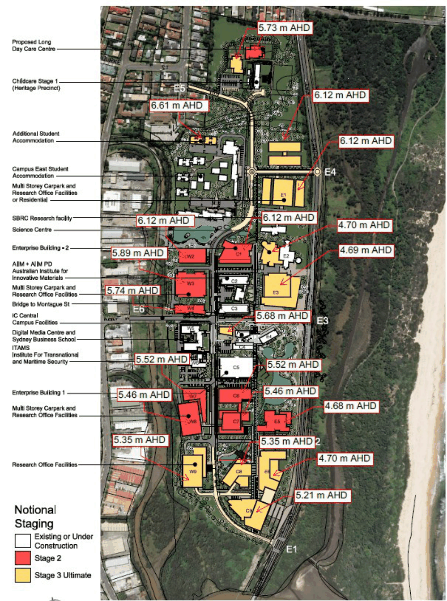

## 12 FLOODPLAIN MANAGEMENT

### 12.1 Flooding

#### Background

1\. A comprehensive review of floodplain management was undertaken by the University in 2011 /12 as part of the Stage 1 Precinct plan Review. The University commissioned Cardno to undertake the Flood Management Study (“Flood Management Study – Master Plan Review 2011-12 – Innovation Campus”) which included up to date flood modelling for the revised fully developed Precinct Plan built contours. For full details and findings refer to the full Flood Management Study

– Master Plan Review 2011-12 – Innovation Campus (iC-FMS-2012).

#### Objectives

1\. The Flood Management Strategy aims to:

a) To ensure the safety of existing and future occupants of the floodplain

b) To maximise the development potential for the site

c) Ensure compliance with appropriate guidelines and policies, including:

i) Wollongong City Council’s Development Control Plan (Chapter E13); and

ii) NSW Government Policy

#### Performance Guidelines

a) Set minimum floor levels for the ultimate development at iC at the 100 year ARI flood level + 0.9m freeboard (based on the results of the 2016 flood modelling). Refer Fig. 27.

b) Maintain the existing surface topography through the northern floodway area of the site, which currently behaves as an informal floodway between Cabbage Tree Creek and the Towradgi Arm in major storm events.

c) Incorporate flood compatible building materials for all structures at or below the 100 year ARI level + 0.9m freeboard.

d) All internal roads to achieve trafficability during 100 year ARI storm events.

e) Protect basement carparks from floodwater up to at least the 100 year ARI flood +0.2m freeboard, to minimise the risk to life during a flood.

f) Elevate open car parks above the 100 year ARI flood level +0.9m freeboard to ensure that externally parked vehicles do not become moving debris during flood events.

### 12.2 Flood Access and Evacuation

#### Background

1\. Floodwaters around the site are generally slow moving being a result of ‘backwater’ from the restricted beach bar opening.  Although slow moving, the depth of flooding around the site does not allow flood free access in the 1% AEP event.  Squires Way, the main access road to the Innovation Campus is under 1.0 to 1.5 m of water in this event.  There is an existing road link between Campus East and Cowper Street to the north but this is also flood affected, although to a lesser extent. The bridge access to Montague Street at Puckey Ave is also affect by flooding along Montague Street.

#### Objectives

a) To provide for occupant safety during flood events.

#### Performance Guidelines

a) Provide safe refuge within the site including:

i) Minimum floor levels set at 100 year ARI flood level + 0.9m freeboard..

ii) Multi storey buildings with upper floor levels several metres above PMF.

iii) The central section of the main pedestrian spine set at a minimum elevation equal to 100 year ARI flood level +0.9m freeboard.

b) A detailed Flood Safety Strategy must be maintained by the University.

> [Picture on page 61: a picture, saved as a picture (images/chapter-d14-wollongong-innovation-campus-page-61-1.gif, 150 dpi).]

#### Figure27: Minimum Floor Levels
