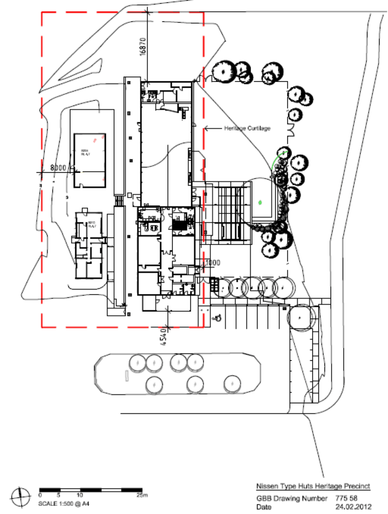

## 13 HERITAGE

### 13.1 Objectives

To ensure that the heritage value of the site is recognised.

### 13.2 Aboriginal Archaeological Assessment

#### Performance Guidelines

1\. The recommendations of a study undertaken in July 2002 by Navin Officer Heritage Consultants should be noted:

There are no known Aboriginal heritage constraints to the proposed development  If any Aboriginal relics as defined in the NPWS Act are identified in the course of  construction activities then works should cease in the vicinity of the finds.  The NPWS  zone archaeologist should be contacted and an appropriate course of action decided  upon.

### 13.3 European Heritage - Brandon Park

#### Performance Guidelines

a) The recommendations of an Assessment Study of European Heritage for the Brandon Park site completed in October 2002 by Colin Brady Architects + Planning should be noted.  The recommendation included:

i) The peripheral landscape and stream shoreline to the site should be maintained and enhanced.

ii) No activity or works should be allowed that would have a substantial detrimental effect on the significance, landscape and environmental qualities of the shoreline.

### 13.4 European Heritage – Campus East

#### Background

1\. The northern end of the site was used as a migrant hostel in the period 1950 – 1982.

2\. In 2004, two Nissen type huts were relocated adjacent to an existing hut to form a heritage precinct. Refer fig. 31.

3\. This precinct is listed on the NSW State Heritage Register.

#### Performance Guidelines

a) The following information may be required to be submitted with a Development Application which relates to any item of environmental heritage.

i) A statement of heritage impact

ii) A statement of compliance with the relevant provisions of Wollongong LEP, the Heritage Act 1977 (if relevant) and Wollongong City Council’s Development Control Plan 2009 Chapter E11 Heritage Conservation

iii) Application made under Section 60 of the Heritage Act 1977 to the NSW Heritage Office

> [Picture on page 63: a picture, saved as a picture (images/chapter-d14-wollongong-innovation-campus-page-63-1.gif, 150 dpi).]

#### Figure 28: Nissen Type Huts – Heritage Precinct
