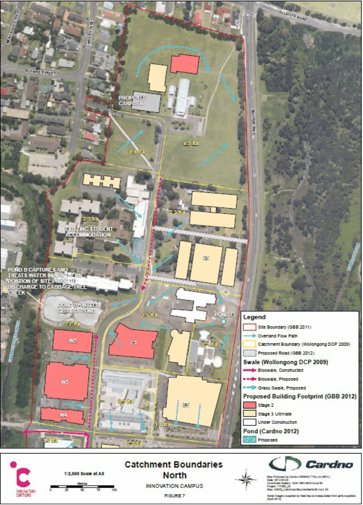
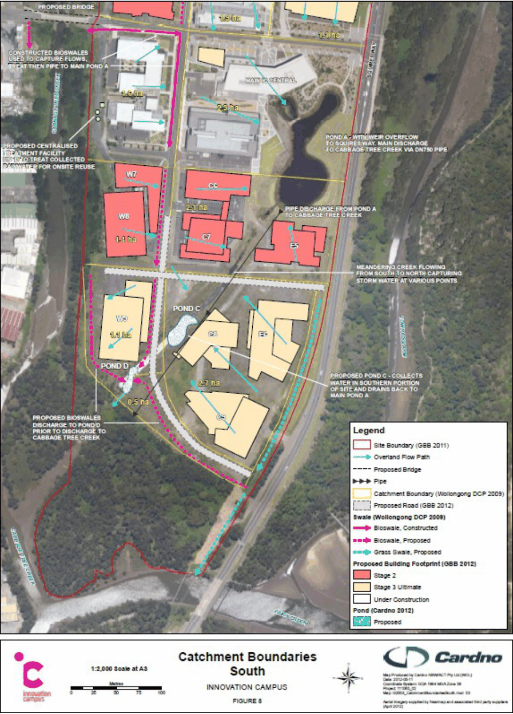

## 17 WATER SENSITIVE DESIGN

#### Background

1\. The development of Water Sensitive Urban Design (WSUD) on the Innovation Campus is a key objective. At the time of the initial Master Plan (2002) a Water Sensitive Design Aspects Report was prepared by Forbes Rigby (now Cardno). This Report set out the initial goals and objectives for the development of water sensitive design solutions on the iC.

2\. As part of the 2011 – 2012 Precinct Plan review the University commissioned Cardno to review the Water Sensitive Urban Design principles established in 2002 and the various elements of the design implemented on site during Stage 1 development. Their report “Innovation Campus – Precinct Plan Review – 2012 – WSUD” sets out the findings and confirms the WSUD objectives for further iC Development.

3\. A précis of the updated objectives and performance guidelines is presented below.

#### Objectives

1\. The following objectives recognise the environmentally sensitive nature of the estuarine reaches of Fairy and Cabbage Tree Creeks and the need to prevent water quality degradation.

2\. The Wollongong Innovation Campus should:

a) Encourage a flexible strategy for water re-use in order to reduce demands on potable ‘town water’ supply and encourage self-sufficiency with respect to high demand water use components such as garden watering and toilet flushing.

b) Provide at source treatment solutions which target pollutants at an early stage within the urban water cycle.

c) Provide effective control of a range of diffuse urban pollutants including suspended solids, nutrients, heavy metals and oil and grease. There should be no net increase in pollutant loads resulting from the development.

d) Limit the transport of coarse debris and litter into waterways to reduce pollution and enhance, visual amenity.

e) Encourage development of healthy natural aquatic systems through appropriate design of stormwater treatment wetlands.

f) Integrate water quality controls into the built form to meet architectural and landscape objectives.

g) Minimise long term maintenance requirements for the University of Wollongong, Wollongong City Council and the community.

h) Balance capital costs against environmental benefits and ensure good environmental ‘value for money’ is achieved.

#### Performance Guidelines Clean water

1\. The cleanwater component of the water cycle includes potable water from the reticulated ‘town water’ supply system and run-off from ‘clean’ roof surfaces. These sources represent the cleanest water that is used or generated on site and is therefore, most suitable for re-use requiring only limited treatment.

a) Water efficient fittings to be installed in all new buildings.

b) New buildings to be dual plumbed to allow an alternative water source to be used for toilet flushing.

c) Treated (re-used) water plumbing to be extended in buildings to allow future connection to cooling towers.

d) Treated and untreated wastewater or recycled water mains be continued throughout the iC to allow future flexibility in alternative water source connections to each development.

e) Following Stage 1 development and moving into Stage 2 it is proposed to use the captured rainwater for recycled use within buildings. This will reduce potable water consumption and improve water quality during storm events.

#### Stormwater

1\. Stormwater is generated by surplus roofwater (not captured and retained by the clean water re-use system) and run-off from paved surfaces such as roadways, car parking and landscape areas. Roadways and carparks have the potential to contribute fine sediment and other pollutants such as heavy metals and trace hydrocarbons. Landscape areas also contribute fine sediments, Biological Oxygen Demand and excess nutrients.

As anticipated in the Stage 1 Master Plan the following stormwater infrastructure has been constructed;

i) Stormwater wetland / pond A – serving the middle portion of the site;

ii) Stormwater wetland / pond B – serving the northern portion of the site;

iii) Vegetated buffer strips and bio-retention swales located along the western side of Innovation Way;

iv) Gross pollutant traps;

v) Buffer strips along minor internal roads.

a) The storm water treatment elements already constructed on site are to be expanded and / or enhanced to include the following (refer to Fig. 29 and 30);

i) Weir overflow to Squires Way from Pond A;

ii) Pond C and channel link to Main pond A;

iii) Pond D and discharge to Cabbage Tree Creek;

iv) Vegetated buffer strips and bio-retention swales;

v) Gross pollutant traps;

vi) Buffer strips along minor internal roads.

#### Wastewater (Grey and Blackwater)

1\. The 2011 – 2012 review undertook a comprehensive analysis of grey and black water production. Grey water streams comprise wastewater generated from showers and hand basins and ‘black water’ from toilets and kitchen waste. Refer to the “iC Masterplan Review – 21012 – WSUB Rpt” for full details.

2\. There has been significant reductions in estimated grey and black water production for the fully developed Innovation Campus - based on the Stage 1 analysis. This can be attributed to the implementation of water saving initiatives within the building such as water efficient appliances. Predicted grey water volumes result in unfeasible collection, treatment and re-use of this waste stream. The practice of dual plumbing new developments to split grey water from black water will therefore not be adopted for future stages of development. Sydney Water have confirmed that their existing infrastructure can accommodate the updated predicted black water flows.

a) The wastewater performance guidelines for further development shall include;

i) Focus on re-use of rainwater for toilet flushing / cooling tower make up purposes rather than grey water reuse;

ii) Continue to monitor sewer flows at regular intervals to ensure actual waste water flows are consistent with revised predictions.

iii) Current NSW Legislation (Water Industry Competition Act) makes treatment of wastewater for the Innovation Campus not feasible. It is understood the Legislation will be undergoing review in the future. The University will update the analysis on sewer mining in the future to see the impact on the revised Legislation.

> [Picture on page 72: a picture, saved as a picture (images/chapter-d14-wollongong-innovation-campus-page-72-1.gif, 150 dpi).]

#### Figure 29: Water Sensitive Design North

> [Picture on page 73: a picture, saved as a picture (images/chapter-d14-wollongong-innovation-campus-page-73-1.gif, 150 dpi).]

#### Figure 30: Water Sensitive Design South
