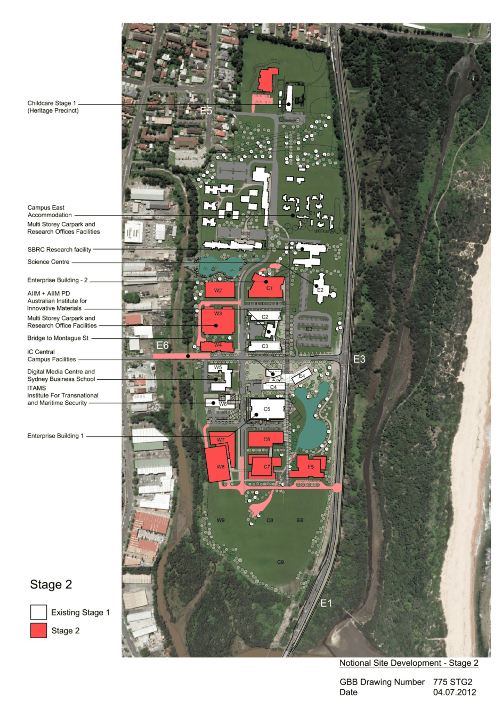
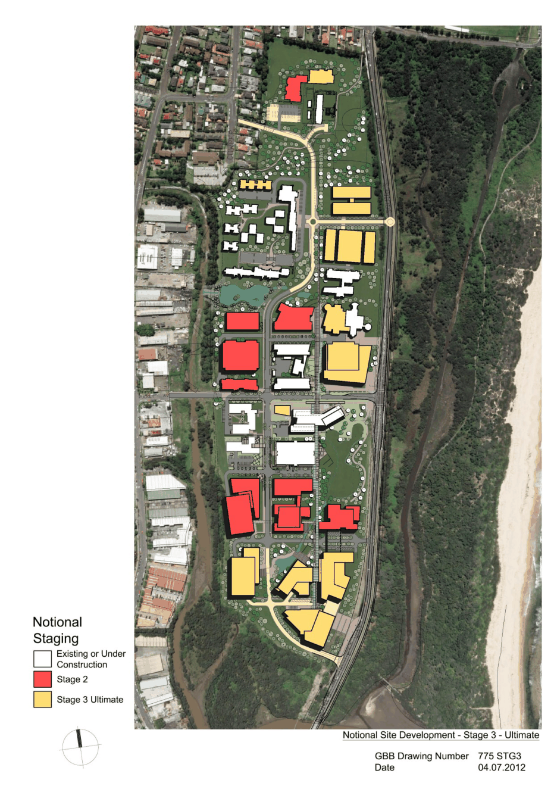

## 20 FORWARD PLANNING

### 20.1 Forward Planning Strategy

#### Background

1\. From the inception of the Innovation Campus Precinct Plan (in 2003) to 2012 significant infrastructure and development works have been completed.

2\. The following strategy identifies further infrastructure and development works to be planned and implemented concurrently with the remaining stages  of development of the Innovation Campus.

3\. A number of organisations and authorities including the University of Wollongong, Wollongong City Council and State Government Agencies are responsible for the implementation of the strategy and undertaking the works.

4\. The University of Wollongong will co-ordinate the planning and implementation of the works in accordance with the staging outlined in this section.

5\. The Forward Planning Strategy is linked to the following stages of development

#### Total Development (GFAm2)

55,000m2 Stage 1 Complete

95,000m2 Stage 2

135,000m2 Stage 3 (Ultimate)

Section 19.2 of this Precinct Plan identifies the general order of works as a notional staging strategy.

### 20.2 Notional Staging Strategy

#### Background

The staging and timing of the development of Innovation Campus will be determined primarily by tenant demand and University development.

#### Objectives

a) To facilitate the effective staged development of the site.

#### Performance Guidelines

a) The project should be developed from the centre outwards. Development should not occur randomly over the site.

b) Services and site infrastructure works should proceed to meet building requirements. It is not proposed to complete all roadworks or landscaping to the site in the early stages for example.

c) The Transport and Access Strategy must be reviewed and updated match the impacts of the development and Staging.

d) The Innovation Campus should generally be developed in accordance with the notional staging strategy indicated in the attached Figures.

> [Picture on page 77: a picture, saved as a picture (images/chapter-d14-wollongong-innovation-campus-page-77-1.gif, 150 dpi).]

#### Figure 31:  Notional Staging - Stage 2

> [Picture on page 78: a picture, saved as a picture (images/chapter-d14-wollongong-innovation-campus-page-78-1.gif, 150 dpi).]

Figure 32:  Notional Staging - Ultimate
