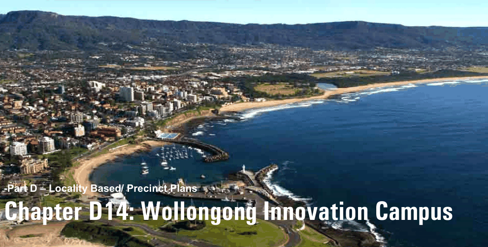
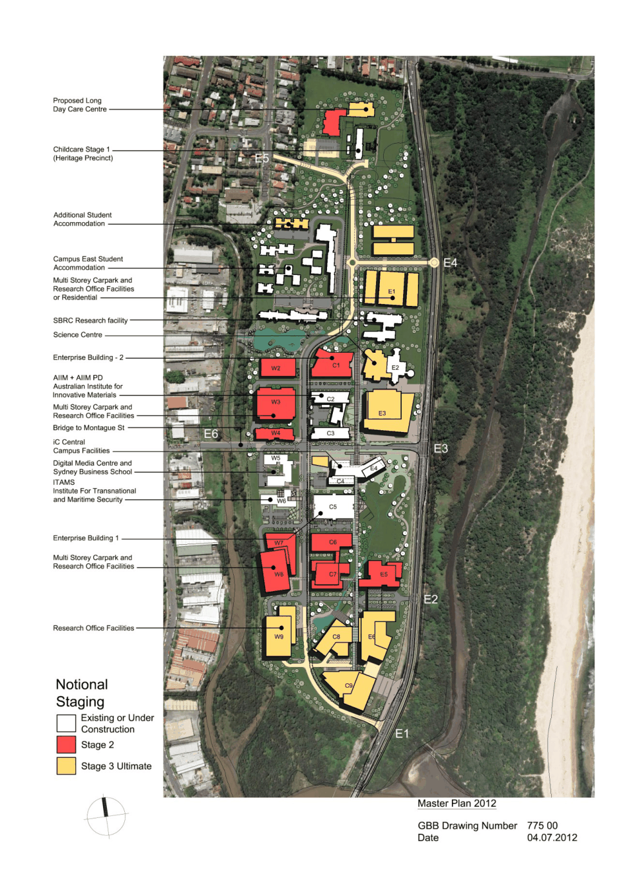

# Wollongong Development Control Plan 2009 - Chapter D14 Wollongong Innovation Campus

> This chapter is split into 21 section file(s), one per numbered heading, in the order they appear in the PDF.

Source PDF: [Wollongong-DCP-2009-Chapter-D14-Wollongong-Innovation-Campus.pdf](https://planfortomorrow.sharepoint.com/sites/Planfortomorrow/Shared%20Documents/00%20NSW-Planning-Resources/dcp/wollongong-development-control-plan-2009/chapter-d14-wollongong-innovation-campus/Wollongong-DCP-2009-Chapter-D14-Wollongong-Innovation-Campus.pdf)

> [Picture on page 1: a picture, saved as a picture (images/chapter-d14-wollongong-innovation-campus-page-1-1.gif, 150 dpi).]

#### -Part D – Locality Based/ Precinct Plans

### Chapter D14: Wollongong Innovation Campus

> The PDF's contents list (page numbers of the printed document) is not repeated here - see Sections below.

Wollongong Development Control Plan 2009 – in force as of 24 May 2017

i

| 8 SETBACKS | 24 |
|---|---|
| 9 BUILDING CHARACTER AND APPEARANCE | 28 |
| 10 LANDSCAPE | 34 |
| 10.1 Landscape Character | 34 |
| 10.2 Open Space | 34 |
| 10.3 Vegetation | 35 |
| 10.4 Safety and Security | 37 |
| 10.5 Furniture | 37 |
| 10.6 Lighting | 38 |
| 10.7 Public Art | 38 |
| 10.8 Signage | 39 |
| 10.9 Fencing | 39 |
| 10.10 Streets | 40 |
| 11 TRANSPORT AND ACCESS | 48 |
| 12 FLOODPLAIN MANAGEMENT | 55 |
| 12.1 Flooding | 55 |
| 12.2 Flood Access and Evacuation | 55 |
| 13 HERITAGE | 58 |
| 13.1 Objectives | 58 |
| 13.2 Aboriginal Archaeological Assessment | 58 |
| 13.3 European Heritage - Brandon Park | 58 |
| 13.4 European Heritage – Campus East | 58 |
| 14 ECOLOGICALLY SUSTAINABLE DEVELOPMENT | 60 |
| 14.1 General | 60 |
| 15 ENVIRONMENTAL DESIGN AND MANAGEMENT | 62 |
| 15.1 Acoustics | 62 |
| 16 SERVICES INFRASTRUCTURE | 63 |
| 17 WATER SENSITIVE DESIGN | 65 |
| 18 LIFESTYLE HEALTH | 70 |
| 19 DISABLED PERSONS REQUIREMENTS | 71 |
| 20 FORWARD PLANNING | 72 |
| 20.1 Forward Planning Strategy | 72 |
| 20.2 Notional Staging Strategy | 72 |

ii

### Figures

Figure 1: Land to which the Precinct Plan applies. ......................................................................................................... 6 Figure 2: Illawarra Regional Education and Research Corridor ......................................................................................... 11 Figure 3: Site Context ......................................................................................................................................... 12 Figure 4: Existing Development .............................................................................................................................. 13 Figure 5: Site Analysis ........................................................................................................................................ 14 Figure 6: Development Structure ............................................................................................................................ 17 Figure 7: Precinct Plan - Landscape Structure ............................................................................................................ 18 Figure 8: Precinct Plan - Pedestrian Network ............................................................................................................. 19 Figure 9: Precinct Plan - Precincts .......................................................................................................................... 20 Figure 10: Notional Development Sites ..................................................................................................................... 21 Figure 11: Site Setbacks ...................................................................................................................................... 26 Figure 12: Setbacks - Notional Leased Sites .............................................................................................................. 27 Figure 13: Building Image Office/ Research ................................................................................................................ 30 Figure 14: Building Image - Research ....................................................................................................................... 31 Figure 15: Examples - building character and appearance ............................................................................................... 32 Figure 16: Examples - building character and appearance ............................................................................................... 33 Figure 17: Landscape Precinct Plan ......................................................................................................................... 41 Figure 18: Street Reserve Innovation Way ................................................................................................................. 42 Figure 19: Street Reserve Puckey Avenue ................................................................................................................. 43 Figure 20: Street Reserve Service Access Links .......................................................................................................... 44 Figure 21: Street Reserve Residential ...................................................................................................................... 45 Figure 22: Squires Way ....................................................................................................................................... 46 Figure 23: Landscape themes ................................................................................................................................ 47 Figure 24: Proposed Rail Network & Ped - Sheds ........................................................................................................ 54

#### Document Control

|  |  | Document ID: Wollongong DCP 2009 – D14 Wollongong Innovation Campus |  |
|---|---|---|---|
| Rev No | Adoption Date 15/12/09 | In force date 3/3/10 | Revision Details Original DCP Chapter |
| 1 | 8 May 2017 | 24 May 2017 | Revised Masterplan incorporated and DCP chapter updated |

iii

> [Picture on page 5: a picture, saved as a picture (images/chapter-d14-wollongong-innovation-campus-page-5-1.gif, 150 dpi).]

### PART A

<!-- sections -->
## Sections

1. [1 INTRODUCTION](01-introduction.md)
2. [1 INTRODUCTION](02-1-introduction.md)
3. [2 PLANNING CONTEXT](03-2-planning-context.md)
4. [3 ENVIRONMENTAL PLANNING CONTEXT AND SITE ANALYSIS](04-3-environmental-planning-context-and-site.md)
5. [4 DEVELOPMENT CONCEPT](05-4-development-concept.md)
6. [5 SITE USES OBJECTIVES](06-5-site-uses-objectives.md)
7. [6 GROSS FLOOR AREA (GFA)](07-6-gross-floor-area-gfa.md)
8. [7 BUILDING HEIGHTS AND FLOOR LEVELS](08-7-building-heights-and-floor-levels.md)
9. [8 SETBACKS](09-8-setbacks.md)
10. [9 BUILDING CHARACTER AND APPEARANCE](10-9-building-character-and-appearance.md)
11. [10 LANDSCAPE](11-10-landscape.md)
12. [11 TRANSPORT AND ACCESS](12-11-transport-and-access.md)
13. [12 FLOODPLAIN MANAGEMENT](13-12-floodplain-management.md)
14. [13 HERITAGE](14-13-heritage.md)
15. [14 ECOLOGICALLY SUSTAINABLE DEVELOPMENT](15-14-ecologically-sustainable-development.md)
16. [15 ENVIRONMENTAL DESIGN AND MANAGEMENT](16-15-environmental-design-and-management.md)
17. [16 SERVICES INFRASTRUCTURE](17-16-services-infrastructure.md)
18. [17 WATER SENSITIVE DESIGN](18-17-water-sensitive-design.md)
19. [18 LIFESTYLE HEALTH](19-18-lifestyle-health.md)
20. [19 DISABLED PERSONS REQUIREMENTS](20-19-disabled-persons-requirements.md)
21. [20 FORWARD PLANNING](21-20-forward-planning.md)
