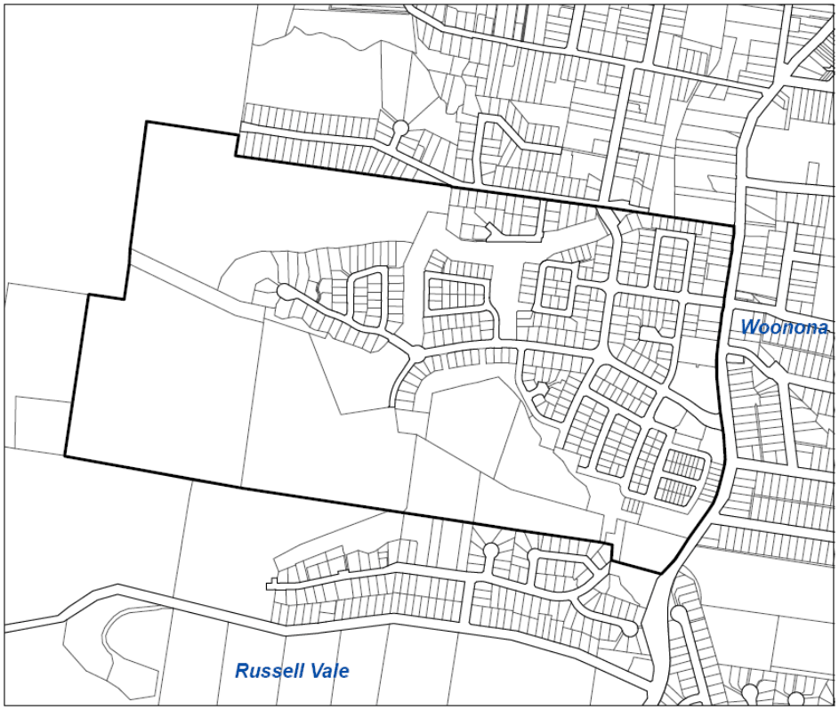

## 2 LAND TO WHICH THIS PLAN APPLIES

1\. This precinct plan applies to the Edgewood Estate (i.e. former “Boral Brickworks Site”), Princes Highway, Woonona.

> [Picture on page 3: a picture, saved as a picture (images/chapter-d15-woonona-edgewood-estate-page-3-14.gif, 150 dpi).]

#### Figure 1: Land to which this plan applies
