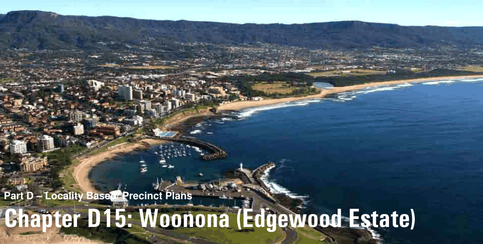

# Wollongong Development Control Plan 2009 - Chapter D15 Woonona (Edgewood Estate)

> This chapter is split into 15 section file(s), one per numbered heading, in the order they appear in the PDF.

Source PDF: [Wollongong-DCP-2009-Chapter-D15-Woonona-Edgewood-Estate.pdf](https://planfortomorrow.sharepoint.com/sites/Planfortomorrow/Shared%20Documents/00%20NSW-Planning-Resources/dcp/wollongong-development-control-plan-2009/chapter-d15-woonona-edgewood-estate/Wollongong-DCP-2009-Chapter-D15-Woonona-Edgewood-Estate.pdf)

> [Picture on page 1: a picture, saved as a picture (images/chapter-d15-woonona-edgewood-estate-page-1-1.gif, 150 dpi).]

#### Part D – Locality Based/ Precinct Plans

### Chapter D15: Woonona (Edgewood Estate)

### Contents

<!-- sections -->
## Sections

1. [2 LAND TO WHICH THIS PLAN APPLIES](01-2-land-to-which-this-plan-applies.md)
2. [4 DEVELOPMENT CONTROLS](02-4-development-controls.md)
3. [1 INTRODUCTION](03-1-introduction.md)
4. [2 LAND TO WHICH THIS PLAN APPLIES](04-2-land-to-which-this-plan-applies.md)
5. [3 AIMS AND OBJECTIVES](05-3-aims-and-objectives.md)
6. [4 DEVELOPMENT CONTROLS](06-4-development-controls.md)
7. [1 Building Controls for Residential Buildings](07-1-building-controls-for-residential.md)
8. [2 Vehicular Access and Car Parking](08-2-vehicular-access-and-car-parking.md)
9. [3 Boundary Setbacks](09-3-boundary-setbacks.md)
10. [4 Private Open Space Requirements](10-4-private-open-space-requirements.md)
11. [5 Boundary Fencing](11-5-boundary-fencing.md)
12. [6 Ancillary Structures](12-6-ancillary-structures.md)
13. [7 Architectural and Landscaping Design](13-7-architectural-and-landscaping-design.md)
14. [8 Multiple Dwellings](14-8-multiple-dwellings.md)
15. [5 Figures](15-5-figures.md)
