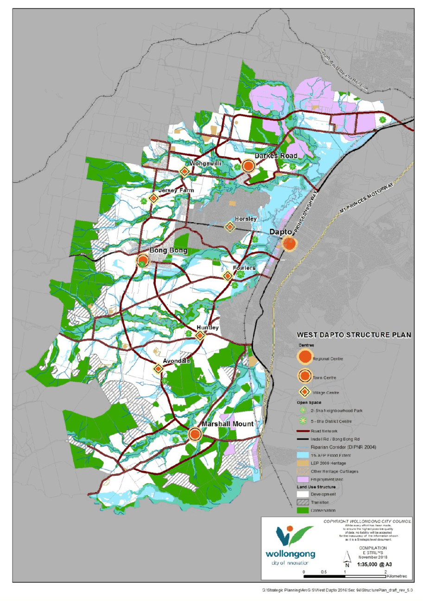
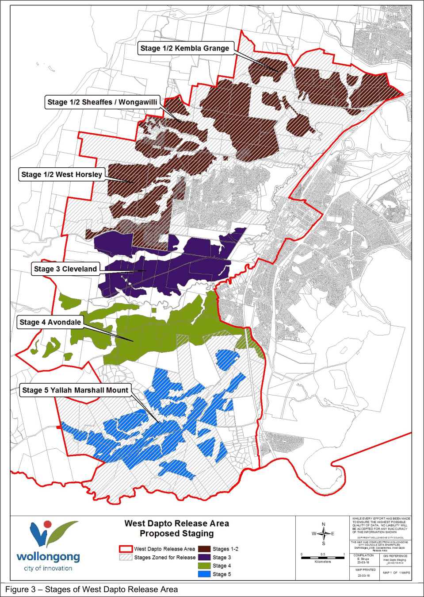

#### 4.3 Stages 3 and 4

Stages 3 and 4 are located in the existing rural suburbs of Cleveland and Avondale, in the middle of the release area south of Horsley. They are well connected to the Dapto Regional Centre to the east via Fowlers Road into Cleveland Road. Part of Stage 3, and a small part of Stage 4 have been rezoned. Stages 3 and 4 will ultimately include:

• Potential development of approximately 8,800 new dwellings.

• Community facilities including a district level recreational centre and youth services facility.

• Two primary schools to meet the educational needs of future residential families.

• Three well connected village centres (Fowlers, Huntley and Avondale) that will provide local convenience shops and urban focal points within the residential areas.

• Unique Mullet Creek Catchment environmental features providing the riparian corridor spur supporting and defining the surrounding urban form.

• Structural road network that will connect from the southern extent of Stage 2 at Bong Bong Town Centre down to the southern extent of Stage 4 and into Stage 5 of the release area. There will also be road connections spanning from Dapto Regional Centre into the release area along the east, branching into the village centres supporting surrounding residential development.

• Active transport facilities (cycleways and shared paths) connecting residential areas with open space provisions via riparian corridors and along the structural road network.

• School facilities for the future population of the stages. Ideally the school will be located near the Bong Bong Town Centre (in Stage 2 or 3) to create a relationship with the town centre and provide education services for the future children and youth population residing between Stages 1, 2 and 3 of the release area.

> [Picture on page 11: a picture, saved as a picture (images/chapter-d16-west-dapto-release-area-page-11-1.gif, 150 dpi).]

Figure 2 – West Dapto Structure Plan 2018

> [Picture on page 12: a picture, saved as a picture (images/chapter-d16-west-dapto-release-area-page-12-1.gif, 150 dpi).]

Figure 3 – Stages of West Dapto Release Area
