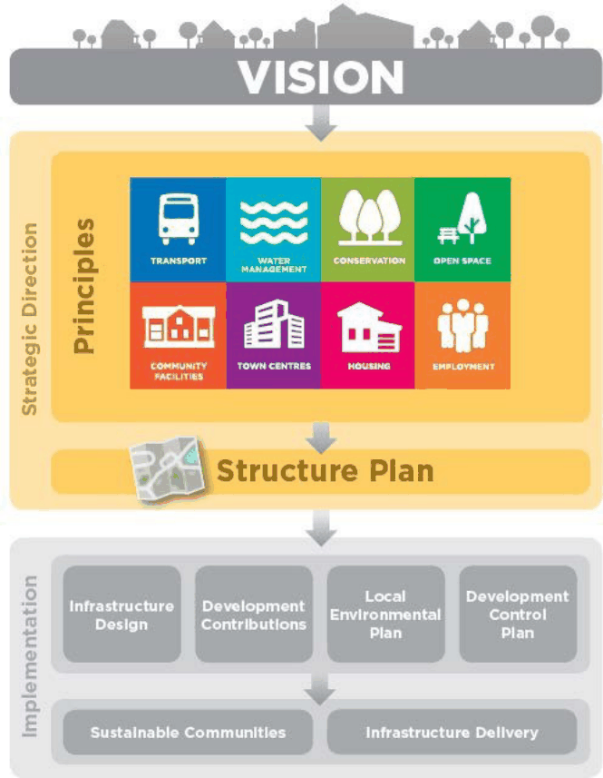

## 5. PLANNING PRINCIPLES

The West Dapto Planning Principles are intended to guide land use planning decision associated with the release area. They provide a statement of a desirable outcome for the development of the release areas and provide a basis of reasoning to support making planning decisions. Principles are important considerations when there may be more than one interpretation or contradictions between any qualitative requirements or development controls defined in other chapters of the DCP.

There are eight groups of principles originally outlined in the West Dapto Vision 2018. This chapter is structured in a similar way, building on principles with additional details. Figure 4 outlines the key components and how they relate to Council’s planning policies.

The groups of principles include:

• Transport

• Community facilities (and Education)

• Water management

• Town centres

• Conservation

• Employment

• Open space

• Housing

> [Picture on page 13: a picture, saved as a picture (images/chapter-d16-west-dapto-release-area-page-13-20.gif, 150 dpi).]

Figure 4 – Principles and planning tools relationship
