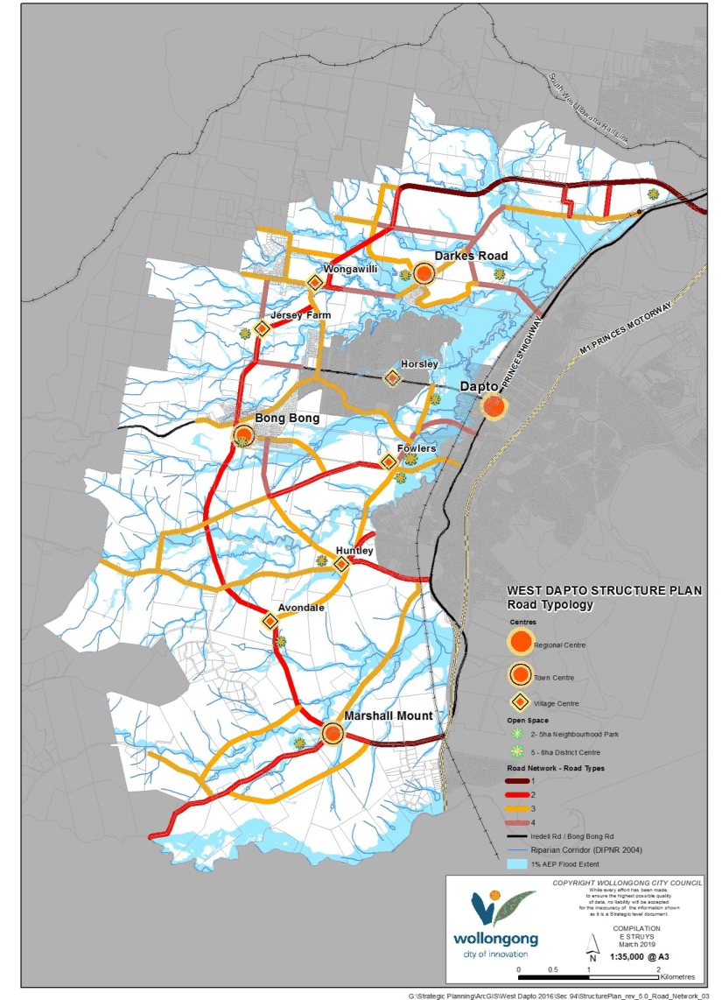
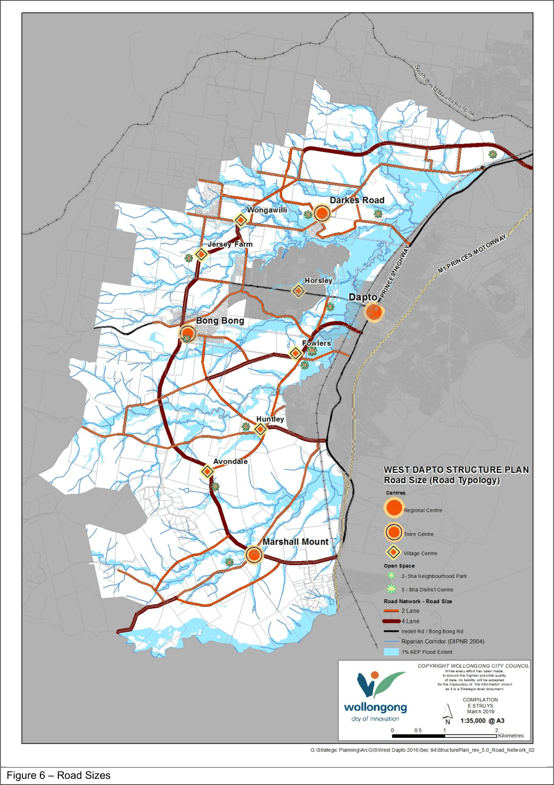
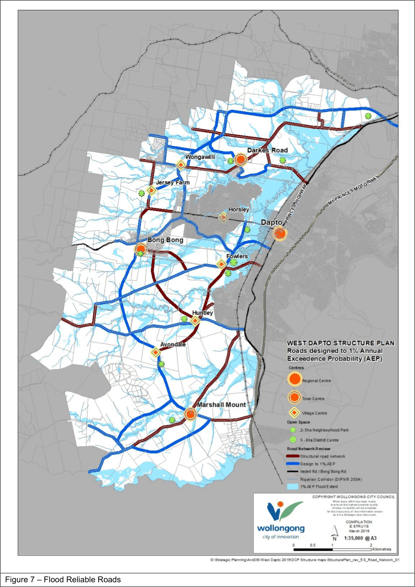
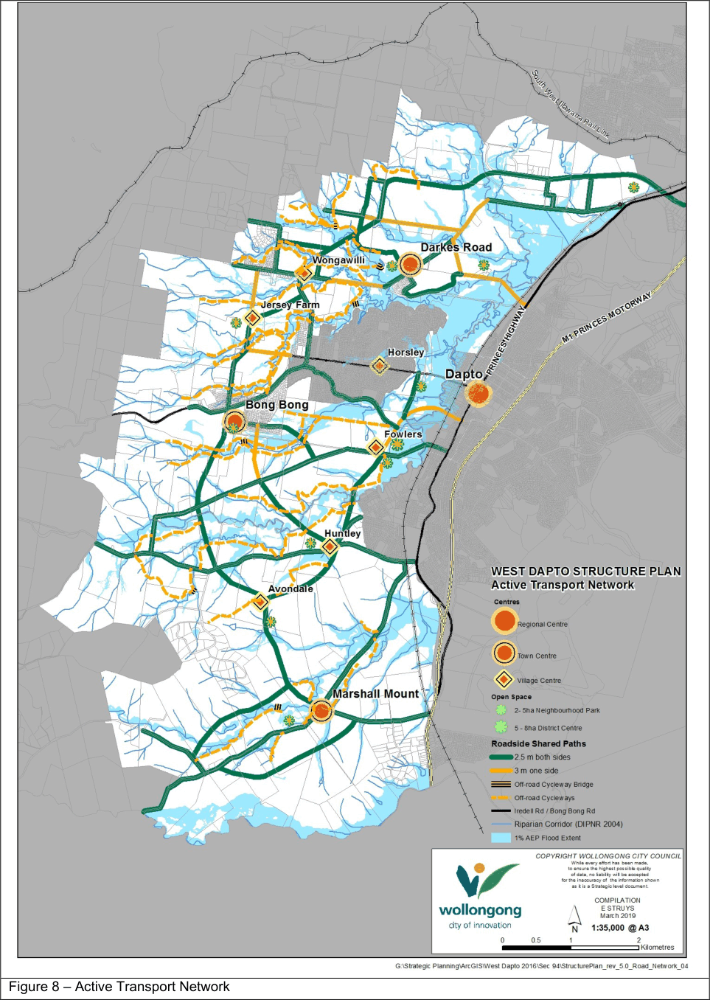

### 6.2 Bridge and Culvert Design

Bridges and culverts form important structural components supporting the road network as it traverses the flood plain landscape. While there are design limits and prefabrication conditions the infrastructure are built to, it is also important that design decisions on materials, placements, modification to standards and any other specifics take into account desired outcomes for the areas they are in and who they will cater to.

#### 6.2.1 Principle 1 – Good Design is Context Sensitive Design

Design that is sensitive to context is valued by communities. Bridges and culverts that are functional and fit the landscape are good for community pride and local identity.

a) Consider the influence of locational context and functional requirements in the design process. For example, if the crossing is traversing land that is zoned C2 or C3 and there are known ecological communities or fauna groups recorded there, fauna crossings should be a design component and construction must be sensitive to these outcomes.

b) Bridge and culvert alignment should integrate with environmental features.

c) Construction over or within waterways should have regard to the Fish Passage Guidelines developed by NSW Fisheries.

d) Ensure storm immunity standards are met, and design and construction provides longevity and minimises maintenance requirements.

e) Design finishes and overall appearance should respond to and incorporate character of the area.

> [Picture on page 16: a picture, saved as a picture (images/chapter-d16-west-dapto-release-area-page-16-7.gif, 150 dpi).]

Figure 5 – Road Typology

> [Picture on page 17: a picture, saved as a picture (images/chapter-d16-west-dapto-release-area-page-17-1.gif, 150 dpi).]

Figure 6 – Road Sizes

> [Picture on page 18: a picture, saved as a picture (images/chapter-d16-west-dapto-release-area-page-18-1.gif, 150 dpi).]

Figure 7 – Flood Reliable Roads

> [Picture on page 19: a picture, saved as a picture (images/chapter-d16-west-dapto-release-area-page-19-1.gif, 150 dpi).]

Figure 8 – Active Transport Network
