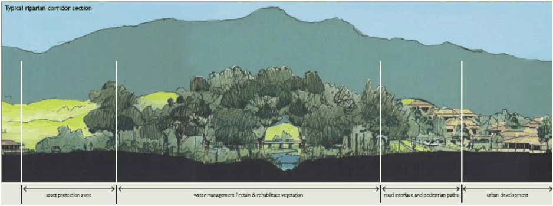

### 8.3 Riparian Corridors

> [Picture on page 34: a picture, saved as a picture (images/chapter-d16-west-dapto-release-area-page-34-2.gif, 150 dpi).]

Figure 9 – Typical Riparian Corridor Cross Section

West Dapto is dissected by fast flowing creeks and extensive areas of flood prone land, and riparian corridors. These areas offer an opportunity for recreation, visual separation and conservation. The corridors will result in significant amounts of open space creating wider landscapes within easy reach of all parts of the new development areas, meaning walking, cycling, recreation and nature will form a part of daily life. These riparian corridors have been, or will be, zoned for environmental protection. Limited development is allowed in these areas.

The riparian corridors will link the escarpment to Lake Illawarra through the release area. They will be vegetated with avenues of intensive planting and water management running through the urban street pattern to create a connected web of open space. This will encourage walking and create a sense of nature interacting with urbanity (see cross section in Figure 9).

Land between the watercourse and the 1% Annual Exceedance Probability flood extent can either be:

• retained in private ownership and used for grazing, recreational activities or other permissible uses, or

• dedicated at no cost to Council, for use as bushland, agricultural or recreational purposes. There are no development contributions off-set for the dedication or transfer of this land.

#### 8.3.1 Controls

1\) Neighbourhood Plans will identify proposed land uses and ownership of the riparian land.

2\) Riparian corridors are to be revegetated to instate a healthy ecological structure and function and to enhance resilience to flooding and improving water quality.

3\) Refer to DCP Chapter E23: Riparian Land Management for controls relating to riparian lands.
